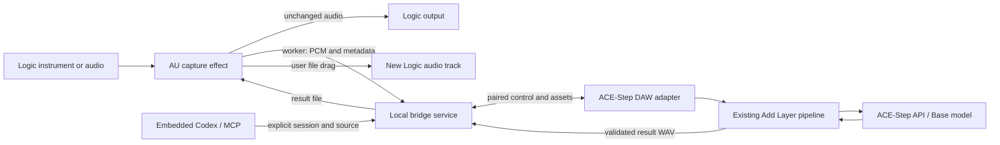

# Logic Pro AU Bridge Design

Status: Proposed architecture, ready for implementation review.
Date: 2026-11-07.
Implementation status: No AU binary or bridge service has been implemented. Base-model Lego generation on the target Mac remains a feasibility gate.

## 1. Problem and outcome

As a Logic Pro user, I want to send the sound of an existing MIDI instrument or audio track to ACE-Step DAW and ask its embedded Codex assistant to add an instrument layer, so that I can keep arranging in Logic with my existing sounds.

Today, audio import, Add Layer and embedded Codex exist separately. There is no Logic-facing AU, durable cross-application session, explicit context-generation MCP contract, or return-asset workflow. The existing VST3 host loads plugins into this DAW; it does not expose this DAW to Logic.

The proposed workflow is:

1. Open ACE-Step DAW and the local bridge service.
2. Insert ACE-Step Bridge after a Logic instrument, on an audio track, or on a bus.
3. Pair the instance with an explicit DAW bridge session.
4. Arm a fixed-length capture and play the passage once, or import an existing audio file.
5. Select the capture in ACE-Step DAW and ask Codex or Add Layer for a named instrument and range.
6. Audition the generated layer against the captured reference in ACE-Step DAW.
7. Drag the exported WAV into a new Logic audio track at the displayed source position; copy it into the Logic project.

The design does not require replacing the original Logic instrument or running the model inside Logic.

## 2. Initial scope and alternatives

| Decision | Selected design | Reason and boundary |
| --- | --- | --- |
| Plugin format | Native Apple Silicon AUv2 audio effect; JUCE/C++ proposed | Small capture/UI surface; Logic supports AU. Framework version and licensing must be checked before dependency adoption. |
| MIDI instrument context | Capture audio after the existing instrument | Preserves Logic's instrument, preset and upstream insert processing. The Audio FX plugin does not claim access to MIDI regions. |
| Audio context | Capture the audio arriving at the insert, or explicitly import a file | No project-file scraping or undocumented Logic API. |
| Multiple tracks | Capture a deliberately routed Logic bus | One reference mix per generation; no automatic discovery of other tracks. |
| Generation | Existing Add Layer and compatible Base Lego | Reuses context conditioning, variations and project clips. No silent fallback to Turbo Cover/Repaint. |
| Result return | Native file drag plus Reveal in Finder | Independent of unsupported Logic track/region creation APIs. Manual placement is explicit. |
| Runtime | Independent local service, separate DAW and API processes | AU capture/control never depends on inference finishing. |
| Control | DAW UI, store actions and MCP call the same adapter | Codex does not need to click forms or infer the selected track. |

Direct MIDI capture through a MIDI FX AU, host-synchronized generated playback, ARA random access, automatic Logic track creation, tempo-map generation and cross-machine networking are later extensions. They are not prerequisites for the audio workflow. The first integration target is the existing Vite-served DAW with embedded Codex; packaged Tauri distribution needs a separately verified assistant/runtime lifecycle.

An API-only client can share capture and result contracts later. The initial implementation MUST use the DAW generation executor; it MUST NOT introduce a second hidden inference pipeline.

## 3. Process boundaries and ownership

| Component | Owns | Must not own |
| --- | --- | --- |
| AU processor | Pass-through, bounded sample capture, host position snapshot | Inference, synchronous networking or filesystem I/O on render thread |
| AU worker/UI | Encoding/upload, pairing, capture status, local result cache, native file drag | Logic project edits or implicit transport start |
| Bridge service | Sessions, capabilities, immutable assets, persistent jobs, event replay, pairing and quotas | Audio rendering or browser store mutation without a paired executor |
| DAW adapter | Project binding, context preview/import, generation lock integration, status and result publication | Guessing a target tab/project or mixing unrelated tracks |
| Generation pipeline | Backend request, task tracking, audio decoding, clip/result derivation | Logic host routing |
| MCP server | Typed discovery and commands into the same service/adapter | Inferring completion from task submission |

The service is a standalone Node process launched by a proposed `npm run bridge` command. Default listener: `127.0.0.1:5176`, configurable at launch; a collision fails visibly instead of attaching to an unknown service. No automatic model download, model switching or cloud submission occurs on startup.

The service runs independently of Vite. Existing terminal WebSockets remain available in Vite; new Logic tools connect directly to the service with a session-scoped capability. Existing unrelated DAW MCP tools retain their behavior.

## 4. User interaction

### Logic plugin

Keep the plugin small: connection/session header, source label, capture length, Capture/Cancel controls, recorded duration and result list. Use text plus icons for every status. The initial window target is 440 by 360 logical pixels; layout must resize and remain keyboard accessible. These are proposed dimensions, not a rendered design.

State labels: `Disconnected`, `Ready`, `Armed`, `Capturing`, `Uploading`, `Captured`, `Generating`, `Result ready`, `Failed`. Distinguish capture errors from generation errors; original audio continues in either case.

- Capture is armed while transport is stopped and starts at the next playback callback.
- Default length is 8 bars when tempo and meter are available; otherwise offer seconds. Duration is resolved and displayed before arming.
- Changing length, format or pairing while capturing is disabled. Cancel stops capture without muting audio.
- At the requested frame count, capture ends even if Logic continues playing.
- A premature transport stop fails the take with `CAPTURE_INCOMPLETE`; retain partial data only for diagnostics, never submit it as a complete reference.
- A host seek, loop wrap, sample-rate change or observed tempo/meter change invalidates the take. A continuous pass ending exactly at a cycle boundary is accepted before evaluating the next wrapped block.
- If the host suspends processing before a stop callback, a 2-second worker inactivity watchdog fails the capture; it must not wait indefinitely for another audio callback.
- Results show instrument, duration, source position and format. `Drag WAV` requires an already downloaded, verified local file. `Reveal in Finder` is the fallback when native drag is unavailable.

### ACE-Step DAW

Add a Logic Bridge source panel using existing theme variables and component density. Its source cards show instance label, source position, tempo/meter, captured duration, readiness and pairing. UI selection MUST carry concrete IDs into the store action; it is not an implicit global generation source.

`Use as context` creates or reuses an immutable reference clip, selects it in the source panel and opens Add Layer with an explicit source. The source panel can be hidden without losing state. Preview uses the stored canonical reference, not a new live capture.

The Add Layer form shows reference, output instrument, local start/end, prompt and backend capability. Keyboard, GUI and MCP use the same action. Additions/removals participate in project undo; undo does not delete immutable files or erase completed job history. A canceled or undone job cannot recreate its removed clip when a late backend result arrives.

Follow `.claude/references/interaction-design.md` and `design-patterns.md`: existing tokens, no color-only status, visible focus, actionable errors and immediate pending feedback. Progress over 500 ms is visible; generation percentage is shown only when the backend supplies meaningful progress.

## 5. Time and audio contract

### Capture and canonical assets

- Initial capture: mono or stereo, 44.1/48/88.2/96 kHz, float32 PCM, 1 to 120 seconds. Other layouts/rates require explicit file conversion; reject rather than changing Logic's host settings.
- Preserve the incoming signal amplitude and silence. Do not normalize, trim silence, stretch, add fades or compensate reported upstream latency by guessing.
- Source capture is the audio observed at the insert. It includes upstream instrument/effects and excludes downstream inserts and fader processing after that point. Use a bus when the desired context differs.
- Store original PCM as a WAV plus immutable metadata. Derive canonical 48 kHz stereo float32 WAV with a single deterministic offline resample; duplicate mono to both channels. Preserve duration by deriving canonical frame count from original frame count and rate.
- Limit original payload to 96 MiB and canonical payload to 64 MiB. At 120 seconds, 96 kHz stereo float32 is 92,160,000 bytes before the WAV header; 48 kHz canonical audio is 46,080,000 bytes. Validate both duration and bytes independently.
- Validate decodability, finite samples, nonzero frame count and non-silent content before generation. Reject NaN/Inf and entirely silent references; warn about clipping without silently changing gain. Content hashes verify upload and export bytes.

### Timeline coordinates

Each capture is its own context origin. Source frame zero maps to DAW reference time zero; the bridge imports into a dedicated bridge project or an explicitly selected empty bridge workspace. A nonempty ordinary project is not silently retimed. Initial project duration must fit the entire capture before calling the importer, which currently trims to project duration.

Metadata records signed `hostStartSample`, `hostSampleRate`, optional `hostStartPpq`, observed tempo/meter and an optional user label. Host sample position is authoritative for the captured stream, not proof that the plugin can identify a Logic project or region. The user pairs a named session; the plugin cannot discover a trustworthy Logic project path.

For local generation range `[a,b)` within canonical audio:

- `0 <= a < b <= canonicalFrameCount`.
- `audio_duration = canonicalFrameCount / 48000`.
- `repainting_start = a / 48000`; `repainting_end = b / 48000`.
- Export only the generated range as a WAV, with placement metadata `hostStartSample / hostSampleRate + a / 48000`.
- Show original position and PPQ/bar information when the host supplied enough information. Do not invent a bar number from a single tempo value or assume the first bar starts at time zero.

The exported WAV does not automatically place itself in Logic. Show the placement position and include it in a JSON sidecar. The user places it explicitly. No automatic time-stretch is applied on import/return. Variable-tempo passages are unsupported for the initial generation contract; detected changes fail capture, and undetectable host metadata is clearly labeled. File import requires user-supplied tempo/meter/position when unavailable.

Container alignment is testable to one output frame with deterministic fixtures. Model note onset, groove and harmonic adherence require listening and are not guaranteed by the metadata contract.

## 6. Capture transport and real-time behavior

Allocate a stereo-capable ring of 262,144 float32 frames before rendering starts (2 MiB for stereo). A capture block contains its frame sequence and host position metadata. The render callback only passes audio through, reads an atomic command snapshot and copies samples into this preallocated single-producer/single-consumer queue. No locks, allocation, logging, encoding, filesystem or socket operations occur there.

A worker drains the ring, creates sequential chunks up to 1 MiB and uploads them. Overflow marks capture failed and stops sample collection; it never blocks Logic or overwrites older frames to produce a corrupted take. Disconnect stops capture; the current partial take is not resumable after plugin/service restart. Completed assets remain available.

Each chunk includes capture ID, zero-based sequence, start frame, frame count and SHA-256. Identical retries are acknowledged; a reused sequence with different content is rejected. Gaps/out-of-order appends fail without making an asset ready. A finalize request checks the expected total frames/hash and atomically promotes the original asset; canonical conversion then runs outside the render thread. `Captured` means canonical conversion and validation completed, not merely upload receipt.

## 7. Session and asset records

Versioned records are proposed contracts, not existing APIs.

| Record | Required fields and invariants |
| --- | --- |
| BridgeSession | `sessionId`, display name, `protocolVersion`, executor ID, bound DAW project ID, connection status. Exactly one active executor per session. |
| PluginInstance | Persistent plugin state ID, fresh runtime connection ID, label, paired session. Host-duplicated instances receive independent runtime IDs; do not trust a cloned state UUID as a unique live identity. |
| Capture | `captureId`, session/instance IDs, format, expected/received frames, state, host timing, original asset ID, canonical asset ID. Ready assets are immutable. |
| ContextBinding | Session/project/capture/clip IDs, canonical asset hash, fixed origin and imported duration. Reject stale or deleted bindings. |
| GenerationJob | `jobId`, client request ID, session/project IDs, immutable capture hash, frame range, instrument, prompt, actual model ID, seed, state, backend task ID if known, result IDs, timestamps and structured error. |
| Result | `resultId`, job ID, audio asset ID/hash, canonical range, suggested Logic placement, format, validation and file availability. |

Use UUIDs for externally visible identities and content hashes for asset integrity. Persist JSON records by temporary-file write and atomic rename in a service-owned data directory, with one writer per job and an append-only transition journal. This avoids adding a database dependency for the initial local workflow. The daemon enforces a single-writer process lock.

Default root: `~/Library/Application Support/ACE-Step Bridge/`, containing `sessions/`, `captures/`, `jobs/`, `results/` and `staging/`. Do not infer a Logic project path. A proposed initial 10 GiB quota blocks new ingest before exhaustion; completed user assets are never silently evicted. Staging files abandoned for 24 hours may be cleaned on startup. Asset removal is explicit and rejects files referenced by active jobs.

## 8. Service and MCP contracts

All endpoints are under `/v1`; binary bodies are transported outside JSON. Errors contain a stable code, human-readable message, retryability and request ID. The protocol version is negotiated before accepting writes.

| Method and route | Contract |
| --- | --- |
| `GET /health` | Version and readiness only; no session names, paths or credentials. |
| `POST /sessions` | Create a named session; does not attach an arbitrary DAW project. |
| `POST /pairings` | Create a short-lived one-use pairing challenge through the local service control interface. |
| `POST /pairings/claim` | Exchange a challenge for a role-scoped session credential. |
| `POST /captures` | Validate session, format, requested frame count and reserved quota; create upload. |
| `PUT /captures/{id}/chunks/{sequence}` | Append/retry a validated binary PCM chunk. |
| `POST /captures/{id}/finalize` | Validate complete stream, convert and return a pending/ready asset record. |
| `POST /captures/{id}/cancel` | Stop ingest and invalidate partial data. |
| `GET /captures?sessionId=...` | List only captures visible to the authenticated session. |
| `GET /assets/{id}` | Authenticated binary transfer; IDs map to owned files, never caller paths. |
| `POST /jobs` | Validate immutable context/range/capability, persist queued job and return `202` plus job ID. |
| `GET /jobs/{id}` | Authoritative persisted state, including errors and result readiness. |
| `POST /jobs/{id}/cancel` | Idempotent cancel request with terminal-state protection. |
| `GET /results/{id}` | Result metadata; audio is fetched through the asset endpoint. |
| `WS /events` | Authenticated ordered session events with cursor; expired cursor requires a full snapshot refresh. |

The event channel also carries executor registration and job command/ack frames. Every command names request/session/project/job IDs. The DAW returns acceptance only after validating the binding and persisting its dispatch receipt. The service does not interpret an open socket as successful project mutation.

Proposed MCP tools, exposed through the existing MCP process and authenticated service client:

| Tool | Required input | Completion meaning |
| --- | --- | --- |
| `logic_list_captures` | `sessionId` | Snapshot of visible capture metadata. |
| `daw_attach_logic_capture` | `sessionId`, `projectId`, `captureId`, `clientRequestId` | Complete reference clip and binding IDs, after project/asset validation. |
| `daw_add_layer_from_context` | `sessionId`, `projectId`, `captureId`, `bindingId`, `instrument`, `startFrame`, `endFrame`, `prompt`, `clientRequestId` | Job accepted, not audio ready. |
| `logic_get_job` | `sessionId`, `jobId` | Current state and validated result when ready. |
| `logic_cancel_job` | `sessionId`, `jobId` | Cancellation acknowledgment; state reports whether backend stopped. |
| `logic_export_result` | `sessionId`, `resultId` | Verified export metadata and owned asset availability; no Logic placement claim. |

All frame counts are safe JSON integers. Instrument values come from the backend's supported Lego vocabulary. Prompts and filenames are data, never shell input. Credentials are injected session-locally, following the existing Codex MCP configuration pattern; do not rewrite global Codex settings.

## 9. Generation adapter and state transitions

Capture state: `created -> receiving -> converting -> ready`, with `failed` or `canceled` terminal exits.

Job state: `queued -> dispatched -> running -> exporting -> ready`, with `failed`, `interrupted`, `cancel_requested` and `canceled` branches. Only `ready` guarantees a valid result file. Capture and job state are separate: one capture may produce several independently identified layers or variations.

1. Preflight checks the compatible Base Lego capability, capture readiness, project binding, bounds, quotas and generation lock. A busy project returns `PROJECT_BUSY`; do not create an empty pending clip.
2. Resolve the exact canonical source bytes by asset ID/hash. Introduce a shared explicit-context generation entry point taking that blob and range. Reuse the existing Lego submission, polling, decoding and clip/history logic beneath it.
3. Do not send a session-local source file path directly to a possibly remote ACE-Step server. Upload the canonical WAV through the existing API client unless server-local ownership was explicitly established.
4. Build the Lego instrument instruction and use the actual compatible model, not merely the last selected Turbo model. Persist the resolved parameters and backend task ID. Model availability is required before submission; switching/loading is a visible user action.
5. Validate output semantics: the current pipeline assumes the generation range contains the isolated part. Establish this through the Base-model feasibility trial; do not export a duplicated backing mix as an isolated layer. If output semantics differ, fail with `UNSUPPORTED_OUTPUT_SEMANTICS` until an explicit extraction adapter exists.
6. Trim the canonical generated region using one frame-coordinate contract and save the result in DAW storage and service-owned export storage. Both writes and clip readiness must succeed before publishing `ready`.
7. On project switch, disconnect or deleted target, never mutate the new project. Preserve a completed service artifact as an unattached result when possible. A retry/reattach is explicit.

Important existing-code constraint: `extractContextAudio` currently mixes all audible overlapping tracks and its `ContextWindow` has no track-ID filter. Merely placing a capture in the timeline would allow unrelated/generated audio into later contexts. The bridge entry point MUST bypass that mixed extraction with an explicit canonical source blob; it MUST NOT change mute/solo settings to select a reference. Existing ordinary Add Layer behavior remains available.

### Retries, cancellation and uncertain outcomes

Deduplicate commands by `(sessionId, clientRequestId)` and canonical parameter hash. Same ID/same payload returns the existing binding/job; same ID/different payload returns conflict. Persist the ID before dispatch.

Generation runs are serialized through the existing project generation lock, with one active inference job per configured backend in the initial service. No parallel hidden GPU jobs. Queueing records does not bypass the executor's own lock.

No exactly-once claim is made across a crash during backend submission. If submission may have happened but the task ID was not durably recorded, mark `interrupted` with `SUBMISSION_OUTCOME_UNKNOWN`; never automatically resubmit. Known task IDs can be reconciled after reconnect. Service restart revalidates output files before restoring `ready`.

Cancellation prevents result publication and new clip mutation immediately, then attempts backend cancellation where supported. If the backend cannot stop the computation, state shows that fact; its eventual output is not promoted into the canceled job. A late ready/cancel race is resolved by the persisted terminal transition: an already ready result remains ready and a canceled job cannot become ready.

## 10. Pairing and local trust

Listen on loopback only. Use a randomly generated installation control secret stored with owner-only permissions, role/session-scoped runtime credentials and one-use pairing codes expiring after 120 seconds. Rate-limit failed claims. The AU displays/enters a pairing code explicitly; it does not enumerate private projects without pairing.

Browser pairing requires an allowlisted exact Origin, with the default development origin `http://127.0.0.1:5174`. Other ports/origins and packaged app origins are configured explicitly. Validate Host as well to resist DNS rebinding. Do not use wildcard CORS. Check Origin and credentials during WebSocket upgrade. Browser clients use a first-message credential handshake with a short unauthenticated timeout; never put bearer credentials in URL query strings.

Bind executor credentials to session ID and project ID; reject a second live executor. Distinguish native AU, DAW executor and MCP roles. Code/prompt content cannot grant broader authority. Asset APIs accept IDs, not arbitrary filesystem paths or URLs. Logs redact credentials. No telemetry or external file upload is introduced by this bridge.

## 11. Saved projects and distribution

AU state saves session display information, stable state ID, capture settings and result references. Secret credentials are not embedded in Logic presets/project files; use Keychain or a private local credential store with explicit re-pairing on another machine.

Downloaded drag files live in a stable AU-owned cache, separate from temporary HTTP downloads. Keep them while referenced by plugin state; never delete them immediately on drag completion. Logic receives an ordinary WAV; the user must copy/import it into the Logic project assets before relying on portability. Saving only the plugin state does not embed the generated audio.

Reopening a Logic project without the DAW/API/service must preserve original playback and access to cached results. A missing result shows a recover/re-pair action, not silence substituted for the original signal. File drag is the initial return path, so no generated-audio playback is required inside the AU.

Distribution requires Apple Silicon build validation, AU validation, Logic rescanning/loading, signing/notarization and a documented service installation/startup path. Confirm JUCE licensing compatibility and the repository's AGPL distribution requirements before publishing binaries. A successful development build does not establish these release properties.

## 12. Verification and feasibility gates

These are acceptance requirements for subsequent implementation, not tests performed by this design task.

| Scenario | Observable pass condition |
| --- | --- |
| Base Lego feasibility | A Logic-exported 8-bar piano reference produces a usable bass layer; original reference remains intact; listened-to accompaniment, isolation and placement are recorded separately from file validation. Record model/backend, runtime and memory. Failure blocks a generation-ready release. |
| AU pass-through | Deterministic host fixture demonstrates unchanged samples while idle, capturing, overflowing and disconnected; no render-thread allocation/network/file operations under instrumentation. |
| Capture alignment | Impulse fixture at known host positions survives upload/resample/export within one canonical frame; 44.1/48/88.2/96 kHz mono/stereo cases preserve expected length. |
| End conditions | Stop early, seek, loop wrap, rate/tempo change and missing callbacks fail predictably; reaching the exact requested end succeeds once. |
| Explicit source | Two overlapping audible DAW tracks plus a prior generated layer do not alter the hash of the selected canonical reference. No mixer settings change. |
| Model capability | A Turbo-only backend reports unavailable Lego before accepting a runnable job; it never silently switches task semantics. |
| Routing | Two AU instances, two DAW tabs and project switches never send a result/mutation to the wrong binding; duplicate live executor rejected. |
| Retry/crash | Duplicate upload/job requests return one asset/job; conflicting retries fail; unknown backend submission is interrupted without duplicate generation. |
| Cancellation | Cancel before dispatch/during running/during export and a late completion cannot create a canceled result clip. |
| Data validation | Bad headers, gaps, hash mismatch, NaN/Inf, all-silence, quota exhaustion, oversized bodies and path traversal fail without publishing ready assets. |
| Return and reopen | Native WAV drag works in real Logic, target position is confirmed, project assets are copied, and saved project plays after all generation services stop. |
| Codex journey | Real embedded Codex lists a capture, attaches it, requests a named layer/range, polls to ready and exports; readiness is verified against the actual clip and file. |
| Accessibility and layout | Real AU at supported sizes and DAW desktop/390px views show focus, readable status, no clipped controls and keyboard completion of core actions. |
| Trust boundary | Unpaired client, wrong Origin/Host, expired code, wrong role/session and stale credentials cannot read assets or mutate projects. |

Given a ready capture and compatible backend, when Codex requests a layer for an explicit range, then one persistent job is created and only its bound project receives a ready output clip.

Given inference or service failure, when Logic continues rendering, then its original audio remains unchanged and the plugin reports the failure without blocking playback.

Given a ready exported result, when the user drags it into Logic and copies it into the project, then the new audio track remains playable after the DAW, service and model server are stopped.

## 13. Integration map

Proposed modules are design boundaries; they do not exist yet unless listed as existing below. Implementation tasks and acceptance checklists belong in a GitHub Issue under project rules, followed by OpenSpec before coding.

| Area | Proposed location or existing integration |
| --- | --- |
| Native AU | New `plugins/logic-bridge/`: CMake/JUCE processor, capture ring, worker, UI, state and drag support |
| Shared contract | New `shared/logic-bridge/`: protocol/schema documentation and cross-language conformance fixtures |
| Local service | New `server/logic-bridge/`: main, auth/pairing, assets, sessions, jobs and events |
| DAW adapter | New `src/services/logicBridge.ts`, `src/store/logicBridgeStore.ts`, `src/types/logicBridge.ts` |
| Source UI | New `src/components/logicBridge/`; reuse existing Add Layer form and theme tokens |
| Explicit context generation | Existing `src/services/generationPipeline.ts`, `src/services/aceStepApi.ts`, generation lock and abort registry |
| Source import | Existing `src/services/audioImport.ts`; preflight project duration and binding before mutation |
| Context safeguards | Existing `src/services/contextAudioExtractor.ts`, `src/services/lazyContextAudioExtractor.ts`; bridge path passes explicit audio instead of changing global extraction behavior |
| Agent controls | Existing `server/mcp-server.ts`, `server/daw-cli.ts`, `server/daw-cli-format.ts`; add service client and typed Logic tools |
| Assistant lifecycle | Existing `server/vite-plugin-claude-terminal.ts`; inject service connection in session-local MCP configuration |
| Service launch | Existing `package.json`; proposed bridge command and health/status output |
| Verification | New service/protocol tests, native render fixtures and Logic manual QA evidence; existing Vitest/server/Playwright configuration |

## 14. Evidence and unresolved release dependencies

Inspected source:

- `src/services/generationPipeline.ts`: Add Layer context extraction, Lego params and isolated-region trimming.
- `src/services/contextAudioExtractor.ts` and `lazyContextAudioExtractor.ts`: current audible-track mixing without source-ID filtering.
- `src/services/audioImport.ts`: project-duration trimming, project-switch checks and ready import result.
- `server/audio-import.ts`: current local import size limit of 64 MiB.
- `server/mcp-server.ts` and `src/services/mcpBridge.ts`: current generation arguments and submit-only success semantics.
- `server/vite-plugin-claude-terminal.ts`: development-server terminal/MCP registration and ambiguous-client rejection.
- `package.json`: current stack and AGPL license declaration.

Primary external references, consulted during the preceding research:

- [Apple AU compatibility](https://support.apple.com/en-ca/102082): AUv2/AUv3 and published Logic ARA/Rosetta guidance.
- [Apple Audio Unit architecture](https://developer.apple.com/library/archive/documentation/General/Conceptual/ExtensibilityPG/AudioUnit.html): instrument/effect/MIDI roles.
- [JUCE AudioProcessor](https://docs.juce.com/master/classjuce_1_1AudioProcessor.html) and [PositionInfo](https://docs.juce.com/master/classjuce_1_1AudioPlayHead_1_1PositionInfo.html): processing/state boundary and optional host-position data.
- [ACE-Step inference tasks](https://ace-step.github.io/ACE-Step-1.5/en/INFERENCE): Base-only Lego context generation, distinct from Cover/Repaint/Complete.
- [Celemony Logic ARA integration](https://helpcenter.celemony.com/M5/doc/melodyneStudio5/en/M5tour_LogicARA_InsertVorbereitungen?env=logic): ARA limitation behind avoiding it as an initial dependency.
- [Blue Cat Connector](https://www.bluecataudio.com/Products/Product_Connector/): precedent for cross-application plugin audio/MIDI transport, not proof of this proposed bridge's behavior.

Still unresolved by documentation: actual Base/MLX Lego quality/performance on this Mac, AU capture behavior under Logic's processing suspension and latency compensation, file-drag placement ergonomics, framework license selection and packaged assistant lifecycle. These require the matching runtime or release checks before claiming support.
