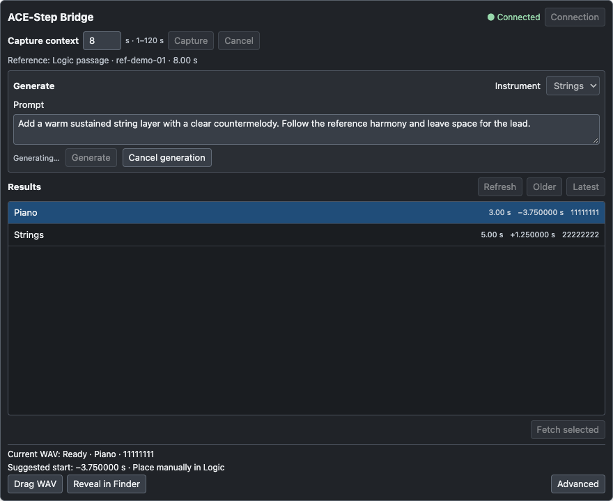
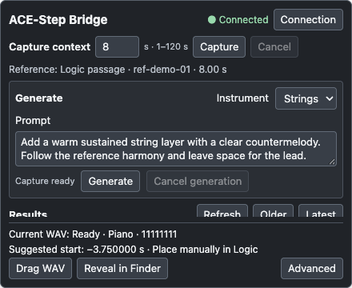

# Logic Bridge: plugin-centered generation workflow

Status: proposed UX, not implemented in the native AU.

This document revises the earlier capture-and-return UI proposal by adding instrument selection, prompt entry and generation control inside the plugin. Screenshots show an interactive HTML prototype with fixture data; they are not screenshots of a working generation feature in Logic.

## Outcome

As a Logic musician, I want to capture a passage, describe the instrument layer and receive a generated WAV from the same plugin window, so that I can keep arranging without switching to the web DAW for each generation.

The user-facing flow is:

**Connect → Capture context → Choose instrument and enter prompt → Generate → Select and fetch a result → Drag WAV into Logic.**

The bridge service, compatible model and generation executor still run outside Logic. Plugin-centered control does not mean that inference runs inside the AU or that the external runtime is no longer required.

## Proposed screen


*Figure 1. Proposed UI, not implemented. The prompt belongs in the Generate layer section between capture and results. All shown audio, IDs and timings are fixtures.*

The window has four functional regions:

1. **Connection:** compact connection state and expandable pairing settings.
2. **Capture context:** capture length, Capture, cancellation and a clear reference-ready state.
3. **Generate layer:** instrument, multiline Prompt, generation action and generation status.
4. **Results and current output:** result selection, explicit Fetch, and an output footer containing the verified WAV, signed placement and export actions.

The Current WAV footer remains visible. At smaller sizes, the middle workflow area may scroll so that adding prompt controls does not force tiny text or hide output actions. This deliberately supersedes the earlier proposal that all primary controls would always fit at 440×360 without workflow scrolling. Standard and expanded windows expose more of the workflow at once.

## Step-by-step interaction

### 1. Connect

Start or reuse the local bridge and generation runtime. Pair the plugin with the intended session. Show connection state separately from generation readiness: a paired plugin can capture while the compatible model or executor is unavailable.

Keep pairing inputs behind Connection once paired. Expired codes require a new code. Restoring an AU does not restore credentials; request pairing again. An already verified restored WAV remains usable offline.

### 2. Capture a reference passage

Enter a capture length from 1 to 120 seconds and choose Capture. Show an armed instruction to play the passage in Logic, then distinguish collecting audio from uploading/finalizing it. A reference is usable only after canonical readiness is confirmed.

Display the selected reference identity and duration near Generate layer. The first version uses the complete captured passage as its generation range; partial-range editing is deferred. Tempo, meter and source position come from the actual capture rather than being inferred from prompt text.

Stopping, seeking or looping during capture can invalidate the take. Explain the failure and offer a new capture. A failed replacement capture must not silently become the generation reference. Keep the last confirmed reference visibly identified until a new one is ready.

### 3. Choose an instrument and enter the prompt

The prompt is entered **inside the plugin**, in Generate layer. Instrument is a separate selection, limited to the active executor's supported instruments.

Example fixture input:

```text
Instrument: Strings
Prompt: Add a warm sustained string layer with a clear countermelody.
        Follow the reference harmony and leave space for the lead.
```

The prompt supplements the captured audio. It does not replace the reference, select a Logic MIDI region or authorize unrelated edits to the Logic project.

Use the existing prompt contract: optional text, at most 4096 characters, with the existing default instruction for empty or whitespace-only input. Show the default behavior in helper text and reject excessive input without silently truncating it. Preserve the entered text after a failed attempt.

### 4. Generate

Enable Generate only when a ready reference, valid session/project binding, supported instrument, compatible verified model and live executor are available, and backend occupancy permits a new job. Show an actionable reason beside a disabled action.

One click creates one request identity. Repeated delivery of that same request must resolve to the same job. Disable duplicate submission while pending. A deliberate new variation after completion receives a new request identity.

Show actual job states such as queued, running and exporting. Use indeterminate activity where measurable progress is unavailable; do not fabricate a percentage or completion estimate. Editing the prompt after submission applies to a future request and must not rewrite the submitted job.

Cancellation requests prevent publication according to the existing job contract. A canceled UI state does not prove that backend computation has stopped. If backend occupancy is unknown, explain that readiness must be reconciled; do not automatically resubmit or enable another generation prematurely.

### 5. Select and fetch a result

When a job publishes a ready result, expose it in Results and show the existing generic new-results notice. Do not automatically select, download or replace the current WAV.

Select a row, inspect its instrument, duration and signed suggested start, then choose Fetch selected. Keep Refresh, Older, Latest and Advanced UUID lookup. Browsing older results must not jump to the newest page when a new result appears.

Selection and Current WAV are distinct. Under the current behavior, explicit Fetch clears the previous active export reference immediately; Drag WAV and Reveal in Finder remain disabled during fetching or after a failed fetch. Merely selecting a different row does not change the current WAV.

### 6. Return the WAV to Logic

Only enable Drag WAV and Reveal in Finder after the existing hash and WAV verification succeeds. Show the current output identity and signed suggested start in seconds to six decimal places.

Drag the WAV to a Logic audio track and place it manually at the suggested position. Finder is the alternative path if native dragging is unavailable. The plugin does not automatically create tracks, position regions or verify that the user has imported the file.

Negative suggested starts remain visible and require deliberate placement handling in Logic; never silently clamp them to zero. Copy the audio into the Logic project using the user's normal project asset workflow, then check playback and save/reopen behavior.

## State examples



*Figure 2. Simulated generation in the prototype. No inference request was sent.*



*Figure 3. Compact layout proposal. The workflow scrolls while the output footer stays inside the plugin frame.*

| Situation | User-visible behavior |
|---|---|
| Unpaired | Pairing action; Capture and Generate unavailable; verified offline output remains independently usable |
| Paired, no ready capture | Capture available; Generate explains that a reference is required |
| Reference ready, executor unavailable | Retain reference and prompt; explain how to restore generation readiness |
| Generation pending | Prevent duplicate requests; show authoritative job state and cancellation request action |
| Unknown submission or backend outcome | Preserve the job identity; require reconciliation; never silently retry |
| Generation failed | Show recoverable cause; retain prompt/reference; retry is a deliberate new action once occupancy allows |
| Result ready | Show in catalog; explicit selection and Fetch remain necessary |
| Fetch failed | Current export unavailable; retry Fetch; no false claim that the previous active WAV remains available |
| Catalog stale | Keep existing rows and retry guidance; preserve existing notification behavior |
| Reopened session | Re-pair for new operations; restore verified cache independently |

## Current implementation and required changes

Today, `src/components/logicBridge/LogicBridgePanel.tsx` contains Instrument, Prompt, range and Add layer controls. The native AU captures audio, browses results and fetches verified exports. It does not currently offer prompt-driven generation.

Moving those controls into the AU requires more than adding fields:

- **Project and reference preparation:** the existing executor imports canonical audio and creates a project-scoped binding. The proposed plugin must request this through an explicitly designed, acknowledged preparation flow. A capture ID alone is not a valid binding.
- **Authorization:** current `POST /jobs` and cancellation accept control, MCP or executor roles, while the native credential is session-scoped and cannot submit generation. Design a project-scoped generation-request capability or delegated control path. Do not embed the installation control token or simply broaden native permissions.
- **Readiness:** expose supported instruments, verified compatible model, executor availability and backend occupancy to the plugin without leaking credentials or internal paths.
- **Request lifecycle:** preserve idempotency, authoritative job state, cancellation and reconciliation semantics, including restart and uncertain-submission cases.
- **Native UI:** add the generation form and its state presentation while preserving audio-thread isolation, result catalog behavior and verified-cache/export guarantees.

These are implementation prerequisites, not completed work or an approved authorization contract. The bounded first implementation may still need the web DAW open as its executor; the routine prompt and generation interaction should be available in the plugin once readiness has been established.

## Scope and verification

In scope for this proposal: plugin prompt entry, instrument selection, reference readiness, generation request/status, results and explicit WAV return. Deferred: in-plugin preview playback, partial-range editing, automatic Logic placement, MIDI generation, new model algorithms and running inference inside the AU.

Before implementation, define the preparation/authorization contract and its project/session permissions. Then verify:

1. Pair → capture → prepare reference → enter prompt → submit exactly once → publish result → explicit Fetch → drag/import → manual placement → playback.
2. Empty or whitespace-only prompts submit with the existing default instruction. Over-limit prompts, unsupported instruments, unavailable models/executors and invalid references produce actionable states without submission.
3. Duplicate clicks, lost responses, cancellation and restart do not cause duplicate inference or release unknown backend occupancy.
4. Selection, pagination and refresh do not replace output; failed Fetch disables active export actions.
5. Compact/standard/expanded sizes, middle-area scrolling, keyboard focus and VoiceOver retain access to every control.
6. Save/reopen preserves project audio references and verified cache behavior; credentials require re-pairing.

Prototype screenshots validate presentation only. They do not establish native AU behavior, authorization safety, model output quality or Logic compatibility.

## References

- [Native AU implementation and current behavior](../../plugins/logic-bridge/README.md)
- [Bridge service contracts](../../server/logic-bridge/README.md)
- [Existing results contract](../../openspec/specs/logic-bridge-results/spec.md)
- [Current web generation panel](../../src/components/logicBridge/LogicBridgePanel.tsx)
- [Current native editor](../../plugins/logic-bridge/src/Plugin.cpp)

The earlier `LOGIC_AU_BRIDGE_DESIGN.md` is an initial architecture proposal containing historical pre-implementation statements. It is not the current implementation status. This document supersedes the capture-only UI direction for the proposed user journey, while retaining the existing service and audio-safety constraints until separately revised.
