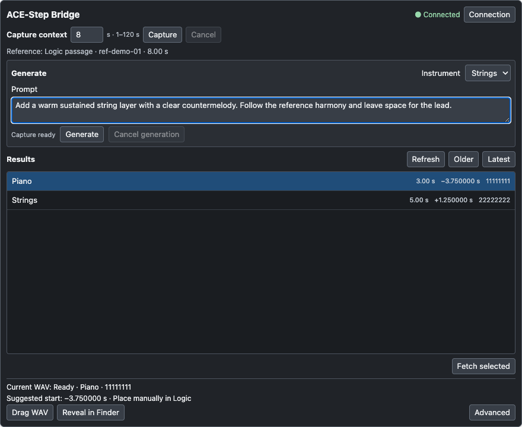
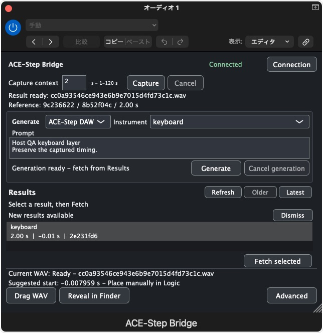
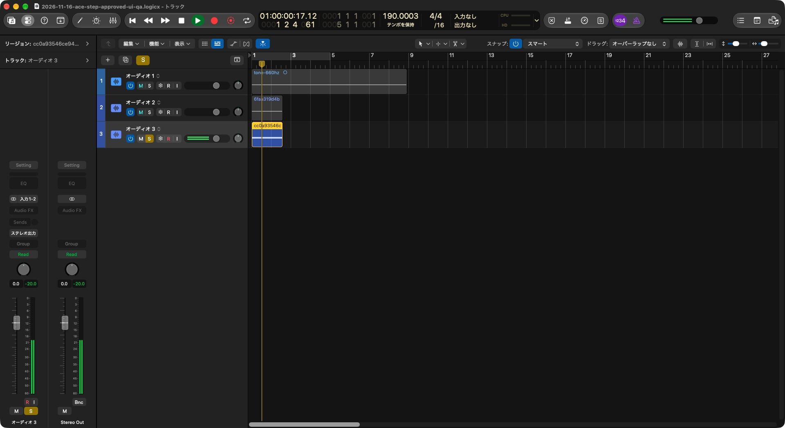

# Logic Bridge: plugin-centered generation workflow

Status: native editor implemented and exercised in Logic with a deterministic model fixture on 2026-11-16; this is not a release qualification.

This document records the implemented plugin-centered workflow, actual Logic-host screenshots, and the original design proposal. Figures 1–3 are an interactive HTML prototype with fixture data, preserved as design provenance; they are not screenshots of the native editor or Logic. Native JUCE editor fixture screenshots are recorded separately under `.codex/omo/evidence/bridge-plugin-generation-ui/resume6/native/`; they are not Logic-host evidence.

## Outcome

As a Logic musician, I want to capture a passage, describe the instrument layer and receive a generated WAV from the same plugin window, so that I can keep arranging without switching to the web DAW for each generation.

The user-facing flow is:

**Connect → Capture context → Choose instrument and enter prompt → Generate → Select and fetch a result → Drag WAV into Logic.**

For ACE-Step DAW mode, the bridge service, compatible model and generation executor run outside Logic. Plugin-centered control does not mean that inference runs inside the AU or that the external runtime is no longer required.

## Original proposed screen



*Figure 1. Original proposed UI. The prompt belongs in the Generate layer section between capture and results. All shown audio, IDs and timings are fixtures.*

The implemented window has four functional regions:

1. **Connection:** compact connection state and expandable pairing settings.
2. **Capture context:** capture length, Capture, cancellation and a clear reference-ready state.
3. **Generate layer:** instrument, multiline Prompt, generation action and generation status.
4. **Results and current output:** result selection, explicit Fetch, and an output footer containing the verified WAV, signed placement and export actions.

The Current WAV footer remains visible. The default window is 640×520, with limits of 440×360 and 880×720. At smaller sizes, the middle workflow area scrolls so that adding prompt controls does not force tiny text or hide output actions. This deliberately supersedes the earlier proposal that all primary controls would always fit at 440×360 without workflow scrolling. Standard and expanded windows expose more of the workflow at once.

## ACE-Step DAW step-by-step interaction

### 1. Connect

Start or reuse the local bridge and generation runtime. Pair the plugin with the intended session. Show connection state separately from generation readiness: a paired plugin can capture while the compatible model or executor is unavailable.

Open Connection to enter a pairing code. Expired codes require a new code. Restoring an AU does not restore credentials; request pairing again. An already verified restored WAV remains usable offline.

### 2. Capture a reference passage

Enter a capture length from 1 to 120 seconds and choose Capture. Show an armed instruction to play the passage in Logic, then distinguish collecting audio from uploading/finalizing it. After canonical readiness, the AU automatically requests preparation. The paired DAW executor imports the capture and durably acknowledges its project binding before the reference becomes usable.

Display the selected reference identity and duration near Generate layer. The first version uses the complete captured passage as its generation range; partial-range editing is deferred. Tempo, meter and source position come from the actual capture rather than being inferred from prompt text.

Stopping, seeking or looping during capture can invalidate the take. Explain the failure and offer a new capture. An accepted replacement that is pending, failed or canceled blocks generation from the older reference, although its identity can remain displayed. If the replacement POST is rejected before acceptance, fresh authoritative readiness can permit explicit generation from the displayed prior reference.

### 3. Choose an instrument and enter the prompt

The prompt is entered **inside the plugin**, in Generate layer. Instrument is a separate selection, limited to the active executor's supported instruments.

Example fixture input:

```text
Instrument: Strings
Prompt: Add a warm sustained string layer with a clear countermelody.
        Follow the reference harmony and leave space for the lead.
```

The prompt supplements the captured audio. It does not replace the reference, select a Logic MIDI region or authorize unrelated edits to the Logic project.

The prompt is optional and limited to 4096 UTF-16 code units. Empty or whitespace-only input uses `Add an instrumental layer`; excessive input disables generation. The entered text remains available after a failed attempt.

### 4. Generate

Enable Generate only when a ready reference, valid session/project binding, supported instrument, compatible verified model and live executor are available, and backend occupancy permits a new job. Show an actionable reason beside a disabled action.

One click creates one request identity. Repeated delivery of that same request must resolve to the same job. Disable duplicate submission while pending. A deliberate new variation after completion receives a new request identity.

The status shows preparation or generation in progress without a fabricated percentage or completion estimate. Editing the prompt after submission applies to a future request and does not rewrite the submitted job.

Cancellation requests prevent publication according to the existing job contract. A canceled UI state does not prove that backend computation has stopped. If backend occupancy is unknown, readiness must be reconciled; do not automatically resubmit or enable another generation prematurely. Re-pairing does not automatically retry an unknown request. If the AU loses its active request snapshot and remains unknown, the ACE-Step DAW operator first confirms and reconciles pending or unknown work, including a pending native intent that has no occupied job. Then save, close and reopen the Logic project, or reinstantiate the AU, to create a fresh processor and pair again. Closing and reopening only the editor retains the processor and cannot clear the unknown state. The verified saved WAV can restore offline independently of pairing.

### 5. Select and fetch a result

When a job publishes a ready result, expose it in Results and show the existing generic new-results notice. Do not automatically select, download or replace the current WAV.

Select a row, inspect its instrument, duration and signed suggested start, then choose Fetch selected. Keep Refresh, Older, Latest and Advanced UUID lookup. Browsing older results must not jump to the newest page when a new result appears.

Selection and Current WAV are distinct. Under the current behavior, explicit Fetch clears the previous active export reference immediately; Drag WAV and Reveal in Finder remain disabled during fetching or after a failed fetch. Merely selecting a different row does not change the current WAV.

### 6. Return the WAV to Logic

Only enable Drag WAV and Reveal in Finder after the existing hash and WAV verification succeeds. Show the current output identity and signed suggested start in seconds to six decimal places.

Drag the WAV to a Logic audio track and place it manually at the suggested position. Finder is the alternative path if native dragging is unavailable. The plugin does not automatically create tracks, position regions or verify that the user has imported the file.

Negative suggested starts remain visible and require deliberate placement handling in Logic; never silently clamp them to zero. Copy the audio into the Logic project using the user's normal project asset workflow, then check playback and save/reopen behavior.

## State examples


*Figure 2. Simulated generation in the prototype. No inference request was sent.*


*Figure 3. Compact layout proposal. The workflow scrolls while the output footer stays inside the plugin frame.*

| Situation | User-visible behavior |
|---|---|
| Unpaired | Pairing action; Capture and Generate unavailable; verified offline output remains independently usable |
| Paired, no ready capture | Capture available; Generate explains that a reference is required |
| Reference ready, executor unavailable | Retain reference and prompt; explain how to restore generation readiness |
| Generation pending | Prevent duplicate requests; show authoritative job state and cancellation request action |
| Unknown submission or backend outcome | Preserve the job identity; require reconciliation; never silently retry |
| Generation failed | Show recoverable cause; retain prompt/reference; retry is a deliberate new action once occupancy allows |
| Result ready | Show in catalog; explicit selection and Fetch remain necessary |
| Fetch failed | Current export unavailable; retry Fetch; no false claim that the previous active WAV remains available |
| Catalog stale | Keep existing rows and retry guidance; preserve existing notification behavior |
| Reopened session | Re-pair for new operations; restore verified cache independently |

## Implementation contract

The AU offers two distinct modes. **ACE-Step DAW** requires an open paired DAW executor and a loaded, verified non-Turbo LEGO model advertising isolated-layer output. It prepares the entire capture, accepts a supported instrument and an optional prompt, and requires explicit Fetch for its result. **Direct Cover** uses a separately running Cover-capable ACE-Step API without a DAW executor, requires a nonblank prompt, and automatically fetches its generated WAV. Cover transforms the captured audio; it is not an isolated layer.

Native credentials can submit scoped preparation and generation intents, not generic job writes. The executor validates source and binding before acknowledging preparation and before submitting generation. A stale binding can be invalidated by the current scoped executor, which also fails linked pending intents. Readiness follows the latest preparation rather than falling back after failure. See the [service contract](../../server/logic-bridge/README.md) for request ownership, idempotency, cancellation and reconciliation.

## Scope and verification

In scope: plugin prompt entry, instrument selection, reference readiness, generation request/status, results and explicit WAV return. Deferred: in-plugin preview playback, partial-range editing, automatic Logic placement, MIDI generation, new model algorithms and running inference inside the AU.

Verification should cover:

1. Pair → capture → prepare reference → enter prompt → submit exactly once → publish result → explicit Fetch → drag/import → manual placement → playback.
2. Empty or whitespace-only prompts submit with the existing default instruction. Over-limit prompts, unsupported instruments, unavailable models/executors and invalid references produce actionable states without submission.
3. Duplicate clicks, lost responses, cancellation and restart do not cause duplicate inference or release unknown backend occupancy.
4. Selection, pagination and refresh do not replace output; failed Fetch disables active export actions.
5. Compact/standard/expanded sizes, middle-area scrolling, keyboard focus and VoiceOver retain access to every control.
6. Save/reopen preserves project audio references and verified cache behavior; credentials require re-pairing.

### Observed Logic-host workflow (2026-11-16)



*Figure 4. Actual Logic-hosted AU at its default 640×520 size after explicit Fetch.*



*Figure 5. Actual Logic project reopened for playback of the imported fixture result.*

The installed and freshly loaded arm64 AU had UUID `72E8E7C5-BF76-363A-8C7F-F44381637607`. In Logic, the test paired, captured audio, and observed reference preparation with durable executor binding acknowledgment. Keyboard navigation selected the keyboard instrument, a multiline prompt was entered, and Generate produced one submission. The result became ready without automatic Fetch; selecting it preserved the prior Current WAV, and explicit Fetch retrieved the new WAV. Reveal in Finder and Logic audio import placed it on Audio 3. Solo playback showed advancing transport and -20 dB on the channel and stereo output. The project was saved with copied audio, reopened and replayed; decoded project audio matched the export. Offline restoration created a fresh verified export and credentials were reset.

The displayed suggested start remained negative at -0.007959 seconds; the test deliberately imported at 0 seconds and did not exercise exact negative placement. The actual Logic editor was observed at its default size; separate native JUCE fixtures covered 440×360, 640×520 and 880×720. Native dragging, OS hover, VoiceOver and resizing within Logic were not exercised. The model API boundary returned a deterministic 330 Hz, two-second WAV: no real model inference or musical quality was assessed. Direct Cover has separate regression fixtures; this host run did not exercise Cover inference. The detailed receipt and accessibility evidence are under `.codex/omo/evidence/bridge-plugin-generation-ui/resume16/host/`.

## References

- [Native AU implementation and current behavior](../../plugins/logic-bridge/README.md)
- [Bridge service contracts](../../server/logic-bridge/README.md)
- [Existing results contract](../../openspec/specs/logic-bridge-results/spec.md)
- [Current web generation panel](../../src/components/logicBridge/LogicBridgePanel.tsx)
- [Current native editor](../../plugins/logic-bridge/src/Plugin.cpp)

The earlier `LOGIC_AU_BRIDGE_DESIGN.md` is an initial architecture proposal containing historical pre-implementation statements. It is not the current implementation status. This document supersedes the capture-only UI direction while retaining the service and audio-safety constraints described above.
