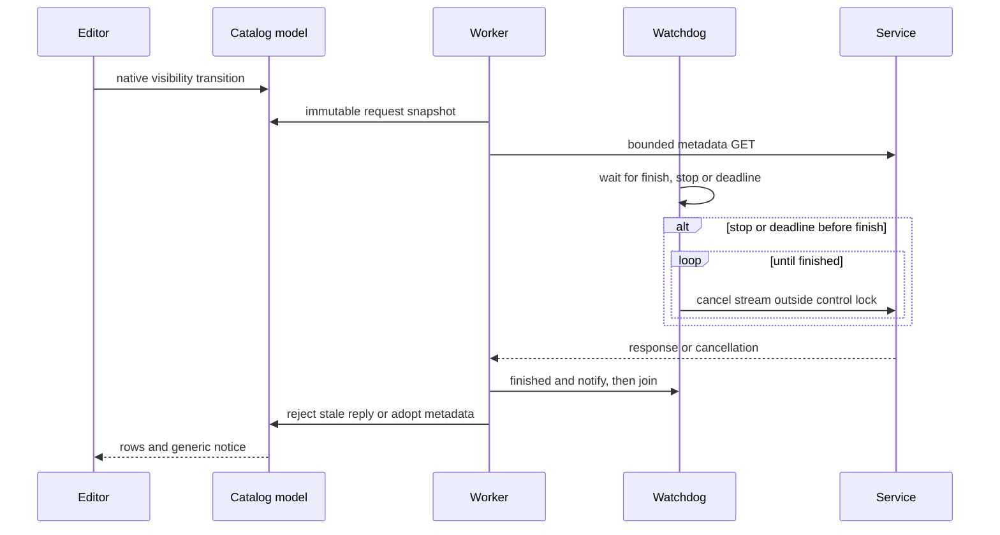

# Logic AU result catalog — external final gate cycle 10

## 判定: Approve

**must 0 / should 0 / ask 0 / nit 0 / imo 0.** Both review axes executed on the current complete product diff. No confirmed remaining finding or product decision.

## Contract and baseline

- Skill: `/Users/takuya/.agents/skills/self-review/SKILL.md`, review-only `--dry-run`.
- Caller: `omo-ultrawork ulw-execute Phase6`, final iteration 10.
- Repository: `/Users/takuya/workspace/github.com/AniP-gt/ACE-Step-DAW`.
- Base and HEAD: `f59fb41b1cd40989fa8132bfb8cd606b11dff8ac`; branch `feat/v0.1.0-logic-result-catalog`; target is the working-tree taskwide diff plus new files.
- Scope: 20 product/spec/test files: 10 tracked changes and 10 new files. Review reports are bookkeeping/evidence.
- Risk floor: medium; native concurrency and API scope received deeper review. English project artifact follows AGENTS.md.
- No fixes, commits, branches, stash, posts, installation or Logic operations by this lane.
- Goal: scoped ready-result discovery, native selection and explicit Fetch through existing SHA/WAV verification/export, generic in-plugin notice, bounded visible-only low-QoS metadata polling, stale session/navigation rejection and cache preservation.
- Explicit Fetch may re-download; offline cache reuse, automatic Fetch/audio replacement, OS notification, automatic Logic placement, model changes and release are outside scope.

### Files reviewed

Tracked changes: `docs/design/LOGIC_BRIDGE_USAGE.md`, `plugins/logic-bridge/CMakeLists.txt`, `plugins/logic-bridge/README.md`, `plugins/logic-bridge/src/Plugin.cpp`, `plugins/logic-bridge/tests/processor_probe.cpp`, `server/logic-bridge/README.md`, `server/logic-bridge/routes.ts`, `shared/logic-bridge/types.ts`, `src/components/logicBridge/LogicBridgePanel.tsx`, `tests/server/logicBridge.test.ts`.

New files: `openspec/specs/logic-bridge-results/spec.md`, `plugins/logic-bridge/src/NativeVisibility.h`, `plugins/logic-bridge/src/NativeVisibility.mm`, `plugins/logic-bridge/src/ResultCatalogClient.h`, `plugins/logic-bridge/src/ResultCatalogState.h`, `plugins/logic-bridge/src/ResultCatalogView.h`, `plugins/logic-bridge/tests/native_visibility_probe.mm`, `plugins/logic-bridge/tests/result_catalog_probe.py`, `plugins/logic-bridge/tests/result_catalog_test.cpp`, `plugins/logic-bridge/tests/startup_cancel_probe.py`.

## Dependency and external contract baseline

Local manifests/lockfiles are authoritative in local diff mode. No dependency upgrade is introduced. JUCE 8.0.6 is pinned in CMake. Relevant implementation was checked against `plugins/logic-bridge/.cache/JUCE-8.0.6`, not guessed from another JUCE release. Source identifier: https://github.com/juce-framework/JUCE/tree/8.0.6/modules . Context7 is unavailable; pinned source, installed Apple SDK declarations and current independent build evidence provide the fallback.

The earlier start/cancel interleaving is understood from `juce_Network_mac.mm:402-405`, `:428-431` and `:853-862`: the connection can exist before its task token is published. The current public-API cancellation loop remains active until client completion, so a cancellation lost before publication is retried after publication. No dependency patch ships with this change. The metadata client still uses a three-second connection setting, five-second watchdog, 256 KiB cap and disabled redirects.

The native helper uses the NSView handle returned by pinned JUCE, attached-window visibility, minimization and `isHiddenOrHasHiddenAncestor`. It runs in GUI visibility/timer callbacks, not the audio/network worker. Local AppKit declarations and the pinned AU shared-view holder shape were checked in this review sequence; the helper remains byte-identical to the independently verified repair8 implementation.

## Specification review

Approved plan and living spec define session roles, ready-only joins, exact summary fields, bounds, insertion-order cursors, session-local publication order, silent baseline, generic notice/high-water rules, stale reply/navigation rejection, explicit Fetch and visibility gating. Empty, invalid cursor, older-page polling, reconnect, host restore, failed reads and persisted old results are covered. No contradictory requirement or unanswered product choice remains.

The usage guide and browser instructions distinguish Results/Fetch selected from Advanced/Result UUID/Fetch UUID. Historical installation/auval observations are separated from unverified new Logic workflow claims. No musical quality or actual host interaction result is inferred.

## Risk map and behavior comparison

| Unit / consumer | Before → after | Hidden impact and guardrail | Closure |
|---|---|---|---|
| Result API / native list | Detail-only → additive bounded collection | Old persisted arrays and ready-job join; exact DTO, session/role, restart, cursor and append tests | Scope and detail/asset endpoints preserved |
| Browser/MCP export | Existing detail/UUID retained; instructions aligned | Endpoint/label searches; panel tests and current DOM text evidence | No old-label consumer regression |
| Editor / host holder | New metadata scheduling gated by effective native visibility | Component flags plus NSView/window/ancestor; seven native hidden cases, null/peerless, actual GUI timer | No hidden-period scheduling or 10 Hz refresh loop |
| Catalog lifecycle | Immutable request, generation and navigation epochs | Pair/restore/hide/delay, older page and bounded state-model checks | Stale replies rejected; baseline/high-water preserved |
| Fetch/Capture/cache | Existing verified audio transfer with selected-ID dispatch | Busy eligibility and captureReserved; actual editor, SHA/state/placement/cache races/finalize probes | No automatic fetch or cache replacement |
| Metadata shutdown | New watchdog with cancellation maintained through startup | Exact task-publication gate, repeated-cancel intervals, healthy control, normal active-request shutdown | Prior startup cancellation finding closed |

Failure-mode ledger: lost initial cancellation before task publication was new in the metadata path and is now repaired. Repeat cancellation survives startup; canceled clients stop further body reads. Normal completion sets finished and exits without cancellation. Stale metadata failures retain rows/cache and back off. Existing command-worker network policy is not changed into a new guarantee.

Human review priorities: ownership/join ordering in the watchdog, native-handle GUI-thread ownership, and honest host QA limits. All medium-impact changed units have source checks plus relevant passing guardrails. No migration, replica/cache read relocation, opaque artifact replacement, or generalized extraction is introduced.

## Findings

None. Security, robustness/data safety, quality, goal and specification perspectives were reviewed. Query/collection review checked session filtering, joins, bounds and insertion-order cursor semantics; no SQL subsystem exists here. Explicit nit and ask passes found no actionable remaining item. PR template is N/A in local diff mode.

## Investigated and withdrawn concerns

- **Startup cancellation could be lost permanently:** closed by `ResultCatalogClient.h:29-33`. Stop/deadline marks canceled and retries stream cancellation until finished. The lock is released for each cancel. The predicate after stop is finished only, so stopping does not turn the 15 ms wait into a busy loop. The current body loop at :37 stops issuing additional reads once canceled.
- **Repeated cancellation could continue after successful completion:** closed by mutex-protected finished, notification and watchdog join at `ResultCatalogClient.h:39`. The healthy actual HTTP control returns a valid page with no cancel marker after join plus 120 ms.
- **A detached watchdog or dependency test hook could ship:** rejected. Stream/watchdog remain owned through join; no listener/reset workaround or detached worker is added. Original SDK 4222-entry before/after snapshots match; canonical AU has no SDK gate string.
- **Strict startup evidence might cancel only after startup release:** rejected. The shadow marker is written only after Pimpl.cancel returns, and the processor waits for that marker before releasing the TaskToken gate. The strict patch contains only the two documented instrumentation hunks in an owned SDK copy.
- **Native-only hiding could preserve polling:** closed by `Plugin.cpp:237` / `NativeVisibility.mm:4-8`; current helper is unchanged from the independent seven-scenario native matrix. Ordinary GUI visibility transitions remain coalesced.
- **Busy selection could re-enable Fetch or overwrite pending Capture:** rejected by `ResultCatalogView.h:41`, :58, :71 and processor captureReserved at `Plugin.cpp:37`; fresh UI/cache invariants pass.
- **Latest poll could overwrite an older page or lower the notice mark:** rejected by `ResultCatalogState.h:39-48`, navigation epoch, older-page guard and max high-water update. Pagination does not notify.
- **Explicit Fetch must reuse offline cache:** withdrawn against the approved scope; explicit Fetch may re-download. Polling, selection and page navigation do not fetch or replace audio.
- **Browser/manual guidance and installation statements are stale:** current text matches actual control labels; the final installation receipt separately documents the current installed AU and auval result without claiming a Logic workflow pass.

## Codex review results

- Execution: **OK**, fresh discovery exit 0, CLI 0.169.0, model requested `gpt-6.1-sol`, medium effort.
- One independent execution covered the normal review and adversarial native-concurrency checks appropriate to the medium-risk change. This is not represented as two independent executions or a separate high-effort heavy run.
- Full current taskwide diff and all new files were supplied. The prompt excluded prior review conclusions/approvals and prohibited fixes, installs, large GUI/SDK rebuilds and unrelated speculative requirements.
- Command: `codex exec --sandbox read-only --ephemeral -C <repo> -m gpt-6.1-sol -c model_reasoning_effort=medium -o /tmp/logic-c10-external/output-iter1.md <prompt> < /tmp/logic-c10-external/input-iter1.diff`.
- Codex verdict: **PASS**, findings **none**, confidence **MEDIUM**. It explicitly excludes actual Logic new UI, OS drag and VoiceOver from verified claims.
- Codex independently reran the 606007-prefix state-model test successfully, checked pinned JUCE cancellation behavior, matched all 21 current source/binary identities and confirmed no SDK startup gate in the canonical AU.
- Axis A also found zero findings. No asymmetric finding required a rebuttal/cross-verification call; none was silently discarded.

| Item | Axis A | Codex | Consolidated result |
|---|---|---|---|
| Current complete product diff | no findings | no findings | no findings |

Discovery input SHA-256: `fcd233305e4fcbebabb87072a85f0dc38d6521fc87ed6363860b1b9c22a548f9`.
Discovery output SHA-256: `c8dfa9a1d857bf1db82f13f8473165b9e464169f251148e46de8dc65fa1cc718`.

## Verification provenance

This lane independently hashed all **21 current source/binary entries** and all **49 saved evidence artifacts** against `verify-repair10` manifests: no mismatch. Original SDK before/after JSON manifests contain **4222 entries** and are identical. Persistent cache before/after snapshots are identical. `git diff --check` passed. The following runs are caller-owned independent QA, not runtime tests initiated by this lane:

- **Controlled startup:** fresh owned SDK/build, actual current processor, exact pre-token gate and post-cancel-return marker; release-to-join 64.0161 ms, stop-to-join 71.638 ms, four cancellations with 22.813 / 22.652 / 22.627 ms intervals, stable after join plus 100 ms, exit 0. The original SDK was not modified. Historical strict red (3053.64 ms, one cancel) was source/trace reviewed and reused, not independently rebuilt in this gate.
- **Healthy control:** current client, pre-released gate, real successful HTTP page; no cancellation after join plus 120 ms, exit 0.
- **Normal SDK regressions:** fresh CTest 4/4; actual editor UI 16 requests/verified keyboard Fetch/busy guard/cache and placement invariants; catalog 10 requests/deadline 5017.99 ms/active-request destruction 3.91004 ms/QoS 9/stale pair and hidden replies/multiple instances.
- **Cache and capture:** fresh restore/download race and pairing race pass; finalize regression returns 48000 frames after 8.010 seconds. All 28 persistent cache file hashes remain unchanged and owned fixture files are cleaned.
- **Unchanged native visibility/UI:** repair8 seven native hidden scenarios each hold 5.8 seconds with zero requests, resume quiet baseline, and preserve normal five-second polling. This is reused evidence under matching helper/Plugin/View identity, not claimed as a new matrix run.
- **Wording:** targeted panel three tests, TypeScript check and actual DOM paragraph provenance remain valid; no old-literal consumer requires a mirrored wording test. Broad prior 8811 frontend / 103 server tests were not repeated for this native-only repair. Existing full npm build missing-WASM-target limitation remains baseline; no fabricated full build success.

Evidence: `.omo/evidence/logic-au-result-catalog/verify-repair10/verification.md`, `actual-shadow-sdk-semantic.patch`, `independent-green.log`, `healthy-runtime.log`, `hook-isolation.json`, source/binary/artifact/SDK/cache manifests and cleanup receipts. The new `startup_cancel_probe.py` and processor mode are checked-in test paths; SDK instrumentation remains evidence-only in an owned shadow copy.

## Host and runtime limits

Phase 4b: skipped (caller contract).

The current AU is installed at the canonical location, SHA-256 `5f7c662dcb00dee13cce5341caf48d4cb36f3436ff8002bc2cea1b733f148e98`, and normal registry lookup plus auval pass, as recorded in `logic-host/last-install-receipt.txt` and companion logs. No registrar kill, cache wipe or signing workaround is claimed. Original project and prior AU backup remain preserved.

A normal Logic restart/open of the saved project was requested and PID 34236 observed. Project-open completion/dialogs and the new catalog workflow were not verified because host accessibility/CUA remained blocked. Actual Logic pairing, banner, selection/Fetch, placement, save/reopen playback, OS drag, VoiceOver and listening remain unverified under the user's explicit implementation/tests delivery exception. Owned AppKit fixtures, instrumented startup gates and auval do not prove those host workflows. No actual Logic freeze or real-host race frequency was measured.

## Flow

The repeated cancellation covers task publication after the first cancel. Metadata remains separate from explicit verified audio Fetch; no automatic audio replacement is added.

## Counts and iteration history

| Iteration | must | should | ask | nit | imo | Codex | Verdict |
|---|---:|---:|---:|---:|---:|---|---|
| 1 | 0 | 0 | 0 | 0 | 0 | OK, exit 0 | Approve |

All priority/prefix combinations are zero. One fresh discovery iteration converged with agreement. Previous text, native visibility and startup cancellation concerns are closed by current source and bounded evidence; old approvals were not used as substitutes. No unanswered decision or database query remains. PR reviews: none supplied. No merge, release or actual Logic compatibility approval is implied.

Phase 5: skipped (local diff mode).
Phase 5b: skipped (local diff mode).

## Integrity and cleanup

Only this report is authored by this lane. Product fingerprints are compared before/after; concurrent reports are accounted for separately. CLI completed with exit 0. Scratch inputs, prompt, logs, output and fingerprints are removed after recording their hashes and results. No lane-owned runtime fixture remains.

Fingerprint receipt: no product files changed during this lane. Other review reports observed: none.
Scratch cleanup receipt: `/tmp/logic-c10-external` inputs, prompt, CLI output/log and fingerprint snapshots removed; discovery exited 0.
