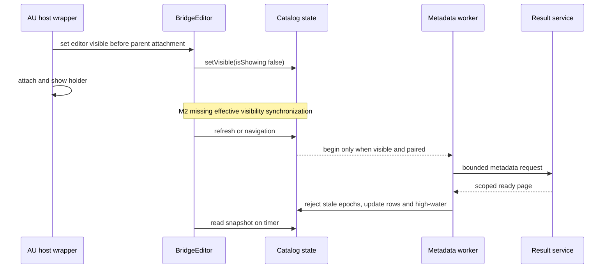

PROJECT_RULES_LOADED:

- AGENTS.md and CLAUDE.md: complete task scope; caller's review-only contract governs this lane.
- .claude/rules/development-process.md, testing-requirements.md, git-conventions.md, autonomous-workflow.md: no path filters; all changed source, tests and documentation.
- PROJECT_RULES_VIOLATIONS: none independently established by this static gate. Full build and host limitations remain explicit below.

## Verdict: Request Changes

Review-only self-review; caller BASE_REF f59fb41b1cd40989fa8132bfb8cd606b11dff8ac. The taskwide working-tree diff, including all six untracked implementation/spec/test files, was reviewed. Two normal-operation defects and one shutdown robustness issue remain. No fixes, host operations, installation, commits, branch changes or posts were made.

## Baseline and scope

Dependency baseline: current working tree, branch recorded by git; HEAD f59fb41b1cd40989fa8132bfb8cd606b11dff8ac. Native CMake pins JUCE 8.0.6 with SHA256; nearest JS manifest/lockfile is repository package.json/package-lock.json (TypeScript 5.9.3, Vitest 4.1.2, tsx 4.21.0). No manifest upgrade or migration is in scope.

Goal: ready-result discovery, generic persistent in-plugin notification, explicit Fetch through the existing SHA/WAV verification/export path, visible paired background polling, cancellation epochs, stable session pagination and high-water handling. No new HTTP-free same-result Fetch requirement was inferred from caller shorthand.

Constraints: no generation, authentication-policy, migration, installed AU or current Logic changes. The user subsequently approved saving/quitting Logic, AU update and restart. Those operations belong to the caller's dedicated host lane; this review did not perform them. Actual host results are still unverified at report time.

## Findings: must

### M1 — must(high) Row selection bypasses capture-busy Fetch protection and loses the saved result reference

Location: plugins/logic-bridge/src/ResultCatalogView.h:70.

During Armed/Capturing/Uploading, update() disables Fetch using busy. A subsequent ordinary row selection synchronously invokes selectedRowsChanged(), which unconditionally enables Fetch for any nonnegative row. Until the next 100 ms editor timer, keyboard or mouse activation reaches the unchanged onClick callback and bridge.command("result", id). Plugin.cpp:36 immediately clears cachedFilename, localResult and placementText and changes savedResultId; Plugin.cpp:187 then discards the command while capture is active instead of fetching it. The exported/cache files survive physically, but Drag/Reveal and the serialized saved reference are lost without a successful replacement.

Evidence: ResultCatalogView.h:39 and :49 versus :70; Plugin.cpp:36, :187, :224-225 and :232; pinned JUCE ListBox.cpp:681-708 invokes the selection callback synchronously. The list remains operable during capture. The existing UI fixture does not cover changing selection and activating Fetch while busy.

Fix: retain paired/busy eligibility in the view and apply the same predicate on selection changes and action activation; reject or defer unavailable result commands at the processor action boundary before clearing any saved result state. Add a regression that begins with an already fetched result, enters capture, changes the selected row and activates Fetch before a timer tick, then asserts no new Fetch and unchanged saved cache/path/placement.

Severity mapping: Codex called this Needs Attention; promoted to must(high) because a reachable normal user flow destroys the current persisted result reference while silently discarding its requested replacement. This is the same root cause independently raised by the caller's other final reviewer, not a second issue.

### M2 — must(high) AU editor construction can leave catalog visibility false permanently

Location: plugins/logic-bridge/src/Plugin.cpp:231.

The catalog tracks visibility only through the editor's own visibilityChanged() callback. In pinned JUCE 8.0.6, AU EditorCompHolder first calls addAndMakeVisible(editor), which invokes editor.setVisible(true) before attaching the editor to its parent; no desktop peer is present, so editor.isShowing() is false. Later the holder attaches to the desktop and becomes visible, but Component::sendVisibilityChangeMessage() only notifies that component and its listeners, not child visibilityChanged() overrides. The editor has no parentHierarchyChanged or component watcher and timerCallback() does not resynchronize effective visibility. Pair, Refresh and Older then cannot enqueue any request because the catalog remains hidden.

Evidence: Plugin.cpp:231-232; ResultCatalogState.h:26-29; JUCE 8.0.6 juce_audio_plugin_client_AU_1.mm:1658-1660 and :1687-1709; juce_Component.cpp:278-340 and addAndMakeVisible. The UI probe manually calls bridgeProbeCatalogVisible(*p,true) at processor_probe.cpp:104 and therefore bypasses this host construction path. Actual Logic symptoms are not claimed as observed; the normal wrapper call order and missing state transition are established statically.

Fix: synchronize effective isShowing() changes through the existing GUI timer or a parent/peer-aware watcher, scheduling only on actual transitions. Add a regression using an initially invisible parent: addAndMakeVisible(editor), then attach/show the parent, pair, and assert polling starts; hide/show the parent and assert polling stops/resumes without resetting the baseline.

## Findings: should

### S1 — should(medium) Processor teardown joins an uncancelled metadata request

Location: plugins/logic-bridge/src/Plugin.cpp:13.

Destruction sets catalogStop and joins catalogThread, but ResultCatalogClient::fetch() cannot observe that stop flag and its stream is private to the function. A stalled request therefore holds the destruction caller until its five-second watchdog completes. Caller native verification records shutdown 4997.27 ms, consistent with this source path. The AU wrapper destroys its processor synchronously; whether Logic performs this destruction on its GUI thread remains unmeasured, so this is a robustness issue rather than a claim of an observed host freeze.

Fix: propagate processor shutdown to the active request's cancellation control without holding the processor mutex during cancel or join. Keep stream/watchdog lifetime safe and test that destruction during a stalled request completes promptly; do not detach a thread that captures this.

## Findings: ask / nit

None. Explicit polish and author-only-question passes produced no additional justified items.

## Findings: imo

### I1 — imo(medium) Page-size bounds do not bound server scan and summary allocation

Location: server/logic-bridge/routes.ts:170.

The route builds the ready-job map and every matching summary before reverse/slice. Each visible AU repeats this on polling through the service's serialized queue. The current append-only contract makes total-history scanning a documented design tradeoff; no measured latency or data-volume threshold establishes a current user failure. Retained as the adversarial lane's nonblocking design warning, not an invented load blocker. A future optimization can count stable positions while reverse-scanning and build only limit+1 summaries.

## Specification review

Approved plan .codex/omo/plans/logic-au-result-catalog.md:22-26 and OpenSpec define empty baseline, >high-water notification, same-session reconnect retention, different-session/restore reset, older-page isolation, limits and failures. No unresolved contradiction was established.
- Empty latest page silently establishes zero baseline.
- Invalid limits and missing/foreign/non-ready cursor IDs are rejected; missing session follows existing scope policy.
- Concurrent appends do not shift cursor traversal.
- Duplicate refreshes coalesce; navigation and credential generations reject stale completion.
- Failures retain rows and downloaded audio, with bounded backoff.
- Existing state/cache restore remains independent from list refresh.
- Explicit Fetch reuses verification/export behavior; it does not promise an HTTP-free repeated Fetch.

## Risk map

| Modified unit | Direct / hidden consumers and contracts | Guardrail and result | Impact / closure |
| --- | --- | --- | --- |
| GET results collection, routes.ts:165 | service routing; native metadata client; scoped control/native/executor/MCP roles; persisted append-only result/job joins | logicBridge.test.ts paging/restart/scopes/real publication; caller records server 103 tests passed | medium; closed by code and evidence |
| Plugin pairing/restore/catalog loop | worker/editor lifecycle; delayed HTTP; credentials; older-page navigation; runtime-only baseline | ResultCatalogState bounded event sequences; actual native deadline/races/processor fixtures | medium; stale generation and navigation handled |
| BridgeEditor and ResultCatalogView | list callbacks, timer, explicit Fetch, user capture commands; saved reference and writable exports | existing UI selection/cache tests pass, busy selection branch absent | high; M1 |
| CMake probe registration | CTest executable target resolution; Debug assertions | build and 4/4 CTest recorded; no automatic installation | medium; closed |
| Documentation | user's manual Fetch/placement/reopen workflow, service contract | changed operational claims checked against routes/model/client/editor and prior verification limits | medium; no additional contradiction |

Search terms included catalog, command, fetchResult, selectedRowsChanged, catalogVisible, restoreCachedResult, beforeResultId and publicationOrder. Indirect GUI/timer callbacks and deferred network completion are found; persisted project/cache paths are found; external Logic lifecycle, OS drag acceptance and accessibility speech remain unverified. No migration/rolling schema change or new environment flag is present. Human focus: M1, restore/credential epochs, append-order invariants, and deferred real-host behavior.

## Existing behavior comparison

- Native/manual result detail, SHA/WAV checking, private verified cache and writable exports retain the pre-existing path.
- New catalog metadata does not enter the single pending user-command slot and does not auto-fetch audio.
- Latest polling updates notification high-water without replacing browsed older rows.
- Capture audio callback is unchanged.
- New list selection introduces the M1 busy-gate bypass; the old manual Fetch button was only enabled by the busy-aware timer.

Failure ledger: stalled metadata reads are improved through independent bounded I/O; stale credential/navigation completions are guarded; explicit Fetch replacing the current selection remains pre-existing intended behavior; selection during capture is a newly reachable faulty entry path (M1). No failure frequency claim is made.

## Documentation and library contract checks

Context7 unavailable; used pinned official JUCE 8.0.6 headers and matching installed source, rather than memory. Sources:
- https://raw.githubusercontent.com/juce-framework/JUCE/8.0.6/modules/juce_gui_basics/widgets/juce_ListBox.h — selection notification lifecycle; matching ListBox.cpp confirms synchronous dispatch.
- https://raw.githubusercontent.com/juce-framework/JUCE/8.0.6/modules/juce_core/network/juce_WebInputStream.h — cancellation interrupts blocking reads; withConnectionTimeout uses milliseconds.
- https://cmake.org/cmake/help/v3.22/command/add_test.html — executable target in COMMAND resolves to its built location; enable_testing required. Existing enable_testing precedes new result_catalog registration. No setting replacement/default behavior was changed.

Changed README/design/service claims were checked for selection versus Fetch, polling/visibility, baseline/reset, generic notice, pagination, cache isolation and host limitations. Quote/scope/sequence/lookup/order sweeps found no additional contradiction. Full UUID accessibility is supported at the JUCE model boundary; VoiceOver speech is not claimed. No shared-abstraction extraction of existing business logic, typed-dialect migration, secret masking or opaque runtime artifact replacement applies.

## Investigated and withdrawn concerns

W1: Codex proposed that explicit Fetch must reuse a local same-result cached asset without HTTP. This adds an unapproved requirement. Approved plan:26 and OpenSpec explicitly require reuse of existing audio verification/export behavior, implemented by Plugin.cpp:127-144; refresh cache preservation is separately scoped. Codex rebuttal returned WITHDRAW after reading exact requirements. Existing offline restoration remains at Plugin.cpp:146-164.
W2: Stale latest replies could replace older-page browsing. ResultCatalogState.h navigation comparison and browsingOlder guard prevent replacement while preserving notification processing.
W3: Pairing or restored host state could accept old metadata. Immutable Request generation snapshots, pair/restore increments and completion comparison prevent acceptance.
W4: Cross-session array positions could skew notification ordering. routes.ts increments publicationOrder only after session filtering and before ready filtering; restart preserves append positions.

## Goal alignment and validation limits

Collection/session/cursor contract, one-flight metadata polling, response cap/deadline, high-water/reset rules, explicit verified Fetch wiring and native layout are implemented. Capture-safe selection and effective AU visibility are not complete (M1, M2).

Caller evidence read: final-native/verification.md, final-js/verification.md, T5-independent-verification.md. These record native Debug build, 4/4 CTest, actual processor/HTTP/UI/cache races, deadline and actual background QoS, 14 native images, 103 server tests, 8,811 frontend tests, TypeScript and JS-only Vite success. These were not rerun or claimed as this lane's independent runtime results.

Full npm build remains limited by pre-existing missing wasm32-unknown-unknown in the active Rust toolchain. Actual newly built AU/Logic capture/download/import/save/reopen/playback, OS drag acceptance, OS Tab injection, VoiceOver speech and musical quality remain unverified. Required host work must preserve the active project; save/quit/update/restart authorization was granted during this review and is being handled separately by the caller. No packages or toolchains were installed.

Phase 4b: skipped (caller contract)
Phase 5: skipped (local diff mode)

## Codex review results

- CODEX_EXECUTION: OK; normal discovery exit 0, nonempty output; model gpt-6.1-sol, codex-cli 0.169.0, read-only, ephemeral.
- Codex verdict: PASS; confidence HIGH. Its two Needs Attention candidates were busy selection and cache-reuse.
- Cross-verification exit 0: cache-reuse WITHDRAW; busy selection remains confirmed.
- codex: OK (self-review, this report).
- codex-adversarial: OK (direct); exit 0, nonempty output, gpt-6.1-sol, model_reasoning_effort=high. Four challenges: AU visibility, busy selection, synchronous shutdown, and scan/allocation growth.
- No failed CLI attempt or installation. The adversarial run was allowed to finish normally.
- Two-axis mapping: M1 independently detected by integrated review and normal/adversarial Codex, confirmed. M2 and S1 originated in adversarial Codex and were source-verified by the integrated axis against pinned wrapper/lifecycle code. I1 is a warning only.
- Rebuttal: W1 was returned to its proposing Codex axis, which explicitly withdrew it against plan:26 and the existing verification/export implementation.
- No extra discovery loop was represented as executed; this report covers one full discovery, one rebuttal, and the required full adversarial run over the same frozen taskwide diff.

## Processing flow

Trigger: new asynchronous state transitions spanning service, processor and editor.

Before this feature there was no metadata polling. The new flow deliberately separates catalog I/O from capture commands. M2 prevents its initial effective-visible transition under the standard AU wrapper sequence. M1 concerns a separate list-selection-to-result-command action while capture is active.

## Counts and disposition

| Prefix | Count | Priority |
| --- | ---: | --- |
| must | 2 | high |
| should | 1 | medium |
| ask | 0 | — |
| nit | 0 | — |
| imo | 1 | medium |
| total | 4 | — |

Existing PR reviews: none fetched in LOCAL DIFF MODE. M1 duplicates the caller's separately acknowledged final-review root cause and must be consolidated once by the caller. No PR review, comment or publication occurred.

## Ownership, fingerprint and cleanup

The prescribed shell fingerprint command was rejected by an automatic PreToolUse hook (a false match to commit-command protection). An equivalent Python subprocess implementation captured sorted git diff HEAD plus untracked paths with git hash-object. Initial hashes were stored only under /tmp. No forbidden git operation was attempted.

Normal, rebuttal and adversarial runs used read-only sandboxes. Pre/post git status and content fingerprints were compared before saving this report. Owned processes are exited; no runtime fixtures, ports, native cache artifacts, host application changes or toolchains were created. CLI findings and execution receipts are summarized above; their original scratch outputs were read in full before exact owned scratch-file cleanup.

## Execution receipts

| Run | Exit | Output bytes | Observed result |
| --- | ---: | ---: | --- |
| Normal discovery | 0 | 2095 | PASS / HIGH; two Needs Attention candidates |
| Rebuttal | 0 | 785 | WITHDRAW local-cache-HTTP-free Fetch claim |
| High-effort adversarial | 0 | 5850 | Three Major challenges, one Minor warning; assessed above |

Normal status unchanged: true. Adversarial status unchanged: true. Final product content fingerprint changes before report write: [].

Report-only mode retained; exact owned /tmp scratch directory and initial fingerprint will be removed after this report is saved. No retained review cache or active PID belongs to this lane.

