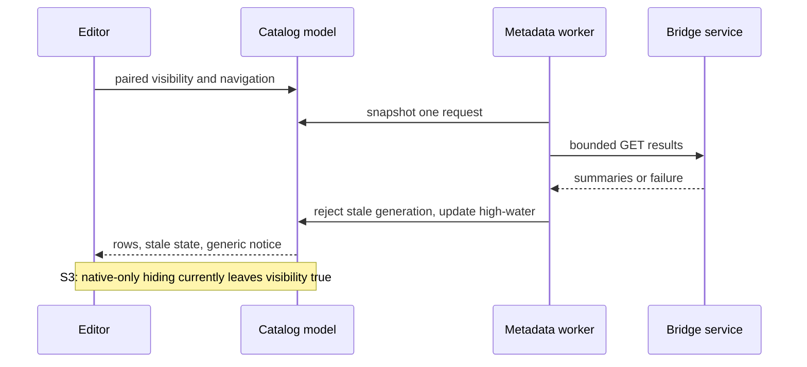

# Logic AU result catalog — external gate cycle 7

## 判定: Approve

Self-review verdict rules permit `Approve` with confirmed `should` findings. This is not a clean outer-controller gate: **must 0 / should 3 / ask 0 / nit 0 / imo 0**. The caller owns the required corrections and its stricter final gate.

## Contract and baseline

- Skill: `/Users/takuya/.agents/skills/self-review/SKILL.md`; review-only `--dry-run`.
- Caller: `omo-ultrawork mode ulw-execute Phase6 iteration7 externalgate`.
- Repository: `/Users/takuya/workspace/github.com/AniP-gt/ACE-Step-DAW`.
- Branch: `feat/v0.1.0-logic-result-catalog`.
- Base and HEAD: `f59fb41b1cd40989fa8132bfb8cd606b11dff8ac`; target is the complete working-tree product diff plus new files.
- Risk floor: medium; API authorization/data integrity and native lifecycle received deeper review.
- Product output language: English, following AGENTS.md.
- Goal: approved phase-1 result discovery, explicit selection/Fetch, existing verification/export path, generic in-plugin availability notice, bounded visible background polling, session/navigation epochs and cache preservation.
- Explicit Fetch may re-download. Offline reuse of a selected result is not an approved promise.
- No fixes, commits, branches, stash, posts, installation or Logic interaction by this reviewer.

### Scope

Tracked changes: `docs/design/LOGIC_BRIDGE_USAGE.md`, `plugins/logic-bridge/CMakeLists.txt`, `plugins/logic-bridge/README.md`, `plugins/logic-bridge/src/Plugin.cpp`, `plugins/logic-bridge/tests/processor_probe.cpp`, `server/logic-bridge/README.md`, `server/logic-bridge/routes.ts`, `shared/logic-bridge/types.ts`, `tests/server/logicBridge.test.ts`.

New product/spec/test files: `openspec/specs/logic-bridge-results/spec.md`, `plugins/logic-bridge/src/ResultCatalogClient.h`, `plugins/logic-bridge/src/ResultCatalogState.h`, `plugins/logic-bridge/src/ResultCatalogView.h`, `plugins/logic-bridge/tests/result_catalog_probe.py`, `plugins/logic-bridge/tests/result_catalog_test.cpp`. Review reports are bookkeeping/evidence, not executable product changes.

### Dependency and external contract baseline

Working-tree manifests/lockfile are authoritative in local diff mode. JUCE is pinned to 8.0.6 by `plugins/logic-bridge/CMakeLists.txt:5`; installed pinned source under `plugins/logic-bridge/.cache/JUCE-8.0.6` was inspected. Root `package-lock.json` resolves TypeScript 5.9.3, Vitest 4.1.2, tsx 4.21.0 and Vite 6.4.1. No dependency version changes are proposed.

Context7 is unavailable. The relevant JUCE contract was checked against pinned source: `juce_Component.cpp:337` (Component visibility), `juce_NSViewComponentPeer_mac.mm:465` (minimization), `:470` (native window visibility), `juce_Network_mac.mm:884` (cancellation), and `juce_audio_plugin_client_AU_1.mm:1687` (AU host holder). Source identifier: JUCE tag 8.0.6, https://github.com/juce-framework/JUCE/tree/8.0.6/modules . No unsupported API/version finding is asserted.

## Specification review

The approved plan and living spec agree on bounded collection, scope parity, ready-only joins, insertion-order cursors, baseline/high-water notification rules, navigation isolation, explicit transfer and visibility gating. Empty/invalid cursors, old persisted entries, hidden/reopened editors, credential replacement, host restore, failed reads and concurrent append are defined. No unanswered product decision was found. Native physical visibility exposes an implementation mismatch, not a new requirement.

## Risk map and behavior comparison

| Unit / consumer | Before → after | Hidden reach / guardrail | Closure |
|---|---|---|---|
| Result API / native catalog | Detail-only → bounded scoped collection | Existing persisted results/jobs; ready join, session positions, authorization and restart tests | No new auth, migration or detail/asset contract change found |
| Browser/MCP detail consumers | Existing detail result and exported UUID unchanged | Search `logic_export_result`, `/results/`, result UUID controls; existing browser guidance | S2 |
| Editor lifecycle / AU holder | No metadata poll → independent visible paired poll | JUCE parent hierarchy and native peer have distinct visibility semantics; state/probe tests | S3 |
| Metadata replies / editor navigation | No catalog → immutable credential/session request plus generation/navigation rejection | Delayed responses, pairing/restore, older-page display, high-water model tests | Reviewed guards close stale adoption concerns |
| Capture / Fetch / cache | Existing transfer pipeline → explicit selected-ID dispatch, capture reservation | Armed/pending capture, upload/finalize, verified-cache and writable exports | Reviewed reservation and eligibility guards; supplied repair7 regressions |
| Worker shutdown | Existing command worker plus metadata worker | Five-second watchdog and stop-control cancellation; no processor mutex during cancel/join | Supplied 3.8 ms shutdown evidence; pinned cancellation source inspected |

Failure-mode ledger: hidden native-peer polling is new; hidden JUCE-Component polling was repaired but did not cover native-only visibility. Stale reply replacement is prevented by generations. Capture loss due to result overwriting its pending slot is improved by `captureReserved`. Existing direct-command network behavior is not changed into a new retry guarantee.

Human review priorities: native physical visibility, retained cache/state isolation, and honest host verification claims. No SQL/replica, migrations, CI configuration, opaque binary replacement, or shared-code extraction is introduced.

## Findings

### S1 — should(low): Update the completed AU installation status

`docs/design/LOGIC_BRIDGE_USAGE.md:58` says the catalog AU has not yet been installed, but the final dated host preflight records installation with matching SHA-256 and successful auval; retain the separate statement that the Logic UI workflow remains unverified.

Evidence: `.omo/evidence/logic-au-result-catalog/logic-host/preflight.txt:16` through its final entry. Earlier uninstalled entries were superseded. Suggested correction: distinguish the installed and auval-validated AU from the still-unverified Logic editor, Fetch, placement and playback workflow. This is a documentation accuracy issue, not a claim that Logic QA passed.

### S2 — should(low): Align the browser fallback instructions with the renamed AU controls

`plugins/logic-bridge/src/Plugin.cpp:213` and `:237` rename the manual action to Fetch UUID and hide it behind Advanced, while `src/components/logicBridge/LogicBridgePanel.tsx:70` still instructs users to click the nonexistent Fetch result control without opening Advanced.

The existing manual fetch command is still connected at `Plugin.cpp:224`; the defect is navigation guidance. Suggested correction: describe selecting a result in the AU, or opening Advanced, entering Result UUID and choosing Fetch UUID. No browser feature expansion is needed.

### S3 — should(medium): Include native peer visibility in the catalog polling predicate

`plugins/logic-bridge/src/Plugin.cpp:236` uses only Component::isShowing(), so hiding the native peer while keeping JUCE Component flags visible leaves the catalog visible and permits a five-second background poll while the editor window is hidden.

This is confirmed for the current processor/editor, not inferred from unavailable Logic automation. JUCE 8.0.6 `Component::isShowing()` recursively tests Component flags and then `!peer->isMinimised()`, whereas native peer `isShowing()` checks NSWindow visibility. The AU wrapper retains a visible holder attached to the host NSView. The bounded native harness used `holder.getPeer()->setVisible(false)` without changing Component flags: BEFORE component=1/peer=1/catalog visible=1; HIDDEN component=1/peer=0/catalog visible=1; after 5800 ms catalog remained visible and one new request occurred. Receipt: nativeExit=0, requestCount=2, requestsWhileNativePeerHidden=1. Actual Logic orderOut behavior was not exercised.

Evidence: `.omo/evidence/logic-au-result-catalog/native-visibility-probe/native_visibility.cpp:19`, `runtime.log`, `receipt.json`, `commands.json`. Suggested correction: require effective native peer/window visibility in addition to Component visibility, preserving the transition/epoch guard; add native-only hide/show coverage. This is a local polling/lifecycle defect with bounded extra requests, so `should(medium)`, not a data-loss or security `must`.

## Investigated and withdrawn concerns

- Busy row selection could re-enable Fetch: withdrawn for the current code; `ResultCatalogView.h:41` sets paired/busy eligibility before updating content, and `:58` / `:71` reuse `canFetch()`.
- Accepted pending Capture could be overwritten by result Fetch: withdrawn; `Plugin.cpp:36` reserves capture under the processor mutex and rejects result commands while reserved; finalization clears the reservation only after upload.
- Parent Component hide could leave stale catalog activity: the Component hierarchy path is repaired by `Plugin.cpp:236`; that closure does not cover S3's distinct native-peer-only path.
- Metadata cancellation could hold the processor mutex or wait until the whole watchdog deadline on destruction: withdrawn; `Plugin.cpp:13`, `ResultCatalogClient.h:15-29` signal and cancel outside the processor mutex before joining. Supplied runtime receipt reports prompt shutdown.
- Explicit Fetch should reuse offline cache: withdrawn against the approved scope; explicit Fetch may re-download. Polling, selection and paging still do not invoke audio fetch.
- Latest polling could replace an older page or lower the notification mark: withdrawn by `ResultCatalogState.h:42-48`, independent navigation epoch and max high-water update.

## Codex review results

- Codex execution: **OK**. Discovery exit 0; cross-verification exit 0. CLI 0.169.0, requested model `gpt-6.1-sol`.
- Discovery combined the normal and heavy adversarial perspectives in **one fresh high-effort execution**, not two independent executions. It reviewed the full product diff and new files without old findings/approval priming.
- Command: `codex exec --sandbox read-only --ephemeral -C <repo> -m gpt-6.1-sol -c model_reasoning_effort=high -o /tmp/logic-c7-external/output-iter1.md <prompt> < /tmp/logic-c7-external/input-iter1.diff`.
- Codex verdict: PASS; confidence MEDIUM. Sole discovery finding: native parent invisibility. Its confidence explicitly excludes actual Logic UI, OS drag and VoiceOver.
- CLI state model run passed: 606007 prefixes, 1044 successful completions, depth <=6, two sessions, three IDs. Its processor/UI attempt encountered `juce_TemporaryFile.cpp:115` in the read-only environment before entering the test; this is not counted as a successful UI run.
- Separate low-effort Codex cross-verification confirmed both Axis A text concerns and distinguished installation from actual Logic UI QA.
- Discovery diff SHA-256: `9bbed9b3a71ac3b336096729ab35c288ab95458ff8e0b1a2d915fcbe8725582a`.
- Discovery output SHA-256: `415861b0a5eefd6ab43e006cd3e4a2c5ea1ccbc20be045c96bdff524169e6622`.
- Cross-verification output SHA-256: `fc98af0bc9af58dbd66b5a057381f58e96008ade708813a8215cf1974652919d`.

| Finding | Axis A | Codex | Cross-verification / adoption |
|---|---|---|---|
| S1 installation wording | proposed | CONFIRMED | Exact final preflight entry contradicts the new doc claim |
| S2 fallback guide | proposed | CONFIRMED | Actual labels and Advanced visibility refute the old instructions |
| S3 native-only hidden poll | source verified after B | proposed | Pinned JUCE source plus bounded current-processor/editor native-peer harness confirm |

No Codex-only finding was silently discarded. No open rebuttal remains. Convergence: one discovery iteration; all findings are confirmed, with no additional speculative concern retained.

## Flow

The existing manual audio pipeline remains a separate explicit Fetch action. Metadata failure retains rows and audio; older-page navigation does not notify or replace the cached audio.

## Verification limits

Phase 4b: skipped (caller contract).

The bounded native visibility counterexample was supplied by the caller's independent QA lane and its source/runtime/receipt were read here. It is not an actual Logic-host result. The caller also supplied repair7 native UI, capture/cache/SHA, shutdown, browser and regression evidence; those are not represented as runs initiated by this reviewer. Actual Logic catalog pairing, banner, selection/Fetch, OS placement, save/reopen playback and VoiceOver remain unverified under the user's accepted host-interaction exception. The AU installation and auval success are observed in the final preflight record; Logic automation and CUA were blocked.

PR-template review: N/A (local diff mode). Existing PR reviews: none supplied. Prior external M1/busy, M2/Component-holder and S1/shutdown concerns are not re-raised as duplicates; S3 is a different native-peer-only visibility path. No merge/release or compatibility approval is asserted.

## Counts and iteration history

| Iteration | must | should | ask | nit | imo | Codex | Verdict |
|---|---:|---:|---:|---:|---:|---|---|
| 1 | 0 | 3 | 0 | 0 | 0 | OK, exit 0 | Approve |

Priorities: should(medium)=1; should(low)=2; all other priority/prefix combinations=0. Fix log: not applicable (review-only). User decision items: none. No database queries are pending.

Phase 5: skipped (local diff mode).
Phase 5b: skipped (local diff mode).

## Artifact integrity and cleanup

Only this report is authored by this lane. Product fingerprints are compared before/after; concurrent review reports are accounted for separately. Temporary CLI inputs, prompts and outputs are removed after recording their hashes and results. No processes or fixtures were left running by this lane.

Fingerprint receipt: no product file changed during this lane. Other review reports observed: none.
Scratch cleanup receipt: `/tmp/logic-c7-external` inputs, prompts, logs, outputs and fingerprint snapshots removed; CLI discovery and verification processes exited 0.
