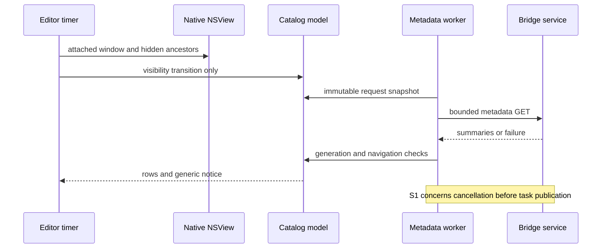

# Logic AU result catalog — external final gate cycle 9

## 判定: Approve

The self-review verdict table permits Approve with confirmed should findings. This is **not a clean outer-controller gate**: must 0 / should 1 / ask 0 / nit 0 / imo 0. The caller owns fixes and its stricter gate.

## Contract and baseline

- Skill: `/Users/takuya/.agents/skills/self-review/SKILL.md`, review-only `--dry-run`.
- Caller: `omo-ultrawork ulw-execute Phase6`, final iteration 9.
- Repository: `/Users/takuya/workspace/github.com/AniP-gt/ACE-Step-DAW`.
- Base and HEAD: `f59fb41b1cd40989fa8132bfb8cd606b11dff8ac`; working tree `feat/v0.1.0-logic-result-catalog`.
- Full taskwide current diff plus all new product/spec/test files; no old approval was substituted for this review. Review reports are bookkeeping/evidence.
- Risk floor: medium. No fixes, commits, branch/stash operations, posts, install, or host interaction by this lane.
- Language: English project artifact under AGENTS.md.
- Goal: session-scoped ready-result catalog, native selection/explicit Fetch through existing integrity/export behavior, generic availability notice, visible-only bounded background metadata polling, stale request/navigation rejection and cache preservation.
- Explicit Fetch may re-download. Offline cache reuse, OS notifications, automatic Logic placement, model generation changes, and release are outside this phase.

### Reviewed files

Tracked: `docs/design/LOGIC_BRIDGE_USAGE.md`, `plugins/logic-bridge/CMakeLists.txt`, `plugins/logic-bridge/README.md`, `plugins/logic-bridge/src/Plugin.cpp`, `plugins/logic-bridge/tests/processor_probe.cpp`, `server/logic-bridge/README.md`, `server/logic-bridge/routes.ts`, `shared/logic-bridge/types.ts`, `src/components/logicBridge/LogicBridgePanel.tsx`, `tests/server/logicBridge.test.ts`.

New: `openspec/specs/logic-bridge-results/spec.md`, `plugins/logic-bridge/src/NativeVisibility.h`, `plugins/logic-bridge/src/NativeVisibility.mm`, `plugins/logic-bridge/src/ResultCatalogClient.h`, `plugins/logic-bridge/src/ResultCatalogState.h`, `plugins/logic-bridge/src/ResultCatalogView.h`, `plugins/logic-bridge/tests/native_visibility_probe.mm`, `plugins/logic-bridge/tests/result_catalog_probe.py`, `plugins/logic-bridge/tests/result_catalog_test.cpp`.

## Dependency and external contract baseline

Local manifests and lockfiles are authoritative. JUCE is pinned to 8.0.6 in CMake; root lock resolves TypeScript 5.9.3, Vitest 4.1.2, tsx 4.21.0 and Vite 6.4.1. No dependency change is introduced. Context7 is unavailable; relevant behavior was checked against pinned installed JUCE source, the local Apple SDK headers and current build evidence.

- JUCE tag source: https://github.com/juce-framework/JUCE/tree/8.0.6/modules . Installed source: `plugins/logic-bridge/.cache/JUCE-8.0.6`.
- `juce_NSViewComponentPeer_mac.mm:335` returns NSView as the native handle; `:465` and `:470` distinguish minimization and native visibility. The AU wrapper attaches its holder to the host NSView.
- AppKit SDK `NSView.h:93` declares `isHiddenOrHasHiddenAncestor`; its deprecated canDraw guidance explicitly recommends window/hidden-ancestor checks. `NSWindow.h:398` / `:435` declare minimization and visibility.
- NativeVisibility.mm reads those properties only from editor visibility/timer callbacks, with null/view-window guards, and performs no networking or file I/O. CMake adds its Objective-C++ source privately on Apple and links the owned native fixture with Cocoa; successful current build/link evidence covers adoption.
- JUCE network cancellation/start ordering is the subject of S1 below; this finding uses the branch's exact pinned implementation, not current upstream assumptions.

## Specification review

Approved plan/spec define API fields, authorization parity, ready joins, stable insertion cursors, publication high-water behavior, bounded requests, silent baseline, stale-response rejection, explicit audio transfer and native visibility. No unresolved product choice was found. The fallback UI labels now agree. GUI/host verification is explicitly limited; installation/auval is distinguished from actual Logic workflow validation.

## Risk map and consumer comparison

| Unit / consumer | Before → after | Hidden reach and guardrail | Result |
|---|---|---|---|
| Results API / native list | Individual detail → additive bounded collection | Existing persisted arrays, ready jobs, cross-session role parity, live append/restart cursor tests | No auth/detail/asset regression found |
| Browser and MCP export | Detail result/UUID unchanged; browser gains accurate instructions | Searches for result endpoints, logic_export_result and old button copy; panel tests and actual DOM text provenance | Old guidance concern closed |
| Native visibility / embedded AU holder | No list worker → Component plus native NSView/window/ancestor predicate | Seven owned AppKit hidden scenarios, peerless/null and transition-only scheduling | Physical visibility concern closed |
| Catalog lifecycle / navigation | New request snapshots, epochs and runtime high-water | State tests and stale session/restore/hide/delay probes | No stale adoption or old-page replacement found |
| Fetch / Capture / persisted cache | Existing verified audio path with explicit selected-ID call | UI eligibility plus processor capture reservation; restore/pair races, finalized upload and cache hashes | No new integrity or selection regression found |
| Metadata shutdown | New cancellable HTTP worker and watchdog | Normal in-flight destruction passes; pinned startup token-publication race is uncovered | S1 |

Failure-mode ledger: ordinary active-request cancellation is improved and measured prompt; a startup cancellation that arrives before the underlying task is published can be lost (new metadata path). Existing command-worker timeout behavior is not recast as a new guarantee. Metadata error/backoff retains rows and cache. Generations reject stale replies; hiding increments the generation while reopening retains the same-session baseline.

Human review priorities: S1's startup/cancellation interleaving, native-handle/thread ownership, and the honest host verification boundary. No migrations, replica reads, opaque runtime artifacts, or generalized shared abstraction are added.

## Findings

### S1 — should(medium): Make cancellation survive the underlying connection task startup window

`plugins/logic-bridge/src/ResultCatalogClient.h:29` calls stream->cancel() only once and then exits the watchdog; in pinned JUCE 8.0.6, cancellation between connection creation and task publication can cancel an empty token, after which connection startup proceeds without rechecking cancellation.

Concrete source sequence: `juce_Network_mac.mm:853-862` releases createConnectionLock after creating the connection and then calls connection->start; `:428-431` constructs a new TaskToken before taking its mutex and moving it into the token member; `:402-405` cancellation takes that mutex and cancels only the current token. A shutdown/watchdog cancellation during the gap therefore sets the Pimpl canceled flag but does not cancel the subsequently published task. The initial Pimpl canceled check has already passed. Client-side canceled is only checked after connect/body completion at ResultCatalogClient.h:37, not while the body loop runs at :32-34.

Why it matters: `Plugin.cpp:14` joins the metadata thread during destruction. A lost startup cancellation can leave that join waiting for network completion. The three-second connection setting is an idle timeout, so it does not establish a total bound for a response that keeps making partial progress after the watchdog has exited. This does not invalidate the observed ordinary five-second deadline or 4.13 ms active-request destruction cases; they do not pin the task-publication gap.

Suggested fix: keep the cancellation request effective through underlying task startup, and ensure subsequent connection/body work observes the stop state. Add a deterministic regression that requests stop before task publication and then proves no continuing body/network wait. Do not patch unrelated command HTTP or modify the pinned dependency merely to hide the interleaving.

Evidence status: confirmed static interleaving in exact dependency source; deterministic stalled-start runtime reproduction was **not run** in this gate. No actual Logic freeze, measured unbounded wait, or ordinary-flow failure rate is claimed. The narrowed concurrency condition and no observed data loss support should(medium), not must.

## Investigated and withdrawn concerns

- Native-only hidden polling: closed by Plugin.cpp:237 plus NativeVisibility.mm:4-8. The caller's current-binary fixture proves native-peer/window/peer-view/host-view/ancestor/detached/minimized cases, each hidden for 5.8 seconds with zero requests, followed by quiet baseline resume. It uses the actual 10 Hz timer, not forced visibility calls.
- Old browser Fetch result guidance and uninstalled-AU claim: closed by current panel paragraph and usage guide; the latter records repair7 as historical and preserves the unverified Logic UI boundary. Final repair8 install/registration/auval record is separately explicit.
- Selection could re-enable Fetch during Capture: rejected by ResultCatalogView.h:41, :58, :71 and command captureReserved guard at Plugin.cpp:37; current UI fixture preserves downloaded WAV/state/placement.
- Hidden/repaired/restore responses could replace current catalog: rejected by ResultCatalogState.h:27, :39-48 and credential generation resets.
- Latest poll could replace an older page or lower the notification mark: rejected by distinct navigation guard and max high-water update; pagination does not update the mark.
- Explicit Fetch must reuse offline cache: not an approved requirement. Explicit re-download remains permitted; metadata activity does not fetch or replace audio.
- Calling the AppKit helper could use a wrong native type or polling thread: pinned JUCE native handle is NSView, all helper production calls are GUI visibility/timer callbacks, and no network worker/audio callback calls it.
- Repeated 10 Hz catalog refresh from visibility polling: rejected by showing != visibleToCatalog transition guard and the owned normal-period test (quiet first second, one request over the following period).

## Codex execution and cross-verification

- Execution: **OK**, discovery exit 0. CLI 0.169.0; requested model gpt-6.1-sol, high effort.
- One fresh execution combined normal and heavy adversarial review; this is not represented as two independent executions. It received the current full task diff/new files without prior findings or approvals.
- Command: `codex exec --sandbox read-only --ephemeral -C <repo> -m gpt-6.1-sol -c model_reasoning_effort=high -o /tmp/logic-c9-external/output-iter1.md <prompt> < /tmp/logic-c9-external/input-iter1.diff`.
- Codex verdict PASS; confidence MEDIUM. Sole finding: startup cancellation loss. Axis A independently inspected the referenced start/cancel/Pimpl code and the client/destructor continuation; no disproving recheck or serialized token-publication guard exists on that path.
- CLI independently passed state model 606007 prefixes / 1044 completions, capture/ring tests, and in-memory real-route checks for concurrent append, pagination bounds, publication order, escaped labels, roles and bad cursors. Its native probe stopped on temporary-file restrictions, so no successful native/Logic UI run is claimed from that attempt.
- No Axis A-only finding required a Codex rebuttal. No open rebuttal or discarded Codex-only concern remains.

| Finding | Axis A | Codex | Result |
|---|---|---|---|
| Startup cancellation loss | Exact pinned source confirmed | proposed Needs Attention | Adopted should(medium), static; deterministic runtime not run |

Review convergence: one discovery iteration with confirmed merged finding. No old review approval substitutes for source checks.

## Reused verification provenance and limits

The reviewer independently hashed **all 21** entries from verify-repair8/source-binary-before.json and compared before/after/current: no mismatch. This includes native sources/tests/CMake, all three current binaries and unchanged neighboring capture/cache probes. Persistent-cache before/after JSON snapshots are identical. The current AU SHA is fa34ac1d4cb98e323dd20dcde2db3c1e0721b352584e4f41136da9a4b22563b7.

Read evidence: verify-repair8/verification.md, native.log, source-binary-before/after.json, cleanup-receipt.json; repair8-text/independent-verification.md; final entries of logic-host/preflight.txt. These are caller-owned independent executions, not runs initiated by this lane.

- Seven native hidden cases: zero requests during each 5.8-second hidden period; resumed baseline/no duplicate notice; null/peerless passes; normal five-second polling remains.
- Current UI: 16 HTTP requests, verified keyboard Fetch, busy guard, cache/placement/state invariants; catalog cap/malformed/stale/multi-instance fixture deadline 5012.55 ms and active-request destruction 4.13383 ms.
- Fresh cache/download race, pair/restore race and eight-second finalization pass; persistent native cache unchanged, fixture artifacts cleaned by exact ownership.
- Current CTest 4/4 is reused with matching binary/source provenance, not independently rerun here.
- Text change: actual DOM matches current paragraph, panel 3 tests and TypeScript check pass. This wording-only change has no old-literal consumer and does not need a mirrored new test.
- Caller reports earlier 8811 frontend / 103 server tests and relevant build diagnostics; these unchanged-path checks were not broadly repeated. Known full npm build wasm-target limitation remains baseline, not a fabricated successful build.
- Final AU installed at canonical path and auval passes after scoped normal registration refresh. Source/install content hashes stayed equal. Original Logic project and previous-AU backup remain preserved.
- Actual Logic catalog UI, pairing/Fetch/placement/save-reopen playback, OS drag, VoiceOver and listening are unverified. Host automation remains blocked under the user's accepted implementation/tests delivery exception. Owned AppKit fixtures and auval do not prove those host workflows.

Phase 4b: skipped (caller contract).

## Flow

Metadata and explicit verified audio Fetch remain separate flows. No automatic audio replacement or Logic placement is added.

## Counts and closing record

| Iteration | must | should | ask | nit | imo | Codex | Verdict |
|---|---:|---:|---:|---:|---:|---|---|
| 1 | 0 | 1 | 0 | 0 | 0 | OK, exit 0 | Approve |

Priorities: should(medium)=1; all other prefix/priority combinations=0. Prior cycle7 three should findings are closed; S1 is a distinct startup window, not the already-fixed ordinary in-flight shutdown case. No unanswered product question or SQL query remains. PR template: N/A. No PR reviews supplied. No merge/release approval is implied.

Phase 5: skipped (local diff mode).
Phase 5b: skipped (local diff mode).

## Integrity and cleanup

Only this report is authored by this lane. Product fingerprints are compared before/after; concurrent review reports are accounted for separately. CLI processes completed; temporary inputs/prompts/logs/outputs are removed after recording results and hashes.

Discovery diff SHA-256: `18a7d957c66175e73c2cc63d435c69a274ce8d1c0008fae4a8804e15354b6f01`.
Discovery output SHA-256: `575e89a22786eb9ac31b9f413d510301db48bc200f400822de98527a9e2a8a4a`.

Fingerprint receipt: no product file changed during this lane. Other review reports observed: none.
Scratch cleanup receipt: `/tmp/logic-c9-external` inputs, prompt, output, logs and fingerprints removed. Discovery CLI exit 0; no lane-owned runtime service remains.
