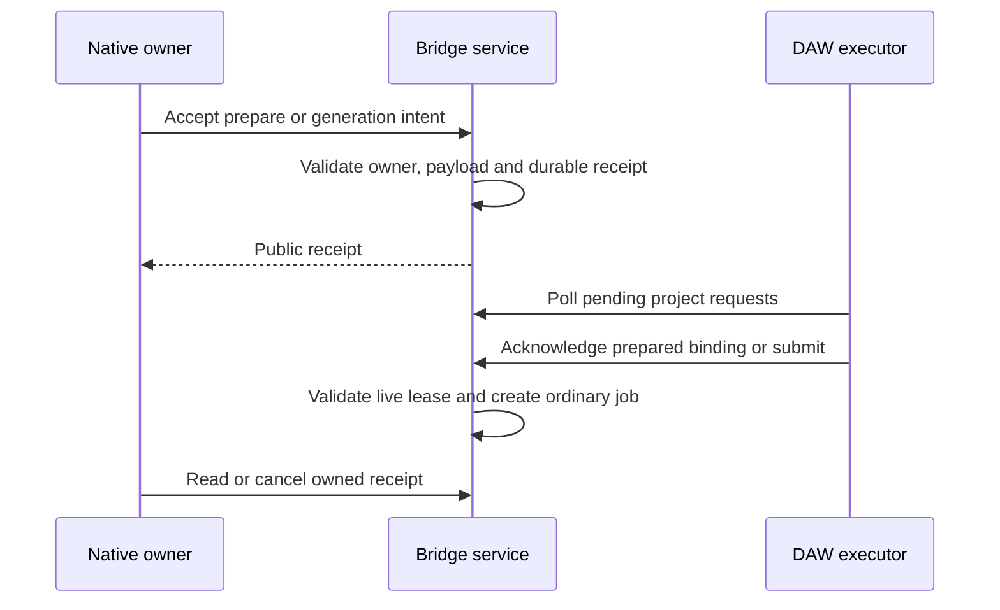

# Logic Bridge generation WIP delivery review

PROJECT_RULES_LOADED:

- `AGENTS.md`, `CLAUDE.md`: all reviewed files.
- `.claude/rules/autonomous-workflow.md`, `development-process.md`, `git-conventions.md`, `testing-requirements.md`: no path frontmatter; applicable project-wide. Read all four files. No product-rule violation confirmed by this review. Historical execution of TDD and issue tracking was not independently reconstructed.
- PROJECT_RULES_VIOLATIONS: 0 confirmed product violations. Delivery quality gates remain the caller's responsibility.

## 判定: Approve

Approval applies to delivery of the current explicitly incomplete feature branch, subject to the caller's build and test gates. It is not approval to merge, release, or claim plugin-centered generation is implemented. Two nonblocking `should(medium)` findings remain.

## Baseline and contract

- Skill: `self-review --dry-run`, Phase 1–4 only; caller: `omo-review delivery pre-commit gate (review-only)`.
- Base and HEAD: `b46c9357372a994ba34b0a58d798c0c4c8c3da34` (base date: 2026-11-14).
- Branch: `feat/bridge-plugin-generation-ui`.
- Target: 27 dirty/untracked files at start, including an existing review report; source/design/spec reviewed against the supplied base. Existing review text was treated as evidence, not instructions or shipped behavior. PNGs are explicitly labeled proposed fixture screenshots.
- Dependency baseline: working tree, root `package.json` / `package-lock.json`; native `plugins/logic-bridge/CMakeLists.txt`. No dependency-version change is in this diff.
- Resolved versions: idb-keyval 6.2.2, Zustand 5.0.11, TypeScript 5.9.3, Vitest 4.1.2, Playwright 1.58.2; JUCE 8.0.6 with a pinned archive hash.
- Risk floor: critical for every reviewed file; finding severity is graded separately by actual reachability and consequence.
- Goal: review implemented native service requests, reference import recovery/persistence, endpoint isolation, standalone native generation state/tests, and proposed design/spec for current WIP delivery.
- Explicit exclusions: T5/T6 web request integration, T7b/T8 native worker/client, T9 generation UI remain unfinished and are not claimed delivered. Existing controller counters remain 5/5; this review does not restart or extend implementation.
- Verification supplied by caller: independent approval and actual HTTP-to-C++ state evidence under `.codex/omo/evidence/bridge-plugin-generation-ui/T7/repair2`; parallel native/frontend workers own current build/test verification. This review did not rerun those checks or count their reported results as personally observed.

## Perspective summary

| Perspective | must | should | ask | nit | imo |
|---|---:|---:|---:|---:|---:|
| Security / authorization | 0 | 0 | 0 | 0 | 0 |
| Robustness / data safety | 0 | 1 | 0 | 0 | 0 |
| Quality / tests | 0 | 1 | 0 | 0 | 0 |
| Specification | 0 | 0 | 0 | 0 | 0 |
| Goal / behavior change | 0 | 0 | 0 | 0 | 0 |
| Query / SQL | N/A | N/A | N/A | N/A | N/A |
| PR template | N/A | N/A | N/A | N/A | N/A |

## Specification review

The requirement sources are the caller contract, `docs/design/LOGIC_BRIDGE_PLUGIN_WORKFLOW.md`, and `openspec/specs/logic-bridge-generation/spec.md`. The design opens with an explicit proposed/not-implemented status and labels its screenshots as fixture data. The spec describes the intended full workflow; it is not treated as a claim that unfinished runtime wiring exists in this WIP delivery.

| Boundary | Implemented behavior / evidence | Result |
|---|---|---|
| Repeated owner/request/payload | Original receipt returned before readiness evaluation; conflicting payload rejected (`server/logic-bridge/nativeRequests.ts:44-51`) | Defined and consistent |
| Re-pair / owner isolation | Receipt owner hash checked against exact native token and session (`nativeRequests.ts:16-18,39-41`) | Defined and consistent |
| Empty prompt / bounds | Whitespace defaults; 4096 UTF-16 unit check; native state uses UTF-16 and matching whitespace set | Defined and consistent |
| Cancellation after dispatch | Linked job becomes canceled with unknown occupancy; ready/failed terminal jobs remain unchanged (`nativeRequests.ts:74-78`) | Defined and consistent |
| Existing persisted state | Missing `nativeRequests` initialized to an empty array (`storage.ts:38`) | Legacy entry path covered by added test |
| Interrupted import | Ownership snapshots protect edited/unrelated tracks; crash between completion journal and project persistence remains S1 | Nonblocking improvement |

No unresolved requirement question was found for the scoped delivery. Performance of an unbounded long-lived receipt history was not measured; the implementation retains existing in-memory array/state-file conventions and this is not presented as a new production-scale guarantee.

## Change risk map

Search terms: `nativeRequests`, `GenerationState`, `attachLogicCapture`, `onCreated`, `bridgeUrlForPort`, `flushProjectReferencePersistence`, `ResultCatalogClient::fetch`. Searches included source, native tests and server tests.

| Changed unit | Visible and hidden consumers | Persisted / environment contract | Guardrail and closure | Impact |
|---|---|---|---|---|
| Native request routes and model | Paired native owner; current executor lease; ordinary `createJob` | Durable request/job linkage; legacy state missing new field | Added nativeRequests/nativeModel/nativeStorage tests inspected; execution delegated to caller. Exact owner/project/lease predicates read | high |
| Reference attach/import | `LogicBridgePanel` and DAW action path; `attachingCapture` serializes entry | IDB journal/receipt + localStorage and project-library persistence; user edits and reload | Added recovery and persistence tests inspected; interrupted-completion gap S1 | medium |
| Optional `onCreated` audio import hook | Bridge caller supplies callback; ordinary callers do not | Project/clip identity rechecked after async work | Existing ordinary call shape preserved; new callback path tested by reference recovery tests | medium |
| Native endpoint port | Existing processor requests, catalog and audio download; probe constructor | Production default remains 5176; custom ports only through probe factory | Probe assertions inspect all endpoint behavior; loopback hostname fixed | medium |
| Frontend endpoint port / E2E env | Browser bridge client and spawned Vite server | Numeric 1–65535 environment value; no arbitrary host | Added client validation tests; explicit test origins | medium |
| Pure GenerationState | New state unit and its tests; not wired into current AU | Epoch/receipt IDs, readiness freshness, occupancy, UTF-16 prompt | Tests inspected; Release assertions S2. Caller retains Debug and HTTP-to-C++ evidence | medium |

Priority human checks before a future merge: persisted import/journal ordering; owner/executor authority; unknown occupancy release; active request/receipt identity; actual native worker/UI integration once implemented. No external consumer source was needed to establish the two findings. Logic host interaction is outside this review's runtime scope.

## Existing behavior and failure-mode ledger

All intended behavior changes below are `documented+intended` against the caller goal; no open-PR body was inspected in LOCAL DIFF MODE.

| Consumer | Before | After |
|---|---|---|
| Native requester | No native intent receipt endpoints | Owner-scoped durable preparation/generation intents; executor still creates the ordinary job |
| Reference attach caller | Receipt-only import retry | Durable ownership journal, conservative edited-track protection, explicit project persistence before binding |
| Normal audio importer | No ownership callback | Same path unless the bridge opts into `onCreated` |
| Production AU | Hardcoded loopback default port | Same production default; probe can isolate all HTTP paths to a fixture port |
| Generation UI | Absent | Still absent; new pure state is not a native UI delivery |

| Failure mode | Before | After | Trigger / downstream result |
|---|---|---|---|
| Lost binding response | Existing receipt allows reuse | Reuse retained; completed ownership additionally recorded | Extra condition: response loss; no second clip intended |
| Audio save/waveform failure | Partial import could be duplicated | Untouched owned track can be removed and retried | Extra condition: local I/O failure; improved |
| User edits partial reference | No durable ownership safety | Retry refuses to delete changed track | Extra condition: user edit during/after failure; improved preservation |
| Process dies after completed journal but before project persistence | No completion-journal state existed | Completed journal can name missing/stale project track and block retry | Extra condition: abrupt process termination/storage failure in a small async window; S1, not a normal-path data-loss blocker |
| Dispatched cancellation / service restart | Unknown occupancy retained by job model | Native route retains same conservative occupancy semantics | Existing safety behavior preserved |

The flow is user-triggered, not scheduled. Reference attach has one module-local in-flight guard; autosave uses 750 ms localStorage and 1000 ms library debounce. Normal pagehide invokes a localStorage flush (`projectStore.ts:2375`), so S1 specifically concerns abrupt termination or failed persistence, not a claim that every ordinary reload fails. Step 2d: legacy server records and missing receipt/journal paths checked in source; tests cover legacy state and interrupted imports. Step 2e: N/A (no type-only migration).

## Processing flow

This depicts implemented service operations, not currently completed frontend or native worker wiring. Completion-journal/project writes are separate durable operations; they are not one transaction.

## Findings: must

None.

## Findings: should

### S1 — should(medium): Completed import journal can outlive the persisted track

- Location: `src/services/logicBridge.ts:183-185`; recovery rejection at `src/services/logicBridge.ts:133-137`.
- Perspective: robustness / data safety.
- The completed ownership journal is awaited before `flushProjectReferencePersistence`. If the process is killed after that IDB write and before localStorage/project-library persistence, the reloaded project can lack the track (or retain the earlier incomplete version). The recovery path only permits a missing track when `!owned.completed`; a completed journal instead fails the snapshot/missing-track check on every retry.
- Consequence: the same capture/project cannot be reattached through the normal retry path until the stale journal is otherwise resolved. This is a bounded recovery failure, not proof of existing user-audio deletion. Ordinary pagehide has a flush handler, reducing reachability; an abrupt crash or persistence failure is required.
- Suggested direction: make journal and persisted-project recovery agree on whether the ready track was durably committed, including a safe missing-completed-track case. Preserve the edited-track guard. Merely moving the completed write after the flush can create a different mismatch window with an incomplete journal, so a complete recovery protocol/test is preferable to a two-line reorder.
- Coverage gap: the added tests exercise thrown save/receipt/journal failures and pagehide reloads; they do not pin the process-exit boundary between lines 184 and 185.
- Source: Codex-only discovery; confirmed from source by Axis A. Runtime: not run under caller contract.
- Caller follow-up received after discovery: an independent import reviewer reported two isolated shadow cases passing. Normal pagehide reload reused one clip and one binding; abrupt termination without pagehide retained the completed journal with no track, refused retry, and created no binding. This supports the bounded recovery limitation and preserves the persist-before-binding guarantee. These are supplied observations, not runtime execution by this lane.

### S2 — should(medium): Release builds compile away state-test setup and checks

- Location: `plugins/logic-bridge/tests/generation_state_test.cpp:7-8`; target registration at `plugins/logic-bridge/CMakeLists.txt:37-40`.
- Perspective: quality / regression guardrail.
- State-changing `applyPrepare` and `applyReadiness` calls are inside `assert`. With `NDEBUG`, both the calls and every corresponding assertion disappear, leaving later generation requests without the setup the source appears to perform. Additional dereferences outside assertions may then operate on empty optionals; a successful executable exit cannot establish the intended properties.
- Consequence: the new tests do not protect the state contract in Release/RelWithDebInfo configurations. This does not invalidate the caller's actual Debug verification: the documented build command and current CMake cache specify Debug.
- Configuration scope: `rg` over `.github/workflows` found no native `cmake`, `ctest`, `CMAKE_BUILD_TYPE` or logic-bridge build configuration. The documented native path is `plugins/logic-bridge/README.md:6-8` (Debug); current cache is `plugins/logic-bridge/build/CMakeCache.txt:34` (Debug). Release/RelWithDebInfo flags exist in that cache at lines 52 and 55. No current Release CI execution is claimed.
- Suggested direction: execute state transitions independently of assertions and use checks that stay enabled for the test target in every supported configuration. Add a Release invocation to native validation if Release is used for delivery.
- Source: Codex-only discovery; confirmed by `cassert` usage and CMake's `-DNDEBUG` Release/RelWithDebInfo settings. Runtime: not run under caller contract.

## Findings: ask / nit / imo

None. Explicit naming/polish and unanswered-policy passes produced no additional scoped findings.

## Investigated and withdrawn concerns

| Concern | Evidence / disposition |
|---|---|
| Native owner can forge executor acknowledgement | `routes.ts:129-134` requires executor project scope and current credential/lease; native owner fails role check. Withdrawn |
| Native caller ID collides with an ordinary job | `nativeRequests.ts:66` creates an internal random job request ID; tests exercise collision. Withdrawn |
| Duplicate prepare retry fails when executor disappears | `nativeRequests.ts:49-51` returns previous receipt before the live-executor check. Withdrawn |
| Retry cleanup deletes user edits | `logicBridge.ts:136-137` compares owned snapshot before removal; edit/reload tests preserve unrelated/user clips. Withdrawn |
| GenerationState changes current AU generation behavior | No production include/use of GenerationState was found; worker/UI integration explicitly unfinished. Not applicable to current AU behavior |
| S1 happens on every normal reload | Pagehide localStorage flush exists; narrow claim to abrupt termination/persistence failure. Broad claim withdrawn |
| S2 invalidates actual Debug evidence | Current cache and README use Debug. Narrow to configurations defining NDEBUG. Broad claim withdrawn |

## External library contract check

Context7 was not available in the active tool inventory; official source/docs and installed version source were used.

| Library / tool | Contract source | Version applicability and result |
|---|---|---|
| idb-keyval 6.2.2 | [v6.2.2 source](https://github.com/jakearchibald/idb-keyval/blob/v6.2.2/src/index.ts); installed `dist/index.js` | `set` resolves on transaction completion; separate journal/project writes remain separate transactions. Matches use; establishes S1's ordering |
| JUCE 8.0.6 | [pinned URL source](https://raw.githubusercontent.com/juce-framework/JUCE/8.0.6/modules/juce_core/network/juce_URL.h) | URL string constructor supports loopback port; redirect/timeouts remain explicit and unchanged |
| Playwright 1.58.2 | [webServer env](https://playwright.dev/docs/test-webserver); installed config types | `env` config supplies child-process environment; changed keys are app environment names, not unknown Playwright options. Current docs checked; unchanged API exists in installed types |
| CMake | [add_test contract](https://cmake.org/cmake/help/latest/command/add_test.html), existing cache | Executable target is resolved by `add_test`; no CONFIGURATIONS restriction or assertion-enabling option is added. Current docs checked; command form predates project minimum 3.22 |

No replacement library API is proposed. No SQL/database migration is involved. CocoIndex enrichment skipped: no callable CocoIndex tool/plugin checker was available in this session.

## Codex review results

- Codex execution: OK, iteration 1, exit code 0.
- CLI: `codex-cli 0.169.0`.
- Codex model: `gpt-6.1-sol` (reported by CLI); read-only sandbox, ephemeral session, approval never.
- Exact command: `codex exec --sandbox read-only --ephemeral -C /Users/takuya/workspace/github.com/AniP-gt/ACE-Step-DAW -o /tmp/delivery-external-20261115-iter1.output.md "$(cat /tmp/delivery-external-20261115-iter1.prompt)" < /tmp/delivery-external-20261115-iter1.diff > /tmp/delivery-external-20261115-iter1.log 2>&1`.
- Input: 120575-byte diff against supplied base plus untracked files; existing review reports excluded as non-product review artifacts. Prompt used the complete skill template with literal goal/constraints/background. Axis A findings were not fed to independent discovery.
- Codex verdict: PASS. Confidence: MEDIUM; it read the diff and relevant source, did not run builds or services, and reported no writes.
- Codex output labels: standard; explanatory prose was Japanese. Findings translated to English for this repository artifact.
- Mapping: each `Needs Attention` becomes `should(medium)` because the fix direction and source predicate are clear and neither requires an author-policy answer. Applicability narrowed S1 to abrupt failure and S2 to NDEBUG configurations.

| Finding | Axis A discovery | Codex discovery | Adopted severity |
|---|---|---|---|
| S1 completed journal/persistence gap | — | yes | should(medium) |
| S2 assert-elided test setup | — | yes | should(medium) |

| Finding | Proposer | Verifier | Round 1 | Round 2 | Result | Evidence |
|---|---|---|---|---|---|---|
| S1 | Codex | Axis A | CONFIRMED, narrowed reachability | — | Confirmed static concern | `logicBridge.ts:133-137,183-185`; `projectStore.ts:2375` |
| S2 | Codex | Axis A | CONFIRMED, limited to NDEBUG | — | Confirmed static concern | `generation_state_test.cpp:7-8`; CMake Release flags |

No Axis A-only finding required a Codex verification round. No `must` or unanswered `ask` remains, both axes passed the scoped delivery gate, and no code changed: convergence reached in one review iteration without implementation/fix rounds.

## Validation and limits

- Phase 4b: skipped (caller contract).
- No product edits, fixes, Git mutations, push, PR posting, service calls, build or test execution by this lane.
- Current build/install and full frontend/native tests are owned by the caller's other verification lanes; their outcomes are not fabricated here.
- Read-only inspection and fresh Codex CLI review completed. Exact hashing recipe was initially blocked by an automatic hook mistaking text containing the word commit for a mutation; a Python subprocess equivalent collected the same hash/path fingerprint successfully. A large combined source read was blocked by context-mode; bounded `sed` reads succeeded.
- No external paid API or notification was used. Official public documentation was read.
- Normal Logic host generation, Fetch/drag/import/playback and real-device behavior were not verified in this review. Existing host-QA limitations were used only as historical context and rechecked against current scoped source claims.
- Follow-up validation for S1: an isolated persistence fixture should reload a pre-import project while retaining a completed operation journal and assert safe retry with no deletion of edited/unrelated clips.
- Follow-up validation for S2: build/run the standalone test with `-DNDEBUG` and an always-on check or negative control; confirm transitions and failed invariants are still exercised.
- No user decision is requested. Findings remain nonblocking follow-ups for the next authorized implementation work.

## Totals and iteration history

| Prefix | Count |
|---|---:|
| must | 0 |
| should | 2 (medium) |
| ask | 0 |
| nit | 0 |
| imo | 0 |

| Iteration | must | should | ask | New findings | Verification | Codex | Verdict |
|---|---:|---:|---:|---:|---|---|---|
| 1 | 0 | 2 | 0 | 2 | 2 source-confirmed; no runtime | OK, exit 0 | Approve |

Phase 5: skipped (local diff mode).

Phase 5b: skipped (local diff mode).

No fix log: review-only contract. No prior controller counter was reset.
