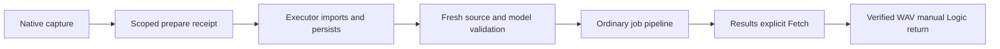

PROJECT_RULES_LOADED:

- AGENTS.md and CLAUDE.md: all reviewed product paths; project artifacts use English.
- .claude/rules/autonomous-workflow.md: workflow and quality gates.
- .claude/rules/development-process.md: source/test changes and runtime evidence.
- .claude/rules/testing-requirements.md: native/frontend/server/browser tests.
- .claude/rules/git-conventions.md: no Git or PR writes in this lane.
- PROJECT_RULES_VIOLATIONS: 0 newly established by this review. Actual-host completion remains pending.

# Task-wide Logic Bridge generation UI self-review

- Skill: self-review, review-only; Phase 1 through Phase 4b.
- Caller: omo-ultrawork final-gate external lane.
- Base: b46c9357372a994ba34b0a58d798c0c4c8c3da34, supplied by caller.
- Head: 6b0e3e1750e332f2bdb4db5199bd6c40a01aa8e0 plus dirty/untracked product files.
- Baseline: working tree on feat/bridge-plugin-generation-ui.
- Dependencies: JUCE 8.0.6; React 19.2.4; Zustand 5.0.11; idb-keyval 6.2.2; TypeScript 5.9.3; Vitest 4.1.2; ws 8.20.0. Versions come from CMake/source and package-lock.json; no package changes.
- Scope: task-wide committed, staged, unstaged and untracked product diff. Historical reviews, pycache and bookkeeping are excluded from product grading. Prototype PNGs are design provenance, not host evidence.
- Risk: critical for authorization/ownership, high for persistence/async submission/native IO, medium for editor interactions. Behavior documents inherit subsystem risk.
- English headings follow project/caller requirements over the skill's Japanese artifact default.

## Verdict: Request Changes

One confirmed should(medium) remains. The caller requires repair of any confirmed must/should before proceeding. No new authorization, privacy, duplicate-inference, source/model-validation or explicit-Fetch blocker was established. This is a code gate, not final Logic-host approval.

## Goal and specification review

Implement the approved native AU workflow: default 640x520, minimum 440x360, maximum 880x720; fixed header/footer and scrolling middle; Connection/Advanced disclosures; capture, durable DAW reference acknowledgement, supported instrument/prompt, existing ordinary generation pipeline, Results, explicit Fetch and manual Logic return. Preserve separately named Direct Cover and automatic Fetch. No AU inference, automatic Logic placement or real-model inference QA.

Sources: docs/design/LOGIC_BRIDGE_PLUGIN_WORKFLOW.md; .codex/omo/plans/bridge-plugin-generation-ui.md superseding resume 6 contract; openspec/specs/logic-bridge-generation/spec.md.

The earlier compact no-scroll proposal is explicitly superseded. Failed accepted replacement preparations must not cause readiness fallback. Definitively rejected POSTs that create no receipt may retain the explicitly displayed previous reference, per plan decision 8 and caller clarification. Conservative unknown after runtime restore is intentional; same-processor automatic recovery is not required. Global ready alone cannot discard an old uncertain intent.



## Findings

### S1 — should(medium) Direct Cover receipt IO lacks a whole-response deadline and body limit

- File: plugins/logic-bridge/src/Plugin.cpp:253 and plugins/logic-bridge/src/Plugin.cpp:284-285; shared helper at plugins/logic-bridge/src/Plugin.cpp:163-176.
- Perspective: robustness / bounded native IO.
- Issue: New Direct Cover submission and receipt polling call request(), which sets a connection timeout but reads the entire response without an absolute deadline or byte cap. Streaming progress can keep the single worker occupied beyond the intended bound. Expected small receipt schemas do not enforce transport bounds.
- Runtime evidence: A console probe linked the existing built JUCE 8.0.6 core objects and executed the same URL/InputStreamOptions/JSON-read sequence against an owned loopback fixture. An eight-chunk JSON response arriving once per second with connection timeout 3000ms produced status=200 elapsed_ms=7066.79 payload_chars=300000. No GUI, actual bridge/API/model, or native result cache was used. The owned listener stopped and its port rebound successfully.
- Impact: Direct Cover receipt IO exceeds the intended response deadline and accepts more metadata than the new generation client's cap. This does not claim normal bridge receipts exceed the cap or that a simple no-data stall is necessarily infinite.
- Fix: Apply the existing GenerationClient-style 5-second absolute deadline and 256 KiB metadata cap to Direct Cover requests. Preserve unknown/no-rePOST handling for uncertain submissions. Capture finalization and WAV transfer retain their separate appropriate contracts; timeout must not imply backend occupancy release.
- Verification: Native HTTP regression for progressing slow/oversized responses, bounded completion and teardown, unknown outcome if submission might have started, and no second POST. Preserve Direct Cover normal/lost-response/race/recovery and native-generation regressions.
- Origin: Codex-only discovery, confirmed by integrated Axis A source inspection and actual JUCE execution. Round 2 maintained the narrowed claim. Needs Attention maps to should(medium) because the required mitigation follows the explicit bounded-IO contract.

## Perspective summary

| Perspective | must | should | ask | nit | imo |
|---|---:|---:|---:|---:|---:|
| Security / owner privacy | 0 | 0 | 0 | 0 | 0 |
| Robustness / data safety | 0 | 1 | 0 | 0 | 0 |
| Quality / maintainability | 0 | 0 | 0 | 0 | 0 |
| Specification | 0 | 0 | 0 | 0 | 0 |
| Goal | 0 | 0 | 0 | 0 | 0 |
| Behavior disclosure | 0 | 0 | 0 | 0 | 0 |
| Query/SQL and PR template | N/A | N/A | N/A | N/A | N/A |

## Change risk map and behavior comparison

| Unit / consumers | Before to after; hidden impact | Guardrail / conclusion |
|---|---|---|
| Native requests/routes/types; native owner and executor | Generic jobs remain inaccessible to native role; intents pin project and strict owner. Internal job client IDs differ from caller IDs. Adds persisted pending/prepared/submitted records and scoped invalidation. | HTTP tests cover replay/conflict/privacy/lease/invalidation/no old accepted fallback. Ownership, public-receipt fields and submit-parent guards inspected. |
| attachLogicCapture/audioImport/project persistence; ordinary imports and bridge | Optional guard/onCreated leaves existing import callers compatible. Journals and exact snapshots protect edited/user tracks. Durable save precedes acknowledgement. | Reference recovery tests cover save failure, reload, same-project re-pair and edited incomplete tracks; scoped tests pass. |
| Executor/reconciliation; native and ordinary manual jobs | Native-only projected nativePreparedRequestId activates fresh source checks. Rechecks after awaited canonical download/transition and before ordinary pipeline entry; manual jobs preserve prior route. | Executor/reconciliation tests pass; caller actual-browser source-edit test reports zero model calls. |
| GenerationState/client/worker; editor and host state | Epoch/immutable identity, UTF-16 default/boundary, no uncertain rePOST, and occupancy states added. Credentials excluded from saved AU state. | Native state executables pass; caller native fixtures/CTest; S1 identifies separate Direct Cover helper gap. |
| Editor/catalog/export; compact/standard/expanded users | Fixed header/footer, middle scroll, processor-owned reopened mode; selection separate from WAV; Fetch clears active export, generation does not auto-Fetch a layer. | Caller actual-component RED/GREEN and visual comparison; actual host focus/drag/lifecycle pending. |
| Direct Cover worker/service/storage | Separate Cover pipeline shares occupancy, restart reconciliation and validated result publication; automatic native Fetch remains. New receipt callers expose legacy helper response bounds. | Caller server/native fixture regressions; actual JUCE probe confirms S1. |
| Pair CLI/environment/Playwright | Adds native-only/existing-session pairing and loopback fixture configuration, no package changes. | CLI/server/e2e tests reported; no real environment/credential file accessed. |

Search terms included native-requests, reconcileReleased, restore, rejectPrepare, request, generationPrepare, nativePreparedRequestId and guard across source/test callers. Hidden/deferred contracts include runtime restore, old project references, owner replacement, in-flight generation and browser reload. External consumers are Logic/macOS and ACE-Step API; installed AU behavior is not inferred. No SQL/replica changes. Human focus: ownership/derived IDs, durable acknowledgement, final source/model guards, S1 bounds and actual host lifecycle.

## Investigated and withdrawn concerns

| Concern | Evidence and disposition |
|---|---|
| F1: old capture after rejected replacement | Pure-state output: F1 rejected replacement: canGenerate=1 usedCapture=capture-a. Plan decision 8 permits the visibly identified confirmed reference when a new POST is not accepted. Server appends only accepted preparation records. Caller clarified this boundary; Codex round 2 WITHDRAW. Failed accepted receipts still govern latest readiness. |
| F2: unknown remains after restore/re-pair | Pure-state output: F2 after restore/re-pair/new prepare/ready: unknown=1 canGenerate=0. reconcileReleased has no product caller. Codex round 2 UNSURE on the same-processor recovery requirement. Caller explicitly confirms conservative retention and processor recreation after operator reconciliation; automatic same-processor recovery is not required. Nonblocking limitation, not a code defect; never clear solely from global ready. |
| Simple no-data stall necessarily lasts forever | Exact JUCE mac source maps timeout to NSURLRequest.timeoutInterval. Withdraw that unproved wording; S1 is limited to demonstrated progressing-response deadline/body bounds. |

Existing-review declaration: LOCAL DIFF MODE, no PR comments/reviews fetched. Earlier scoped reports/caller results are background, not independent discoveries. No stale fixed scoped finding is re-raised.

## Codex review results

- Execution OK: fresh codex exec --sandbox read-only --ephemeral with task-wide product diff on stdin, no source edits. CLI v0.169.0, model gpt-6.1-sol.
- Discovery exit 0: advisory FAIL, confidence MEDIUM; one Critical and two Needs Attention candidates.
- Cross-verification: second fresh read-only Codex call exit 0; F1 WITHDRAW, F2 UNSURE settled by caller scope clarification, F3 MAINTAIN narrowed to transport bounds.
- Consolidation: 0 must, 1 should, 0 unresolved ask, 0 nit, 0 imo. Request Changes follows the caller's stricter must/should gate.

| Item | Discovery | Integrated verification | Round 2 | Final |
|---|---|---|---|---|
| F1 old displayed reference | Codex | Contract decision 8 refutes defect | WITHDRAW | Withdrawn |
| F2 same-processor unknown recovery | Codex | Reproduced; conservative intent | UNSURE, caller settles scope | Nonblocking limitation |
| S1 response bounds | Codex | Actual JUCE reproduction confirms | MAINTAIN narrowed | should(medium) |

No independent fix loop started. Caller owns repairs and global iteration 10. Phases 5-9 not run; no PR comments, commits, pushes, stashes or branch changes.

## External library contract check

Context7 unavailable; official references and exact source used.

- JUCE 8.0.6 pinned CMake/source: [WebInputStream documentation](https://docs.juce.com/master/classjuce_1_1WebInputStream.html) documents cancellation and connection timeout. This unversioned page is supporting reference; version authority is .cache/JUCE-8.0.6/modules/juce_core/native/juce_Network_mac.mm:986-996. Linked actual execution establishes S1. GenerationClient already compiles in this plugin, so its current in-repository mitigation is adoptable.
- idb-keyval 6.2.2: [versioned source](https://github.com/jakearchibald/idb-keyval/blob/v6.2.2/src/index.ts) supports awaited IDB operation completion. Actual store tests exercise journal and mocked failure boundaries.
- Zustand 5.0.11: lockfile/installed implementation and actual-store tests form the baseline. Attempted official apis/create URL returned 404 and was not used as evidence. No unverified library-behavior finding issued.

## Local runtime check — self-review Phase 4b

Local C++ console and Vitest; frontend HTTP mocked. Additional owned ephemeral 127.0.0.1 HTTP listener served deterministic JSON to the console JUCE probe. No existing service, port 5176, GUI, Logic project, actual model/API or shared native result directory accessed.

| ID | Scenario | Result | Observed output |
|---|---|---|---|
| S1 | Actual JUCE helper-equivalent read, eight progressing chunks, timeout3000 | Reproduced | status=200 elapsed_ms=7066.79 payload_chars=300000; exit0; listener stop/port rebind PASS |
| F1 | Prepare A, reject B, readiness A, generate | Behavior reproduced; contract-refuted | canGenerate=1 usedCapture=capture-a |
| F2 | Active request, restore, re-pair, new prepared reference and ready | Reproduced; intended conservative limitation | unknown=1 canGenerate=0 |
| R1 | Six scoped frontend Logic bridge Vitest suites | PASS | 6 files /52 tests passed |
| R2 | Existing generation_state_test | PASS | PASS generation state |
| R3 | Existing direct_generation_state_test | PASS | PASS direct generation validation, identity, unknown and stale epochs |

R1 covers logicBridgeExecutor, logicBridgeNativeRequests, logicBridgeReferenceRecovery, logicBridgeReconciliation, logicBridgeClient and logicBridgePersistence. S1 tests actual JUCE HTTP reading linked to current objects, not full processor/Logic behavior; the defect is transport-local.

Caller evidence inspected: resume6/final-npm-test.log reports 8849 frontend and 141 server tests passed. The visual/controller-comparison.md explicitly separates HTML mock, JUCE fixture and Logic-host evidence. Caller reports actual-service browser 2/2 PASS (one intent/job/submission and immediate reload persistence; delayed reference edit -> STALE_BINDING and zero model calls), model unload/reload 10 cycles/20 transitions stable, native build/CTest6 and serial fault/Cover regressions. Historical timeout cause remains unknown; not claimed solved.

## Pending actual-host boundary

Not passed by this report; caller performs after repaired code gate:

1. Installed AU identity and loaded binary UUID in new Logic host, preserving user projects.
2. Actual three sizes, fixed header/footer, middle scrolling, keyboard focus/disclosure return and host accessibility.
3. Actual native AU/service/browser join using deterministic model boundary: pair/capture/durable prepare/instrument/prompt/one job/result/explicit Fetch.
4. Native drag or Finder manual import, signed placement, playback, project save/reopen, cache restore and re-pair.

Real inference/audio quality remain outside QA. Operator reconciliation must settle old uncertain work before processor recreation; global ready alone does not authorize discarding old pending intents.

## Resources and scope

- Scratch owner: taskwide_external_review, /tmp/bridge-taskwide-external-20261116; standalone /tmp/bridge-external-review-fingerprint-before.json.
- Owned Codex PIDs 32869 and 35184 exited0. Owned HTTP server stopped and port rebind passed. No foreign process stopped.
- Product files untouched. Scratch evidence consolidated here before cleanup; this report is the sole intended repository write.
- Prescribed fingerprint shell was blocked by a hook misclassifying command substitution as commit handling; equivalent Python subprocess NUL-delimited path/hash collection used. Report-writing exec was likewise rejected on prose containing command-like text, then written through file patch. Hook settings unchanged; no permission bypass.
- Phase5 and5b skipped: local diff mode/caller owns repairs. English artifact headings are intentional.

## Reproduction sources retained before scratch cleanup

The following standalone probe reads HTTP with the same existing helper operations, linked against the current JUCE8.0.6 core objects.

```cpp
#include <juce_core/juce_core.h>
#include <iostream>
int main(int argc,char** argv){int code=0; auto now=juce::Time::getMillisecondCounterHiRes();auto stream=juce::URL(juce::String(argv[1])).createInputStream(juce::URL::InputStreamOptions(juce::URL::ParameterHandling::inAddress).withHttpRequestCmd("GET").withConnectionTimeoutMs(3000).withStatusCode(&code).withNumRedirectsToFollow(0)); if(!stream)return 2;auto response=juce::JSON::parse(stream->readEntireStreamAsString());std::cout<<"status="<<code<<" elapsed_ms="<<(juce::Time::getMillisecondCounterHiRes()-now)<<" payload_chars="<<response["data"].toString().length()<<"\n";}
```

The owned deterministic HTTP fixture (adjust root to an owned scratch directory):

```python
import http.server,threading,subprocess,time,json,socket,os
from pathlib import Path
root=Path('/tmp/bridge-taskwide-external-20261116')
class H(http.server.BaseHTTPRequestHandler):
 def log_message(self,*args):pass
 def do_GET(self):
  body=json.dumps({'data':'x'*300000}).encode();self.send_response(200);self.send_header('Content-Length',str(len(body)));self.end_headers()
  for i in range(8):
   begin=i*len(body)//8;end=(i+1)*len(body)//8
   self.wfile.write(body[begin:end]);self.wfile.flush();time.sleep(1)
s=http.server.HTTPServer(('127.0.0.1',0),H);port=s.server_port
(root/'http-resource.json').write_text(json.dumps({'pid':os.getpid(),'port':port,'address':'127.0.0.1'}))
t=threading.Thread(target=s.serve_forever);t.start()
try:
 p=subprocess.run([str(root/'native-http'),'http://127.0.0.1:'+str(port)],capture_output=True,text=True,timeout=15)
 print('returncode',p.returncode,p.stdout,p.stderr);(root/'native-http.log').write_text(p.stdout+p.stderr)
finally:
 s.shutdown();s.server_close();t.join()
 with socket.socket() as check:check.setsockopt(socket.SOL_SOCKET,socket.SO_REUSEADDR,1);check.bind(('127.0.0.1',port))
 print('owned server stopped, port rebind PASS')
```

Reviewed product paths supplied to independent Codex:

- docs/design/LOGIC_BRIDGE_PLUGIN_WORKFLOW.md
- docs/design/LOGIC_BRIDGE_USAGE.md
- openspec/specs/logic-bridge-direct-cover/spec.md
- openspec/specs/logic-bridge-generation/spec.md
- playwright.config.ts
- plugins/logic-bridge/CMakeLists.txt
- plugins/logic-bridge/README.md
- plugins/logic-bridge/src/DirectGenerationState.h
- plugins/logic-bridge/src/GenerationClient.h
- plugins/logic-bridge/src/GenerationState.h
- plugins/logic-bridge/src/Plugin.cpp
- plugins/logic-bridge/src/ResultCatalogClient.h
- plugins/logic-bridge/src/ResultCatalogView.h
- plugins/logic-bridge/tests/direct_cover_probe.py
- plugins/logic-bridge/tests/direct_generation_state_test.cpp
- plugins/logic-bridge/tests/generation_state_test.cpp
- plugins/logic-bridge/tests/generation_workflow_probe.py
- plugins/logic-bridge/tests/processor_probe.cpp
- server/logic-bridge/README.md
- server/logic-bridge/directCover.ts
- server/logic-bridge/directCoverAudio.ts
- server/logic-bridge/directCoverWorker.ts
- server/logic-bridge/jobs.ts
- server/logic-bridge/main.ts
- server/logic-bridge/nativeRequests.ts
- server/logic-bridge/routes.ts
- server/logic-bridge/service.ts
- server/logic-bridge/storage.ts
- server/logic-pair.ts
- shared/logic-bridge/types.ts
- src/services/__tests__/logicBridgeClient.test.ts
- src/services/__tests__/logicBridgeExecutor.test.ts
- src/services/__tests__/logicBridgeNativeRequests.test.ts
- src/services/__tests__/logicBridgePersistence.test.ts
- src/services/__tests__/logicBridgeReconciliation.test.ts
- src/services/__tests__/logicBridgeReferenceRecovery.test.ts
- src/services/audioImport.ts
- src/services/logicBridge.ts
- src/services/logicBridgeClient.ts
- src/services/logicBridgeExecutor.ts
- src/services/logicBridgeNativeRequests.ts
- src/services/logicBridgeReconciliation.ts
- src/store/projectStore.ts
- tests/e2e/logic-bridge-generation.spec.ts
- tests/server/logicBridge.directCover.test.ts
- tests/server/logicBridge.nativeModel.test.ts
- tests/server/logicBridge.nativeRequests.test.ts
- tests/server/logicBridge.nativeStorage.test.ts
- tests/server/logicClient.test.ts
- tests/support/logicBridgeGenerationFixture.ts

Final fingerprint comparison excluding this report: none; product files unchanged.


# Iteration 10 task-wide re-review and S1 closure

## Current verdict: Request Changes

S1 is fixed. A fresh task-wide independent review identified two separate issues below, verified against frozen source and local execution. This section supersedes the initial finding counts: one must(high), one should(medium), no unresolved ask/nit/imo. The caller retains actual Logic-host verification as pending. No product fixes were made in this lane.

## Reused baseline and changed surface

The same supplied base and previous risk map apply. All 50 product files, including untracked files, were supplied again to an independent fresh Codex CLI. Exact source hashes match the earlier review for GenerationClient.h (410ee243...), server nativeRequests.ts (114d5366...), routes.ts (4f6e51a5...), logicBridge.ts (eabb6a23...) and logicBridgeExecutor.ts (bd5c6bb0...). Thus earlier security/persistence/source validation evidence remains provenance-labelled reusable evidence, rather than a claim that every unchanged runtime case was repeated.

The implementation delta routes Direct Cover POST, GET-by-server-ID and owner lookup through existing GenerationClient, preserving capture binary/finalization separately. Native probe/fixture changes exercise the response limits. Three behavior documents add the intended manual recovery guidance. The latest fresh discovery found a pre-existing-in-this-task accepted-preparation gap and a new documentation scope error; neither changes the previously settled unaccepted-POST interpretation.

## S1 — fixed

Plugin.cpp now dispatches exact /direct-jobs, /direct-jobs/ and /direct-jobs? request forms to GenerationClient. The existing primitive uses an immutable credential snapshot, no redirects, a five-second watchdog and 256 KiB response cap. Parsed definitive 4xx is preserved as rejection; malformed, oversized or deadline-expired responses remain uncertain rather than being resubmitted or releasing backend occupancy. Legacy capture binary PUT and 30-second finalization path remain separate.

Independent current-built-processor runtime checks, without creating an editor or visible window:

| Scenario | Observed output | Counts | Teardown |
|---|---|---|---|
| JSON409 submit | PASS definitive rejection by 15.1302 ms, pass-through and no fetched WAV | submissions1, lookups0, fetches0 | listener stopped, port rebound |
| Progressing slow submit | PASS unknown by 5011.37 ms, pass-through and no fetched WAV | submissions1, lookups1, fetches0 | listener stopped, port rebound |

Commands used the existing direct_cover_probe.py, current build/processor_probe_artefacts/Debug/processor_probe and --limits-rejected/--limits-slow --target-submit, with isolated output roots under the registered rereview scratch directory. No actual model/API, port5176 or shared output cache was used.

Caller evidence inspected: resume10/native/final/ctest.log 6/6 PASS; normal/lost-response/race/recovery Cover logs and Layer normal PASS; slow poll/lookup around5007/5022ms; oversized submit/poll PASS. The first lookup-oversize log used a1.2second observation window shorter than the1.5second polling retry; lookup-oversize-retry.log with corrected2.5second window passed at1505.25ms. The original log is retained and not described as green. The prior rejected log has an old display phrase; the independent fresh15.1302ms result above is the authoritative current-binary check. Caller cleanup.json records all20 owned resources ended, port rebinds succeeded, no baseline cache changes/new files.

## Current findings

### M2 — must(high) An accepted failed replacement can still generate from the older reference

- File: server/logic-bridge/nativeRequests.ts:63-68 and server/logic-bridge/nativeRequests.ts:93-100; native state counterpart plugins/logic-bridge/src/GenerationState.h:56-65,71-74.
- Perspective: robustness / goal / accepted-reference lifecycle.
- Issue: The server validates that the named older preparation is prepared, but does not require it to be the same owner's latest accepted preparation when accepting or submitting a new generation. The AU also retains old readiness when a newer accepted preparation returns failed/canceled. If the subsequent readiness GET fails, that stale ready state can enable Generate on the old displayed reference; the server accepts it and creates an ordinary job.
- Contract: The superseding resume6 plan explicitly requires readiness to consider the latest accepted prepare regardless of state and never fall back after a failed/canceled replacement. This is distinct from a definitively rejected POST before acceptance, which remains allowed to use the old explicitly displayed confirmed reference.
- Normal path: prepareA acknowledged; prepareB accepted and later failed; AU receives failed receipt; subsequent readiness request fails transiently; old readinessA remains; Generate usesA; accept and executor submit permitA. Old reference may still be source-valid, so existing source/hash/model validation does not reject it.
- Actual native state output: accepted replacement failed; readiness GET unavailable: canGenerate=1 capture=captureA.
- Actual server-function output: {"acceptedLatestFailed":"failed","olderGenerationAccepted":"pending","ordinaryJobs":1}. The reproduction uses the real accept/update functions with synthetic in-memory records and no listener/model/project/real credential.
- Fix: Enforce latest accepted same-owner preparation identity for new generation acceptance and executor submission, while keeping replay of an existing identical request idempotent. Invalidate old native readiness on terminal failed/canceled accepted replacement; do not expand that rule to definitively unaccepted POST rejection. Regression tests must cover failed/canceled latest receipts, transient readiness-fetch failure, and a superseded pending generation, as well as the permitted unaccepted rejection case.
- Axis handling: Codex Critical, independently confirmed by source and executable native/server reproduction. Mapped to must(high): reachable wrong-reference generation violates the explicit accepted-replacement contract.

### S2 — should(medium) Direct Cover recovery documentation claims unknown retention that its state model does not implement

- File: plugins/logic-bridge/README.md:35; source evidence plugins/logic-bridge/src/DirectGenerationState.h:15-19 and plugins/logic-bridge/src/Plugin.cpp:45.
- Perspective: documentation as behavior claim.
- Issue: In the Direct Cover section, the new paragraph says restoring host state or re-pairing conservatively retains unknown. DirectGenerationState.reset() calls pair({}), and pair() always sets idle and clears its active request. Runtime restore invokes direct.reset(); a subsequent pair also resets it. GenerationState's separate conservative layer-mode behavior does not establish this claim for Direct Cover.
- Actual native state output: Direct Cover unknown reset/re-pair: idle=1 busy=0.
- Impact: The manual recovery paragraph conflates the two mode-specific state contracts and tells Cover users that operations remain blocked until processor recreation when the Direct Cover state has already reset. Server occupancy protection still remains; this review does not claim a demonstrated duplicate inference or server occupancy release.
- Fix: Scope the conservative unknown and processor-recreation instructions explicitly to ACE-Step DAW layer state, and describe Direct Cover's actual local reset plus continued server occupancy/reconciliation protection. Alternatively change Direct Cover state only if that additional behavior is explicitly intended; no product expansion is required to correct the document.
- Axis handling: Fresh Codex discovered the state reset. Integrated review narrows the actionable finding to the newly added normative documentation claim, at should(medium), rather than asserting an unapproved same-processor recovery requirement.

## Cross-axis results and runtime checks

- Fresh discovery Codex CLI v0.169.0, gpt-6.1-sol, read-only, ephemeral; full task-wide input, exit0; advisory FAIL, confidence MEDIUM.
- M2 confirmed by integrated review and actual state/server-function reproduction. S2 confirmed against real state methods and narrowed to documentation. No extra speculative finding or independent repair loop started.
- Prior F1 withdrawal remains valid for unaccepted POST rejection. Prior F2 deliberate conservative layer unknown remains a nonblocking accepted limitation. Neither decision is reopened.

| ID | Runtime result | Observed evidence |
|---|---|---|
| S1 | Fixed, independently exercised current processor | definitive40915.1302ms; slow5011.37ms; each onePOST/noFetch/pass-through |
| M2 native | Reproduced | canGenerate1 and captureA after acceptedBfailed without new readiness |
| M2 server | Reproduced | latest failed, older intent pending, ordinaryJobs1 |
| S2 | Reproduced source/document mismatch | Direct Cover reset/re-pair idle1/busy0 |

## Pending host boundary

All earlier actual-installed-AU/Logic identity, sizing/scroll/focus, actual native-service-browser join, drag/manual placement/playback/save/reopen checks remain pending the caller. No real inference/audio-quality claim is made. Source ownership is released only after this lane's final fingerprint and scratch cleanup; the caller owns the next repair iteration.

## Reproduction sources for M2 and S2

```cpp
#include "GenerationState.h"
#include "DirectGenerationState.h"
#include <iostream>
int main(){using S=GenerationState;S s;s.pair("session");auto a=s.beginPrepare("clientA","captureA",1);s.applyPrepare(*a,{"serverA","session","project","captureA",S::PrepareStatus::prepared,"bindingA",{}});s.applyReadiness(s.beginReadiness(),{"serverA",true,{}, {"piano"}});auto b=s.beginPrepare("clientB","captureB",1);s.applyPrepare(*b,{"serverB","session","project","captureB",S::PrepareStatus::failed,{},"IMPORT_FAILED"});auto g=s.beginGeneration("generation","piano",u"x");std::cout<<"accepted replacement failed; readiness GET unavailable: canGenerate="<<bool(g)<<" capture="<<(g?g->request.captureId:"none")<<"\n";DirectGenerationState d;d.pair("session");d.captureReady("session","capture",1);auto q=d.begin("id",u"violin");d.outcomeUnknown(*q);d.reset();d.pair("session");std::cout<<"Direct Cover unknown reset/re-pair: idle="<<(d.status()==DirectGenerationState::Status::idle)<<" busy="<<d.busy()<<"\n";}
```

```typescript
import {accept,update,readiness} from "/Users/takuya/workspace/github.com/AniP-gt/ACE-Step-DAW/server/logic-bridge/nativeRequests.ts";
const state:any={sessions:[],credentials:[],captures:[{captureId:'captureA',sessionId:'s',state:'ready',canonicalSha256:'fixture-hash',canonicalFrameCount:48000}],bindings:[{bindingId:'bindingA',sessionId:'s',projectId:'p',captureId:'captureA',clipId:'clip',canonicalSha256:'fixture-hash'}],jobs:[],nativeRequests:[],directCoverJobs:[],results:[],assets:[]};
const native:any={role:'native',sessionId:'s',token:'synthetic-public-test-token'};
const executor:any={executorId:'e',credentialToken:'synthetic-executor',sessionId:'s',projectId:'p',modelId:'base',instruments:['piano'],seen:Date.now()};
const a:any=accept(state,{sessionId:'s',clientRequestId:'a',kind:'prepare',captureId:'captureA'},native,executor);update(state,state.nativeRequests[0],'prepared',{bindingId:'bindingA'},executor);
const b:any=accept(state,{sessionId:'s',clientRequestId:'b',kind:'prepare',captureId:'captureA'},native,executor);update(state,state.nativeRequests[1],'fail',{error:'IMPORT_FAILED'},executor);
const g:any=accept(state,{sessionId:'s',clientRequestId:'g',kind:'generation',preparedRequestId:a.requestId,instrument:'piano',prompt:'x'},native,executor);update(state,state.nativeRequests[2],'submit',{},executor);
console.log(JSON.stringify({acceptedLatestFailed:state.nativeRequests[1].state,olderGenerationAccepted:g.state,ordinaryJobs:state.jobs.length}));
```

Iteration10 final fingerprint excluding this report: none; no product file changes in review lane.

Independent runtime resource readback: [{"pid": 40569, "port": 64690, "address": "127.0.0.1", "counts": {"submissions": 1, "lookups": 0, "fetches": 0, "injected": true}, "teardown": "server stopped; port rebound successfully"}, {"pid": 40674, "port": 64719, "address": "127.0.0.1", "counts": {"submissions": 1, "lookups": 1, "fetches": 0, "injected": true}, "teardown": "server stopped; port rebound successfully"}]. CLI PID39726 exited0. Registered scratch removed after evidence consolidation; no foreign resources stopped.


# Iteration 11 task-wide re-review: M2/S2 closure and executor continuation

## Current verdict: Request Changes

M2 and S2 are fixed; S1 remains closed. Fresh task-wide discovery and executable verification established one new must(high), M3 below. Current unresolved counts: must1, should0, ask0, nit0, imo0. No product edits were made by this review lane. Actual installed-AU/Logic verification remains pending and is not inferred from these tests.

## Baseline and independent review

The supplied base and prior risk map remain applicable. A fresh read-only ephemeral Codex CLI (v0.169.0, gpt-6.1-sol, exit0) received the full50-product-file current diff, including untracked product files; advisory verdict FAIL, confidence MEDIUM. Its two candidates were independently checked: executor continuation is confirmed as M3; legacy result-metadata bounds are retained as an existing limitation rather than expanding the settled S1 receipt-IO criterion.

Unchanged source hashes support reuse of earlier evidence: GenerationClient.h410ee243..., logicBridge.ts eabb6a23..., logicBridgeExecutor.ts bd5c6bb0..., logicBridgeNativeRequests.ts3b528288..., DirectGenerationState.h7860274d.... The new server latest-preparation validation changes the response consumed by that unchanged executor module; an unchanged source file is therefore still in the change's behavioral blast radius.

## M2 — fixed

Server latestPrepare is scoped by owner and session and is shared by readiness, new generation acceptance and pending pre-job submit. The named preparation must be the latest accepted prepared record. Same-ID/same-payload native retries return the previous receipt before current-readiness checks; already-submitted acknowledgements return the same job despite a later preparation.

Native state now clears readiness and advances its sequence at preparation start and terminal response; blocks generation while preparing; tracks the latest accepted server preparation ID independently of the displayed confirmed reference; and rejects readiness for an older accepted reference. A later unaccepted preparation cannot erase an earlier accepted failed/canceled preparation. Definitively unaccepted replacement rejection permits the old displayed reference only after fresh valid readiness. Editor Generate now calls the same generationCanGenerate state API used by the command guard.

Independent pure-state/real-server-function checks:

| Check | Result |
|---|---|
| Latest accepted pending/failed/canceled blocks old native reference | PASS |
| Stale native readiness callback cannot restore readiness | PASS |
| Accepted failedB followed by unacceptedC cannot restore oldA | PASS |
| Standalone unaccepted409 needs fresh readiness then permits displayedA | PASS |
| Old generation acceptance and pending submit for each newer pending/failed/canceled state | Six rejections, STALE_BINDING; old-reference jobs0 |
| Identical pending request retry despite missing current executor | Same receipt identity |
| Identical submitted native retry and submitted acknowledgement after newer prepare | Same job identity; total jobs1 |
| Another native owner's preparation | Does not supersede this owner |
| Unaccepted preparation error | Does not supersede old accepted reference |

Observed server summary: {"supersededAcceptOrSubmitRejected":6,"oldReferenceJobs":0,"pendingRetryIdentity":true,"submittedRetrySameJob":true,"submittedJobCount":1,"otherOwnerIsolation":true,"unacceptedRejectionPreservesOld":true}.

Existing generation_state_test and direct_generation_state_test were independently rerun and passed. Caller evidence inspected: resume11/server/green.log12 tests PASS, suite.log3files/40tests PASS, native/final/ctest.log6/6 PASS; actual native prepare-accepted-failed and prepare-reject fixture logs PASS. These verify the direct M2 safety fix; they do not exercise the whole polling loop's handling of the new rejection, which is M3.

## S2 — fixed

plugins/logic-bridge/README.md now explicitly separates ACE-Step DAW's conservative local unknown and fresh-processor recovery from Direct Cover's local request/source reset. Direct Cover reset does not release server occupancy or establish stopped computation; manual reconciliation uses the Direct Cover control workflow without requiring a DAW executor. The service README and workflow document preserve the separate layer scope and make no actual Logic recovery claim. The changed normative statements now match GenerationState versus DirectGenerationState. No automatic unknown clear was added.

## M3 — must(high) Superseded pending intent blocks subsequent executor requests

- File: src/services/logicBridgeNativeRequests.ts:83-85; introducing response change server/logic-bridge/nativeRequests.ts:99-101.
- Perspective: robustness / fault isolation / lifecycle liveness.
- Issue: The server legally accepts A prepared -> generation intentG pending -> newer preparationB pending. The new latest-preparation guard correctly rejects G's submit with409 STALE_BINDING. processNativeRequests does not contain that definitive per-request rejection; it throws out of the for-loop before processing B. G remains pending, so every subsequent poll repeats G's rejection and never reaches B or later requests.
- Reachability: The current AU UI prevents Capture while generationActive, but the documented native API accepts this sequence and the new HTTP regression fixtures explicitly exercise it. It is a supported server state, not malformed input or a forged credential. Once present it blocks later work for the current executor. This is introduced by the new submit rejection, not an unrelated legacy cleanup request.
- Executable verification: The exact current processNativeRequests function body was extracted without edits and executed twice with source/model-valid conditions stubbed true and bridgeJson connected to the real server accept/update/publicReceipt functions over synthetic in-memory state. No listener, inference, browser, actual credential or project was used. Both polls threw STALE_BINDING; G and B remained pending, submitAttempts2, attachAttempts0, jobs0.
- Observed output: {"twoPollErrors":["STALE_BINDING","STALE_BINDING"],"oldIntentState":"pending","newPrepareState":"pending","submitAttempts":2,"attachAttempts":0,"jobs":0}.
- Fix: Contain the authoritative per-intent supersession conflict, explicitly close the still-pending obsolete intent with a stable failed receipt, and continue processing subsequent requests. Do not generalize the handling to transport failures or uncertain/lost submit responses: those must retain the same receipt and normal reconciliation without rePOST, fail or occupancy release based on uncertainty alone.
- Regression: Drive the actual processNativeRequests against Aprepared/Gpending/Bpending, assert G becomes terminal with the same request identity and B reaches prepared; repeat polling to prove no persistent poison record. Add a lost/uncertain-submit control proving it is not incorrectly failed or resubmitted. Preserve earlier latest-owner checks, idempotent submitted receipts and source/model guards.
- Axis: Codex Critical, independently confirmed by source and executable full-function-body replay. Mapped to must(high) because a legally accepted persisted request sequence repeatedly blocks the executor's later workflow.

## Existing limitation retained without expanding S1

Codex also observed that Direct Cover automatic Fetch reaches the existing fetchResult result-metadata reader, which uses the legacy helper. The same metadata reader serves manual Fetch and exists at the original supplied base. Its absence of an absolute metadata deadline/body cap is a true existing-path observation, not a regression of the corrected /direct-jobs receipt paths. The caller explicitly retains S1's receipt-boundary scope and does not broaden this repair into shared result-transfer work. This observation is recorded here as a pre-existing limitation; no new blocking finding, duplicate S1 or claim of changed metadata behavior is issued. S1's independently verified409/slow-response evidence from iteration10 remains valid because GenerationClient and its Direct Cover routing are unchanged.

## Phase4b results and provenance

| ID | Executed in this review | Result |
|---|---|---|
| M2 native | Pure C++ current header assertions | PASS latest accepted ID, readiness sequence and permitted unaccepted rejection |
| M2 server | Real accept/update functions over synthetic state | PASS six old-reference rejections, identity stability and owner isolation |
| M3 | Exact current polling body, real server functions, valid-source/model stubs | Reproduced persistent loop abort twice; later attach attempts0 |
| Native state regressions | Existing two state executables | PASS |
| S2 | Current behavior-doc/source scope comparison | PASS |

Caller actual-browser/full-host join is a separate subsequent check. Prior frontend8849/server141/build evidence is reused only for unchanged surfaces; current server scoped40/native6 evidence is listed separately rather than claiming the prior full server count proves the changed branch. No GUI/model/package/foreign-service operations occurred in this lane.

## Reproduction sources retained before cleanup

### Native M2 closure

```cpp
#include "GenerationState.h"
#include <cassert>
#include <iostream>
using S=GenerationState;
void ready(S& s){s.pair("s");auto a=s.beginPrepare("a","captureA",1);assert(a);assert(s.applyPrepare(*a,{"serverA","s","p","captureA",S::PrepareStatus::prepared,"bindingA",{}}));assert(s.applyReadiness(s.beginReadiness(),{"serverA",true,{}, {"piano"}}));}
int main(){for(auto status:{S::PrepareStatus::pending,S::PrepareStatus::failed,S::PrepareStatus::canceled}){S s;ready(s);auto old=s.beginReadiness();auto b=s.beginPrepare("b","captureB",1);assert(b);assert(!s.canGenerate("piano",u""));assert(!s.applyReadiness(old,{"serverA",true,{}, {"piano"}}));assert(s.applyPrepare(*b,{"serverB","s","p","captureB",status,{},"closed"}));assert(!s.beginGeneration("g","piano",u"x"));assert(s.applyReadiness(s.beginReadiness(),{"serverA",true,{}, {"piano"}}));assert(!s.canGenerate("piano",u""));if(status!=S::PrepareStatus::pending){auto c=s.beginPrepare("c","captureC",1);assert(c&&s.rejectPrepare(*c,"409"));assert(s.applyReadiness(s.beginReadiness(),{"serverA",true,{}, {"piano"}}));assert(!s.canGenerate("piano",u""));}}S s;ready(s);auto b=s.beginPrepare("b","captureB",1);assert(s.rejectPrepare(*b,"409"));assert(!s.canGenerate("piano",u""));assert(s.applyReadiness(s.beginReadiness(),{"serverA",true,{}, {"piano"}}));assert(s.canGenerate("piano",u""));std::cout<<"PASS native accepted pending/failed/canceled block old reference; stale readiness rejected; later unaccepted rejection cannot erase failed accepted ID; standalone unaccepted409 requires fresh readiness and permits explicit old reference\n";}
```

### Server M2 closure

```typescript
import assert from 'node:assert/strict';
import {accept,update} from "/Users/takuya/workspace/github.com/AniP-gt/ACE-Step-DAW/server/logic-bridge/nativeRequests.ts";
function fixture(){const state:any={sessions:[],credentials:[],captures:[{captureId:'captureA',sessionId:'s',state:'ready',canonicalSha256:'fixture-hash',canonicalFrameCount:48000}],bindings:[{bindingId:'bindingA',sessionId:'s',projectId:'p',captureId:'captureA',clipId:'clip',canonicalSha256:'fixture-hash'}],jobs:[],nativeRequests:[],directCoverJobs:[],results:[],assets:[]};const native:any={role:'native',sessionId:'s',token:'synthetic-public-test-token'};const executor:any={executorId:'e',credentialToken:'synthetic-executor',sessionId:'s',projectId:'p',modelId:'base',instruments:['piano'],seen:Date.now()};const rec=(id:string)=>state.nativeRequests.find((x:any)=>x.requestId===id);const prep=(id:string,n=native)=>accept(state,{sessionId:'s',clientRequestId:id,kind:'prepare',captureId:'captureA'},n,executor) as any;const a=prep('a');update(state,rec(a.requestId),'prepared',{bindingId:'bindingA'},executor);const intent={sessionId:'s',clientRequestId:'g',kind:'generation',preparedRequestId:a.requestId,instrument:'piano',prompt:'x'};return{state,native,executor,rec,prep,a,intent};}
let rejected=0;
for(const status of ['pending','failed','canceled']){let f=fixture();let b=f.prep('b');if(status==='failed')update(f.state,f.rec(b.requestId),'fail',{error:'IMPORT_FAILED'},f.executor);if(status==='canceled')update(f.state,f.rec(b.requestId),'cancel',{});assert.throws(()=>accept(f.state,f.intent,f.native,f.executor),(e:any)=>e.code==='STALE_BINDING');assert.equal(f.state.jobs.length,0);rejected++;
f=fixture();const g:any=accept(f.state,f.intent,f.native,f.executor);b=f.prep('b');if(status==='failed')update(f.state,f.rec(b.requestId),'fail',{error:'IMPORT_FAILED'},f.executor);if(status==='canceled')update(f.state,f.rec(b.requestId),'cancel',{});assert.equal((accept(f.state,f.intent,f.native,undefined) as any).requestId,g.requestId);assert.throws(()=>update(f.state,f.rec(g.requestId),'submit',{},f.executor),(e:any)=>e.code==='STALE_BINDING');assert.equal(f.state.jobs.length,0);rejected++;}
const f=fixture();const g:any=accept(f.state,f.intent,f.native,f.executor);const submitted:any=update(f.state,f.rec(g.requestId),'submit',{},f.executor);f.prep('newer');assert.equal((accept(f.state,f.intent,f.native,undefined) as any).jobId,submitted.jobId);assert.equal((update(f.state,f.rec(g.requestId),'submit',{},f.executor) as any).jobId,submitted.jobId);assert.equal(f.state.jobs.length,1);
const h=fixture();const other:any={...h.native,token:'synthetic-second-owner'};h.prep('other-owner',other);assert.equal((accept(h.state,h.intent,h.native,h.executor) as any).state,'pending');
const j=fixture();assert.throws(()=>accept(j.state,{sessionId:'s',clientRequestId:'bad',kind:'prepare',captureId:'missing'},j.native,j.executor));assert.equal((accept(j.state,j.intent,j.native,j.executor) as any).state,'pending');
console.log(JSON.stringify({supersededAcceptOrSubmitRejected:rejected,oldReferenceJobs:0,pendingRetryIdentity:true,submittedRetrySameJob:true,submittedJobCount:1,otherOwnerIsolation:true,unacceptedRejectionPreservesOld:true}));
```

### Executor M3 reproduction

```typescript
import {accept,update,publicReceipt} from "/Users/takuya/workspace/github.com/AniP-gt/ACE-Step-DAW/server/logic-bridge/nativeRequests.ts";
const state:any={sessions:[],credentials:[],captures:[{captureId:'captureA',sessionId:'s',state:'ready',canonicalSha256:'fixture-hash',canonicalFrameCount:48000}],bindings:[{bindingId:'bindingA',sessionId:'s',projectId:'p',captureId:'captureA',clipId:'clip',canonicalSha256:'fixture-hash'}],jobs:[],nativeRequests:[],directCoverJobs:[],results:[],assets:[]};
const native:any={role:'native',sessionId:'s',token:'synthetic-public-test-token'};const executor:any={executorId:'e',credentialToken:'synthetic-executor',sessionId:'s',projectId:'p',modelId:'base',instruments:['piano'],seen:Date.now()};
const rec=(id:string)=>state.nativeRequests.find((x:any)=>x.requestId===id);const a:any=accept(state,{sessionId:'s',clientRequestId:'a',kind:'prepare',captureId:'captureA'},native,executor);update(state,rec(a.requestId),'prepared',{bindingId:'bindingA'},executor);const g:any=accept(state,{sessionId:'s',clientRequestId:'g',kind:'generation',preparedRequestId:a.requestId,instrument:'piano',prompt:'x'},native,executor);const b:any=accept(state,{sessionId:'s',clientRequestId:'b',kind:'prepare',captureId:'captureA'},native,executor);
const useLogicBridgeStore={getState:()=>({verifiedModelId:'base',captures:state.captures})};const useModelStore={getState:()=>({availableModels:[]})};const useGenerationStore={getState:()=>({isGenerating:false,backendOccupancyJobId:null})};const TRACK_NAMES=['piano'];const objects=(x:any,k:string)=>x[k];const stringField=(x:any,k:string)=>x[k];let submissions=0,attachments=0;const requireLegoModel=()=>{};const validateContextRange=()=>{};const validReference=async()=>true;const refreshBridge=async()=>{};class ExplicitContextError extends Error{};async function attachLogicCapture(){attachments++;return {bindingId:'bindingA'};}
async function bridgeJson(_token:string,path:string,data?:any){if(path.startsWith('/executor/native-requests'))return{requests:state.nativeRequests.filter((x:any)=>x.state==='pending'||x.kind==='prepare'&&x.state==='prepared').map(publicReceipt)};const id=path.split('/')[2],action=path.split('/')[3];if(action==='submit')submissions++;return update(state,rec(id),action,data??{},executor);}
async function processNativeRequests(context: { token: string; sessionId: string; projectId: string; guard: () => void }): Promise<void> {
  const { token, sessionId, projectId, guard } = context;
  const response = await bridgeJson(token, `/executor/native-requests?sessionId=${encodeURIComponent(sessionId)}`);
  guard();
  for (const request of objects(response, 'requests')) {
    guard();
    if (request.sessionId !== sessionId || request.projectId !== projectId) continue;
    const id = stringField(request, 'requestId');
    const path = `/native-requests/${encodeURIComponent(id)}`;
    if (request.kind === 'prepare' && request.state === 'prepared') {
      if (!await validReference(request, guard)) {
        guard();
        await bridgeJson(token, `${path}/invalidate`, { sessionId, error: 'STALE_BINDING' });
        guard();
      }
    } else if (request.kind === 'prepare' && request.state === 'pending') {
      try {
        const binding = await attachLogicCapture({ sessionId, projectId, captureId: request.captureId, clientRequestId: id });
        guard();
        const bindingId = stringField(binding, 'bindingId');
        if (!await validReference({ ...request, bindingId }, guard)) throw new ExplicitContextError('STALE_BINDING');
        guard();
        await bridgeJson(token, `${path}/prepared`, { sessionId, bindingId });
        guard();
      } catch (error) {
        guard();
        if (!(error instanceof ExplicitContextError)) throw error;
        await bridgeJson(token, `${path}/fail`, { sessionId, error: error.message });
        guard();
      }
    } else if (request.kind === 'generation' && request.state === 'pending') {
      await refreshBridge(); guard();
      let failure: string | undefined;
      if (!await validReference(request, guard)) {
        const parentId = stringField(request, 'preparedRequestId');
        guard();
        await bridgeJson(token, `/native-requests/${encodeURIComponent(parentId)}/invalidate`, { sessionId, error: 'STALE_BINDING' });
        guard();
        continue;
      } else {
        try {
          const modelId = useLogicBridgeStore.getState().verifiedModelId;
          if (!modelId) throw new ExplicitContextError('LEGO_UNAVAILABLE');
          requireLegoModel(useModelStore.getState().availableModels, modelId);
          if (!TRACK_NAMES.some(name => name === request.instrument)) throw new ExplicitContextError('UNSUPPORTED_INSTRUMENT');
          const capture = useLogicBridgeStore.getState().captures.find(item => item.captureId === request.captureId);
          if (!capture || typeof capture.canonicalFrameCount !== 'number') throw new ExplicitContextError('STALE_BINDING');
          validateContextRange(capture.canonicalFrameCount, 0, capture.canonicalFrameCount);
          if (useGenerationStore.getState().isGenerating || useGenerationStore.getState().backendOccupancyJobId) throw new ExplicitContextError('BACKEND_BUSY');
        } catch (error) { failure = error instanceof Error ? error.message : 'GENERATION_UNAVAILABLE'; }
      }
      guard();
      await bridgeJson(token, `${path}/${failure ? 'fail' : 'submit'}`, failure ? { sessionId, error: failure } : { sessionId });
      guard();
    }
  }
}

async function main(){const errors=[];for(let attempt=0;attempt<2;attempt++){try{await processNativeRequests({token:'synthetic',sessionId:'s',projectId:'p',guard:()=>{}});}catch(e:any){errors.push(e.code);}}console.log(JSON.stringify({twoPollErrors:errors,oldIntentState:rec(g.requestId).state,newPrepareState:rec(b.requestId).state,submitAttempts:submissions,attachAttempts:attachments,jobs:state.jobs.length}));}main();
```

Iteration11 final fingerprint excluding report: none; no product changes in this lane. CLI45382 exited after exit0. No ports/listeners/models/GUI resources created. Registered /tmp/bridge-taskwide-review11-20261116 removed after source/evidence consolidation; ownership released to caller.


# Iteration 12 task-wide re-review: M3 closure and concurrent native scheduling

## Current verdict: Request Changes

M3 is fixed. S1/M2/S2 remain closed. Fresh task-wide independent review and executable verification established one new must(high), M4 below. Current unresolved counts: must1, should0, ask0, nit0, imo0. The reviewer made no product edits. Actual installed-AU/Logic workflow validation remains pending.

## Baseline and input provenance

Same supplied base and previous risk map. Fresh read-only ephemeral Codex CLI v0.169.0, gpt-6.1-sol, exit0; advisory FAIL, confidence MEDIUM; one candidate, confirmed as M4. The stdin snapshot contained53paths:51current product files plus two temporary build-generated outputs, src/wasm/pkg/ace_dsp_wasm_bg.wasm and src/wasm/pkg/package.json. Those two are caller-owned production-build noise and excluded from product grading. The caller restored their exact pre-task recorded bytes after build; resume12/host/generated-restoration.json records allRecordedHashesMatch=true. No core TS/C++/test/doc source changed during this review. The earlier invariant/risk map and unchanged native/source/model proofs remain applicable.

## M3 — fixed

processNativeRequests now contains only a typed authoritative BridgeRequestError with HTTP409 and code STALE_BINDING around submit. It closes the obsolete still-pending intent through the existing fail action and continues the loop. A close HTTP409 INVALID_TRANSITION is treated as a concurrent terminal-state race. Transport errors,5xx,authentication errors and close-network errors propagate. This path neither resubmits uncertain work nor releases occupancy. BridgeRequestError now retains the response status while preserving its existing code/message and two-argument constructor compatibility; no server public DTO changed.

Independent executable replay used the exact current processNativeRequests body and BridgeRequestError class with the real server accept/update/publicReceipt functions, synthetic in-memory state, and source/model-valid stubs. No HTTP listener, actual credential, browser, project, GUI or model was used.

| Mode | Result | State / side effects |
|---|---|---|
| Authoritative stale409 | PASS | old intent failed; new preparation prepared; submit1/fail1/attach1/jobs0; repeated poll stable |
| Concurrent cancel before fail | PASS | old intent canceled; new preparation prepared; submit1/fail1/attach1/jobs0 |
| Accepted submit then lost response | PASS | submitted; job1/reserved; fail0; error propagates; repeated poll no second submit |
| Accepted submit then503 with STALE_BINDING-looking body | PASS | submitted; job1/reserved; fail0; error propagates; no duplicate submit |
| Submit authentication403 | PASS | pending; jobs0/fail0; error propagates |
| Fail request network error | PASS | old/new pending; jobs0; error propagates, no false closure |
| Fail request authentication403 | PASS | old/new pending; jobs0; error propagates, no false closure |

Caller evidence inspected: resume12/web/frontend.log8files/62tests PASS; green.log2files/26tests PASS; server.log3files/40tests PASS; tsc log. The new actual-HTTP/store/import tests cover the old obsolete intent, later distinct capture preparation, retention of the old clip, cancellation race and accepted-submit lost/503 outcomes. These support M3 closure without asserting that all native intents can already be scheduled concurrently.

## M4 — must(high) Concurrent native intents prevent the queued job from executing

- File: src/services/logicBridge.ts:105-107; related admission server/logic-bridge/nativeRequests.ts:67-73 and submit failure propagation src/services/logicBridgeNativeRequests.ts:93.
- Perspective: robustness / scheduler liveness / multi-owner concurrency.
- Issue: Two paired AU owners in the same session can both receive ready preparations and submit generation intents before executor processing. Pending intents are not backend occupancy, so both are accepted. processNativeRequests submits the first intent, creating a queued/reserved ordinary job. Submitting the second intent returns409 PROJECT_BUSY; correctly propagated as a non-STALE_BINDING error, it prevents the subsequent executor/jobs query and runBridgeJob call. Every later poll repeats the remaining pending intent's busy rejection before it can execute the first job.
- Reachability: This is a normal two-AU concurrency case, using distinct strict native owners and distinct valid captures/bindings in the same project/session. It does not require malformed input, credential sharing, a stale source or manual bypass of one AU's active-request guard.
- Executable verification: The exact processNativeRequests function body, current typed error class, and native-before-jobs scheduler sequence from connectBridge were replayed with the real server accept/update/publicReceipt functions. Source/model-valid conditions were fixed true. Two accepted intents were processed across two simulated polling iterations; the first became submitted with one queued/reserved job, the second remained pending, and both iterations threw PROJECT_BUSY before any jobs query or dispatch. No network or inference ran.
- Observed output: {"acceptedIntents":2,"twoPollErrors":["PROJECT_BUSY","PROJECT_BUSY"],"firstIntent":"submitted","secondIntent":"pending","jobs":1,"jobState":"queued","occupancy":"reserved","submitAttempts":3,"failCalls":0,"jobPolls":0,"dispatches":0}.
- Impact: The existing queued job owns capacity but cannot reach dispatch; the pending next request waits for that same capacity. This circular wait persistently stops generation until an operator intervenes.
- Fix: Ensure queued/unresolved ordinary jobs can be dispatched/reconciled even when native-intent processing returns a busy or other propagated error. Adjust executor staging/order or isolate the stages; retain authoritative error propagation, no uncertain rePOST/fail, owner checks and occupied/unknown safety. Merely swallowing PROJECT_BUSY or releasing its occupied job is not a safe fix. If admission is also tightened, persisted already-accepted pending intents still require a recovery-capable scheduling path.
- Regression: Two native owners with two accepted intents must let the first ordinary job reach execution/reconciliation and then allow the next legitimate request to progress without duplicate submission or premature occupancy release. Exercise actual executor staging rather than only the per-intent helper. Preserve M3's definitive conflict and uncertain-submit controls.
- Axis handling: Codex Critical; integrated review confirmed the normal actor sequence and exact function-body/server replay. Mapped to must(high): a normal accepted concurrent workflow cannot execute its first queued job.

## Phase4b and remaining boundary

| ID | Executed here | Outcome |
|---|---|---|
| M3 stale and canceled closure | Exact polling body / real server functions | PASS, later preparation progresses |
| M3 uncertain/auth/fail-path controls | Same real server sequence and typed errors | PASS, no unsafe fail/rePOST/release |
| M4 concurrent scheduling | Two owners/captures; exact native-before-jobs body sequence; real server functions; two polls | Reproduced, jobs query0/dispatch0 while job queued/reserved |
| S1/M2/S2 | Reused unchanged earlier reviewed source/evidence | Remain closed |

The caller's full npm/build runs and final browser join are separate evidence. Native layout/mode/unknown proofs are reused from earlier frozen-source checks. Installed AU identity, Logic focus/scroll, actual native-service-browser join, drag/manual placement/playback/save/reopen remain pending the caller. No real-model inference or audio-quality claim is made.

## Reproduction sources retained before scratch cleanup

### M3 closure and uncertainty controls

```typescript
import assert from 'node:assert/strict';
import {accept,update,publicReceipt} from "/Users/takuya/workspace/github.com/AniP-gt/ACE-Step-DAW/server/logic-bridge/nativeRequests.ts";
class BridgeRequestError extends Error {
  override readonly name = 'BridgeRequestError';
  constructor(readonly code: string, message: string, readonly status?: number) {
    super(message);
  }
}

async function scenario(mode:string){
const state:any={sessions:[],credentials:[],captures:[{captureId:'captureA',sessionId:'s',state:'ready',canonicalSha256:'fixture-hash',canonicalFrameCount:48000}],bindings:[{bindingId:'bindingA',sessionId:'s',projectId:'p',captureId:'captureA',clipId:'clip',canonicalSha256:'fixture-hash'}],jobs:[],nativeRequests:[],directCoverJobs:[],results:[],assets:[]};
const native:any={role:'native',sessionId:'s',token:'synthetic-public-test-token'};const executor:any={executorId:'e',credentialToken:'synthetic-executor',sessionId:'s',projectId:'p',modelId:'base',instruments:['piano'],seen:Date.now()};const rec=(id:string)=>state.nativeRequests.find((x:any)=>x.requestId===id);const a:any=accept(state,{sessionId:'s',clientRequestId:'a',kind:'prepare',captureId:'captureA'},native,executor);update(state,rec(a.requestId),'prepared',{bindingId:'bindingA'},executor);const g:any=accept(state,{sessionId:'s',clientRequestId:'g',kind:'generation',preparedRequestId:a.requestId,instrument:'piano',prompt:'x'},native,executor);let b:any;if(['stale','closed','fail-network','fail-auth'].includes(mode))b=accept(state,{sessionId:'s',clientRequestId:'b',kind:'prepare',captureId:'captureA'},native,executor);
const useLogicBridgeStore={getState:()=>({verifiedModelId:'base',captures:state.captures})};const useModelStore={getState:()=>({availableModels:[]})};const useGenerationStore={getState:()=>({isGenerating:false,backendOccupancyJobId:null})};const TRACK_NAMES=['piano'];const objects=(x:any,k:string)=>x[k];const stringField=(x:any,k:string)=>x[k];let submissions=0,attachments=0,failures=0;const requireLegoModel=()=>{};const validateContextRange=()=>{};const validReference=async()=>true;const refreshBridge=async()=>{};class ExplicitContextError extends Error{};async function attachLogicCapture(){attachments++;return {bindingId:'bindingA'};}
async function bridgeJson(_token:string,path:string,data?:any){if(path.startsWith('/executor/native-requests'))return{requests:state.nativeRequests.filter((x:any)=>x.state==='pending'||x.kind==='prepare'&&x.state==='prepared').map(publicReceipt)};const id=path.split('/')[2],action=path.split('/')[3];if(action==='submit'){submissions++;if(mode==='auth')throw new BridgeRequestError('FORBIDDEN','auth denied',403);}if(action==='fail'){failures++;if(mode==='closed')update(state,rec(id),'cancel',{});if(mode==='fail-network')throw new TypeError('fail network');if(mode==='fail-auth')throw new BridgeRequestError('FORBIDDEN','fail auth',403);}let result:any;try{result=update(state,rec(id),action,data??{},executor);}catch(e:any){throw new BridgeRequestError(e.code,e.message,e.status);}if(action==='submit'&&mode==='lost')throw new TypeError('submit response lost');if(action==='submit'&&mode==='server-error')throw new BridgeRequestError('STALE_BINDING','uncertain503',503);return result;}
async function processNativeRequests(context: { token: string; sessionId: string; projectId: string; guard: () => void }): Promise<void> {
  const { token, sessionId, projectId, guard } = context;
  const response = await bridgeJson(token, `/executor/native-requests?sessionId=${encodeURIComponent(sessionId)}`);
  guard();
  for (const request of objects(response, 'requests')) {
    guard();
    if (request.sessionId !== sessionId || request.projectId !== projectId) continue;
    const id = stringField(request, 'requestId');
    const path = `/native-requests/${encodeURIComponent(id)}`;
    if (request.kind === 'prepare' && request.state === 'prepared') {
      if (!await validReference(request, guard)) {
        guard();
        await bridgeJson(token, `${path}/invalidate`, { sessionId, error: 'STALE_BINDING' });
        guard();
      }
    } else if (request.kind === 'prepare' && request.state === 'pending') {
      try {
        const binding = await attachLogicCapture({ sessionId, projectId, captureId: request.captureId, clientRequestId: id });
        guard();
        const bindingId = stringField(binding, 'bindingId');
        if (!await validReference({ ...request, bindingId }, guard)) throw new ExplicitContextError('STALE_BINDING');
        guard();
        await bridgeJson(token, `${path}/prepared`, { sessionId, bindingId });
        guard();
      } catch (error) {
        guard();
        if (!(error instanceof ExplicitContextError)) throw error;
        await bridgeJson(token, `${path}/fail`, { sessionId, error: error.message });
        guard();
      }
    } else if (request.kind === 'generation' && request.state === 'pending') {
      await refreshBridge(); guard();
      let failure: string | undefined;
      if (!await validReference(request, guard)) {
        const parentId = stringField(request, 'preparedRequestId');
        guard();
        await bridgeJson(token, `/native-requests/${encodeURIComponent(parentId)}/invalidate`, { sessionId, error: 'STALE_BINDING' });
        guard();
        continue;
      } else {
        try {
          const modelId = useLogicBridgeStore.getState().verifiedModelId;
          if (!modelId) throw new ExplicitContextError('LEGO_UNAVAILABLE');
          requireLegoModel(useModelStore.getState().availableModels, modelId);
          if (!TRACK_NAMES.some(name => name === request.instrument)) throw new ExplicitContextError('UNSUPPORTED_INSTRUMENT');
          const capture = useLogicBridgeStore.getState().captures.find(item => item.captureId === request.captureId);
          if (!capture || typeof capture.canonicalFrameCount !== 'number') throw new ExplicitContextError('STALE_BINDING');
          validateContextRange(capture.canonicalFrameCount, 0, capture.canonicalFrameCount);
          if (useGenerationStore.getState().isGenerating || useGenerationStore.getState().backendOccupancyJobId) throw new ExplicitContextError('BACKEND_BUSY');
        } catch (error) { failure = error instanceof Error ? error.message : 'GENERATION_UNAVAILABLE'; }
      }
      guard();
      if (failure) {
        await bridgeJson(token, `${path}/fail`, { sessionId, error: failure });
        guard();
      } else {
        try {
          await bridgeJson(token, `${path}/submit`, { sessionId });
          guard();
        } catch (error) {
          guard();
          if (!(error instanceof BridgeRequestError) || error.status !== 409 || error.code !== 'STALE_BINDING') throw error;
          try {
            await bridgeJson(token, `${path}/fail`, { sessionId, error: 'STALE_BINDING' });
            guard();
          } catch (closeError) {
            guard();
            if (!(closeError instanceof BridgeRequestError) || closeError.status !== 409 || closeError.code !== 'INVALID_TRANSITION') throw closeError;
          }
        }
      }
    }
  }
}

let thrown:any;try{await processNativeRequests({token:'synthetic',sessionId:'s',projectId:'p',guard:()=>{}});}catch(e){thrown=e;}
if(['stale','closed'].includes(mode)){assert.equal(thrown,undefined);assert.equal(rec(g.requestId).state,mode==='stale'?'failed':'canceled');assert.equal(rec(b.requestId).state,'prepared');assert.equal(attachments,1);assert.equal(state.jobs.length,0);await processNativeRequests({token:'synthetic',sessionId:'s',projectId:'p',guard:()=>{}});assert.equal(submissions,1);assert.equal(failures,1);}
else if(['lost','server-error'].includes(mode)){assert(thrown);assert.equal(rec(g.requestId).state,'submitted');assert.equal(state.jobs.length,1);assert.equal(state.jobs[0].backendOccupancy,'reserved');assert.equal(failures,0);await processNativeRequests({token:'synthetic',sessionId:'s',projectId:'p',guard:()=>{}});assert.equal(submissions,1);}
else{assert(thrown);assert.equal(rec(g.requestId).state,'pending');assert.equal(state.jobs.length,0);if(b)assert.equal(rec(b.requestId).state,'pending');}
return{mode,intent:rec(g.requestId).state,prepare:b?rec(b.requestId).state:null,submissions,attachments,failCalls:failures,jobs:state.jobs.length,occupancy:state.jobs[0]?.backendOccupancy??null,propagated:!!thrown};}
async function main(){for(const mode of ['stale','closed','lost','server-error','auth','fail-network','fail-auth'])console.log(JSON.stringify(await scenario(mode)));}main();
```

### M4 two-owner scheduling reproduction

```typescript
import {accept,update,publicReceipt} from "/Users/takuya/workspace/github.com/AniP-gt/ACE-Step-DAW/server/logic-bridge/nativeRequests.ts";
class BridgeRequestError extends Error {
  override readonly name = 'BridgeRequestError';
  constructor(readonly code: string, message: string, readonly status?: number) {
    super(message);
  }
}

const state:any={sessions:[],credentials:[],captures:['A','B'].map(x=>({captureId:'capture'+x,sessionId:'s',state:'ready',canonicalSha256:'hash'+x,canonicalFrameCount:48000})),bindings:['A','B'].map(x=>({bindingId:'binding'+x,sessionId:'s',projectId:'p',captureId:'capture'+x,clipId:'clip'+x,canonicalSha256:'hash'+x})),jobs:[],nativeRequests:[],directCoverJobs:[],results:[],assets:[]};
const natives:any[]=['A','B'].map(x=>({role:'native',sessionId:'s',token:'synthetic-owner-'+x}));const executor:any={executorId:'e',credentialToken:'synthetic-executor',sessionId:'s',projectId:'p',modelId:'base',instruments:['piano'],seen:Date.now()};const rec=(id:string)=>state.nativeRequests.find((x:any)=>x.requestId===id);const prepared:any[]=[];const intents:any[]=[];for(let i=0;i<2;i++){const x=i?'B':'A';const a:any=accept(state,{sessionId:'s',clientRequestId:'prepare'+x,kind:'prepare',captureId:'capture'+x},natives[i],executor);update(state,rec(a.requestId),'prepared',{bindingId:'binding'+x},executor);prepared.push(a);}for(let i=0;i<2;i++)intents.push(accept(state,{sessionId:'s',clientRequestId:'gen'+i,kind:'generation',preparedRequestId:prepared[i].requestId,instrument:'piano',prompt:'x'},natives[i],executor));
const useLogicBridgeStore={getState:()=>({verifiedModelId:'base',captures:state.captures})};const useModelStore={getState:()=>({availableModels:[]})};const useGenerationStore={getState:()=>({isGenerating:false,backendOccupancyJobId:null})};const TRACK_NAMES=['piano'];const objects=(x:any,k:string)=>x[k];const stringField=(x:any,k:string)=>x[k];let submitAttempts=0,failCalls=0,jobPolls=0;const requireLegoModel=()=>{};const validateContextRange=()=>{};const validReference=async()=>true;const refreshBridge=async()=>{};class ExplicitContextError extends Error{};async function attachLogicCapture(){return {bindingId:'bindingA'};}
async function bridgeJson(_token:string,path:string,data?:any){if(path.startsWith('/executor/native-requests'))return{requests:state.nativeRequests.filter((x:any)=>x.state==='pending'||x.kind==='prepare'&&x.state==='prepared').map(publicReceipt)};if(path.startsWith('/executor/jobs')){jobPolls++;return{jobs:state.jobs};}const id=path.split('/')[2],action=path.split('/')[3];if(action==='submit')submitAttempts++;if(action==='fail')failCalls++;try{return update(state,rec(id),action,data??{},executor);}catch(e:any){throw new BridgeRequestError(e.code,e.message,e.status);}}
async function processNativeRequests(context: { token: string; sessionId: string; projectId: string; guard: () => void }): Promise<void> {
  const { token, sessionId, projectId, guard } = context;
  const response = await bridgeJson(token, `/executor/native-requests?sessionId=${encodeURIComponent(sessionId)}`);
  guard();
  for (const request of objects(response, 'requests')) {
    guard();
    if (request.sessionId !== sessionId || request.projectId !== projectId) continue;
    const id = stringField(request, 'requestId');
    const path = `/native-requests/${encodeURIComponent(id)}`;
    if (request.kind === 'prepare' && request.state === 'prepared') {
      if (!await validReference(request, guard)) {
        guard();
        await bridgeJson(token, `${path}/invalidate`, { sessionId, error: 'STALE_BINDING' });
        guard();
      }
    } else if (request.kind === 'prepare' && request.state === 'pending') {
      try {
        const binding = await attachLogicCapture({ sessionId, projectId, captureId: request.captureId, clientRequestId: id });
        guard();
        const bindingId = stringField(binding, 'bindingId');
        if (!await validReference({ ...request, bindingId }, guard)) throw new ExplicitContextError('STALE_BINDING');
        guard();
        await bridgeJson(token, `${path}/prepared`, { sessionId, bindingId });
        guard();
      } catch (error) {
        guard();
        if (!(error instanceof ExplicitContextError)) throw error;
        await bridgeJson(token, `${path}/fail`, { sessionId, error: error.message });
        guard();
      }
    } else if (request.kind === 'generation' && request.state === 'pending') {
      await refreshBridge(); guard();
      let failure: string | undefined;
      if (!await validReference(request, guard)) {
        const parentId = stringField(request, 'preparedRequestId');
        guard();
        await bridgeJson(token, `/native-requests/${encodeURIComponent(parentId)}/invalidate`, { sessionId, error: 'STALE_BINDING' });
        guard();
        continue;
      } else {
        try {
          const modelId = useLogicBridgeStore.getState().verifiedModelId;
          if (!modelId) throw new ExplicitContextError('LEGO_UNAVAILABLE');
          requireLegoModel(useModelStore.getState().availableModels, modelId);
          if (!TRACK_NAMES.some(name => name === request.instrument)) throw new ExplicitContextError('UNSUPPORTED_INSTRUMENT');
          const capture = useLogicBridgeStore.getState().captures.find(item => item.captureId === request.captureId);
          if (!capture || typeof capture.canonicalFrameCount !== 'number') throw new ExplicitContextError('STALE_BINDING');
          validateContextRange(capture.canonicalFrameCount, 0, capture.canonicalFrameCount);
          if (useGenerationStore.getState().isGenerating || useGenerationStore.getState().backendOccupancyJobId) throw new ExplicitContextError('BACKEND_BUSY');
        } catch (error) { failure = error instanceof Error ? error.message : 'GENERATION_UNAVAILABLE'; }
      }
      guard();
      if (failure) {
        await bridgeJson(token, `${path}/fail`, { sessionId, error: failure });
        guard();
      } else {
        try {
          await bridgeJson(token, `${path}/submit`, { sessionId });
          guard();
        } catch (error) {
          guard();
          if (!(error instanceof BridgeRequestError) || error.status !== 409 || error.code !== 'STALE_BINDING') throw error;
          try {
            await bridgeJson(token, `${path}/fail`, { sessionId, error: 'STALE_BINDING' });
            guard();
          } catch (closeError) {
            guard();
            if (!(closeError instanceof BridgeRequestError) || closeError.status !== 409 || closeError.code !== 'INVALID_TRANSITION') throw closeError;
          }
        }
      }
    }
  }
}

async function main(){const errors=[];let dispatches=0;const token='synthetic',sessionId='s',project={id:'p'},guard=()=>{};for(let poll=0;poll<2;poll++){try{
await processNativeRequests({ token, sessionId, projectId: project.id, guard });
      guard();
      const response = await bridgeJson(token, `/executor/jobs?sessionId=${encodeURIComponent(sessionId)}`);
      guard();
      const jobs = objects(response, 'jobs');

 dispatches+=jobs.filter((j:any)=>j.state==='queued').length;
}catch(e:any){errors.push(e.code);}}console.log(JSON.stringify({acceptedIntents:intents.length,twoPollErrors:errors,firstIntent:rec(intents[0].requestId).state,secondIntent:rec(intents[1].requestId).state,jobs:state.jobs.length,jobState:state.jobs[0]?.state,occupancy:state.jobs[0]?.backendOccupancy,submitAttempts,failCalls,jobPolls,dispatches}));}main();
```

Iteration12 final fingerprint excluding report: ["0877bb783458fa0418ee459793f1478eb76c774b src/wasm/pkg/package.json", "c6e4a54497f72ea13966c3cff529a43f30bf24f3 src/wasm/pkg/ace_dsp_wasm_bg.wasm"]. Any generated-output differences are the caller-owned exact restoration documented above, not reviewer edits. CLI50440 exited after exit0. No ports/listeners/models/GUI resources created. Registered /tmp/bridge-taskwide-review12-20261116 removed after evidence consolidation; source ownership released to caller.


# Iteration 13 task-wide re-review: M4 closure and failed-job feedback

## Current verdict: Request Changes

M4 is fixed. S1/M2/S2/M3 remain closed. One newly confirmed should(medium), S3 below, remains under the caller's must/should repair gate. No other new blocking finding was established. The reviewer made no product changes. Installed AU/actual Logic verification remains pending.

## Baseline and fresh independent axis

Same supplied base/risk map. A fresh read-only ephemeral Codex CLI v0.169.0, gpt-6.1-sol received53current core product paths and the complete task-wide diff; known caller-generated WASM/package files were explicitly excluded. CLI exited0, advisory PASS, confidence MEDIUM, with three Needs Attention candidates. Integrated review confirms the failed-job feedback candidate as S3 and records the other two contract applicability decisions below. The parent restored the two generated outputs to recorded exact hashes; resume13/host/generated-restoration.json has allRecordedHashesMatch=true.

## M4 — fixed

The coordinator now captures a native-stage exception in an object, including thrown undefined, only after validating the full connection guard. It still performs authoritative job retrieval, reconciliation and serial execution under guards. After those stages it rethrows the captured native error before optional refresh. A jobs-stage throw remains the primary observed error. No unconditional finally dispatch, parallel model work, premature occupancy release or uncertain resubmission was added.

Definitive typed submit409 PROJECT_BUSY joins STALE_BINDING as a known rejection that may close a still-pending native intent. Already-closed INVALID_TRANSITION races remain safe. Other errors, including uncertain backend outcomes, lost responses,503,authentication and fail-transport errors, remain propagated rather than falsely failed/released.

Independent replay used the exact current coordinator stage, processNativeRequests body, BridgeRequestError, boundConnection and connectionGuard functions, together with real server accept/update/publicReceipt functions. Inputs used two strict synthetic owners and separate valid capture/binding records. Source/model validity was fixed true. The job runner was a serial invocation stub, not actual inference; actual pipeline completion is separately supported by the caller's browser evidence.

| Scenario | Independent outcome |
|---|---|
| Two owners, both intents accepted | A submitted, B failed PROJECT_BUSY; jobPoll1/dispatch1/maxConcurrent1; no native error |
| Accepted A submit, then lost response or503 | A dispatched1, B pending, fail0; original native error remains observable |
| Opaque native exception | Existing accepted job dispatched1, then original error rethrown |
| Native throws undefined | Existing accepted job dispatched1, then thrown undefined remains observable |
| Jobs GET authorization failure | JobPoll1, dispatch0, jobs denied is primary error |
| Project/token/session/executor changes after native await | JobPoll0/dispatch0/storeWrites0 |
| Production epoch/disconnect boundary | Activefalse, controller aborted, epoch changed; jobPoll0/dispatch0/storeWrites0 |

Error-cause attachment is not claimed: the implementation prioritizes a jobs-stage thrown error and preserves a primary native error when jobs complete without throwing; it does not attach a second cause object. The caller explicitly clarified that simultaneous cause attachment and prioritization of internally handled runner failures are not added acceptance requirements.

## Lifecycle and guard coverage classification

The real stop path is stopExecutor invoked by disconnectBridge: active becomes false, controller aborts and connectionEpoch advances; connectBridge begins by disconnecting the old context. There is no independent production caller that aborts only this coordinator controller while leaving its epoch/active unchanged. Therefore an isolated abort-only test is not reported as passed or required.

On an invalid project/token/session/executor guard, the outer catch returns before mutation; a still-active timer may schedule another guarded attempt, but the invalid identity prevents HTTP/dispatch. Returning to the same original pinned project with unchanged identity can make the guard valid again. That behavior alone is not evidence of a wrong-project action or violation of the pinned-project contract; no automatic-resume host behavior is claimed verified here.

## S3 — should(medium) Native AU drops ordinary-job failure reasons

- File: plugins/logic-bridge/src/Plugin.cpp:327-334; state API plugins/logic-bridge/src/GenerationState.h:104-123; display plugins/logic-bridge/src/Plugin.cpp:418.
- Perspective: goal / actionable error feedback.
- Issue: The job polling response can contain an error, but pollGeneration only passes job ID, state, occupancy and result ID to applyJob. The state API has no job-error argument and does not save a failure cause. A normal failed/released job therefore leaves snapshot.error empty and the editor displays only Generation failed:.
- Criterion: docs/design/LOGIC_BRIDGE_PLUGIN_WORKFLOW.md:107 explicitly requires a failed generation to show a recoverable cause while retaining prompt/reference. This is an existing approved goal, not a new dual-error/cause-chain requirement.
- Reachability: A submitted native-origin ordinary job can fail preflight or generation with an authoritative stored error, such as an unavailable model or STALE_BINDING. The native receipt remains submitted with a linked job, so the terminal reason must come from the job poll, not the native intent's failed-receipt branch.
- Executable verification: Pure C++ with the current GenerationState header applied a prepared reference, a submitted generation receipt and JobStatus.failed/Occupancy.released. Output: jobFailed=1 storedErrorChars=0 displayed=Generation failed:. Source inspection confirms that the response error is discarded before this state transition.
- Impact: A musician cannot distinguish reference/model/backend failure from the AU's error message and lacks the specified recovery cause. The prompt/reference remain safe; this review does not claim data loss or duplicate inference.
- Fix: Carry the authoritative job error into state under the existing immutable request/job/epoch validation and display it for terminal failures. Preserve stale-response rejection, occupancy handling and deliberate retry semantics. A safe generic fallback can cover an absent error without fabricating a cause.
- Regression: A failed ordinary job with an error must show/store that reason; a stale/mismatched job/epoch must not overwrite current state. Exercise the actual response-to-state mapping as well as the pure state API.
- Axis handling: Codex Needs Attention mapped to should(medium), confirmed by source and actual pure-state execution. Fix direction is defined by the approved failed-generation feedback criterion.

## Other Codex candidates: applicability decisions

1. Direct Cover API definitive4xx handling: The candidate applies the native-stage authentication/uncertain-submit rule to the separate API /release_task response classifier. The accepted contract distinguishes a definitive HTTP rejection from lost/ambiguous transport; the native-stage propagation requirement does not redefine the separate Direct Cover API contract. No uncertain/lost response or unverified occupancy release was demonstrated by this candidate. It is not adopted as a new finding, and no broader API policy change is recommended in this gate.
2. Combined native/job failure cause display: Source can prioritize a thrown jobs error and rethrow a native error after successful stage completion, but does not attach all simultaneous causes or inspect every internally handled runner failure. The caller explicitly clarified those additional semantics are not acceptance requirements. The reviewed coordinator behavior is tested above; no unsupported cause-retention success claim is made and no extra finding is issued. S3 addresses the independently specified AU job-reason path.

## Verification evidence

- Independently executed11 pure in-memory coordination scenarios above, including real connection guard functions and server transitions. No ports, GUI, actual project/credentials or models were used.
- Independently executed native failed-job reason probe, confirming S3.
- Caller source-frozen real browser integration inspected: resume13/integration/browser-all.log reports3/3 PASS. The new case holds the real HTTP poll until both strict native owners submit, then uses actual executor/runBridgeJob/generation pipeline with only the model API deterministic: Aready/Bfailed PROJECT_BUSY, job1/model1. Earlier persistence/reload/model transitions and source-edit-zero-model scenarios also pass.
- Integration cleanup.json records unchanged source hashes, fixture roots absent, bridge/model/UI ports rebound and owned PIDs absent. These are browser/runtime results, not installed AU/Logic results.
- Caller web/frontend.log10files/75tests PASS; abort.log8 PASS; server.log3files/40tests PASS; tsc PASS.
- Full current npm test log inspected:754frontend files,8869tests PASS,3skipped/10todo;11server files,149tests PASS. Production build succeeded with tsc-b/Vite, and generated-output hashes were restored exactly.

## Pending host boundary

Installed AU identity and loaded binary UUID, actual Logic sizing/scroll/focus, actual native-service-browser join, drag/Finder manual return, signed placement/playback/save/reopen are still pending the caller after this code gate. No real-model inference or audio-quality claim is made. No settled reference/unknown/metadata-transfer contract is reopened.

## Independent reproduction sources

### M4 coordinator/guard closure

```typescript
import assert from 'node:assert/strict';
import {accept,update,publicReceipt} from "/Users/takuya/workspace/github.com/AniP-gt/ACE-Step-DAW/server/logic-bridge/nativeRequests.ts";
class BridgeRequestError extends Error {
  override readonly name = 'BridgeRequestError';
  constructor(readonly code: string, message: string, readonly status?: number) {
    super(message);
  }
}

async function scenario(mode:string){
const state:any={sessions:[],credentials:[],captures:['A','B'].map(x=>({captureId:'capture'+x,sessionId:'s',state:'ready',canonicalSha256:'hash'+x,canonicalFrameCount:48000})),bindings:['A','B'].map(x=>({bindingId:'binding'+x,sessionId:'s',projectId:'p',captureId:'capture'+x,clipId:'clip'+x,canonicalSha256:'hash'+x})),jobs:[],nativeRequests:[],directCoverJobs:[],results:[],assets:[]};const natives:any[]=['A','B'].map(x=>({role:'native',sessionId:'s',token:'synthetic-owner-'+x}));const executor:any={executorId:'e',credentialToken:'synthetic-executor',sessionId:'s',projectId:'p',modelId:'base',instruments:['piano'],seen:Date.now()};const rec=(id:string)=>state.nativeRequests.find((x:any)=>x.requestId===id);const prepared:any[]=[],intents:any[]=[];for(let i=0;i<2;i++){const x=i?'B':'A';const a:any=accept(state,{sessionId:'s',clientRequestId:'prepare'+x,kind:'prepare',captureId:'capture'+x},natives[i],executor);update(state,rec(a.requestId),'prepared',{bindingId:'binding'+x},executor);prepared.push(a);}for(let i=0;i<2;i++)intents.push(accept(state,{sessionId:'s',clientRequestId:'gen'+i,kind:'generation',preparedRequestId:prepared[i].requestId,instrument:'piano',prompt:'x'},natives[i],executor));
let currentProject:any={id:'p'},connectionEpoch=0,storeWrites=0;let bridgeState:any={token:'synthetic',sessionId:'s',projectId:'p',executorId:'e',connected:true,verifiedModelId:'base',captures:state.captures,jobs:[]};const useProjectStore={getState:()=>({project:currentProject})};const useLogicBridgeStore={getState:()=>bridgeState,setState:(patch:any)=>{storeWrites++;bridgeState={...bridgeState,...(typeof patch==='function'?patch(bridgeState):patch)};}};const useModelStore={getState:()=>({availableModels:[]})};const useGenerationStore={getState:()=>({isGenerating:false,backendOccupancyJobId:null})};const TRACK_NAMES=['piano'];const objects=(x:any,k:string)=>x[k];const stringField=(x:any,k:string)=>x[k];let submitAttempts=0,failCalls=0,jobPolls=0,dispatches=0,concurrent=0,maxConcurrent=0,optionalRefreshes=0,reconciles=0;const requireLegoModel=()=>{};const validateContextRange=()=>{};const validReference=async()=>true;const refreshBridge=async()=>{optionalRefreshes++;};class ExplicitContextError extends Error{};async function attachLogicCapture(){return {bindingId:'bindingA'};}
async function bridgeJson(_token:string,path:string,data?:any){if(path.startsWith('/executor/native-requests'))return{requests:state.nativeRequests.filter((x:any)=>x.state==='pending'||x.kind==='prepare'&&x.state==='prepared').map(publicReceipt)};if(path.startsWith('/executor/jobs')){jobPolls++;if(mode==='jobs-auth')throw new BridgeRequestError('FORBIDDEN','jobs denied',403);return{jobs:state.jobs};}const id=path.split('/')[2],action=path.split('/')[3];if(action==='submit')submitAttempts++;if(action==='fail'){failCalls++;if(mode==='jobs-auth')throw new TypeError('native fail unavailable');}let result:any;try{result=update(state,rec(id),action,data??{},executor);}catch(e:any){throw new BridgeRequestError(e.code,e.message,e.status);}if(action==='submit'&&submitAttempts===1){if(mode==='lost')throw new TypeError('submit response lost');if(mode==='server-error')throw new BridgeRequestError('STALE_BINDING','uncertain503',503);}return result;}
const reconcileBridgeJob=async()=>{reconciles++;};const runBridgeJob=async(job:any,signal:AbortSignal)=>{assert(!signal.aborted);assert.equal(job.state,'queued');assert.equal(job.backendOccupancy,'reserved');dispatches++;concurrent++;maxConcurrent=Math.max(maxConcurrent,concurrent);await Promise.resolve();concurrent--;};
function boundConnection(sessionId: string, projectId: string) {
  const state = useLogicBridgeStore.getState();
  if (!state.token || !state.connected || state.sessionId !== sessionId || state.projectId !== projectId || useProjectStore.getState().project?.id !== projectId) {
    throw new ExplicitContextError('STALE_BINDING: Pair this tab with the intended project.');
  }
  return { token: state.token, sessionId, projectId };
}

function connectionGuard(sessionId: string, projectId: string): () => void {
  const epoch = connectionEpoch;
  const initial = boundConnection(sessionId, projectId);
  const executorId = useLogicBridgeStore.getState().executorId;
  return () => {
    const current = boundConnection(sessionId, projectId);
    if (connectionEpoch !== epoch || current.token !== initial.token || useLogicBridgeStore.getState().executorId !== executorId) throw new ExplicitContextError('STALE_BINDING');
  };
}

async function actualProcessNativeRequests(context: { token: string; sessionId: string; projectId: string; guard: () => void }): Promise<void> {
  const { token, sessionId, projectId, guard } = context;
  const response = await bridgeJson(token, `/executor/native-requests?sessionId=${encodeURIComponent(sessionId)}`);
  guard();
  for (const request of objects(response, 'requests')) {
    guard();
    if (request.sessionId !== sessionId || request.projectId !== projectId) continue;
    const id = stringField(request, 'requestId');
    const path = `/native-requests/${encodeURIComponent(id)}`;
    if (request.kind === 'prepare' && request.state === 'prepared') {
      if (!await validReference(request, guard)) {
        guard();
        await bridgeJson(token, `${path}/invalidate`, { sessionId, error: 'STALE_BINDING' });
        guard();
      }
    } else if (request.kind === 'prepare' && request.state === 'pending') {
      try {
        const binding = await attachLogicCapture({ sessionId, projectId, captureId: request.captureId, clientRequestId: id });
        guard();
        const bindingId = stringField(binding, 'bindingId');
        if (!await validReference({ ...request, bindingId }, guard)) throw new ExplicitContextError('STALE_BINDING');
        guard();
        await bridgeJson(token, `${path}/prepared`, { sessionId, bindingId });
        guard();
      } catch (error) {
        guard();
        if (!(error instanceof ExplicitContextError)) throw error;
        await bridgeJson(token, `${path}/fail`, { sessionId, error: error.message });
        guard();
      }
    } else if (request.kind === 'generation' && request.state === 'pending') {
      await refreshBridge(); guard();
      let failure: string | undefined;
      if (!await validReference(request, guard)) {
        const parentId = stringField(request, 'preparedRequestId');
        guard();
        await bridgeJson(token, `/native-requests/${encodeURIComponent(parentId)}/invalidate`, { sessionId, error: 'STALE_BINDING' });
        guard();
        continue;
      } else {
        try {
          const modelId = useLogicBridgeStore.getState().verifiedModelId;
          if (!modelId) throw new ExplicitContextError('LEGO_UNAVAILABLE');
          requireLegoModel(useModelStore.getState().availableModels, modelId);
          if (!TRACK_NAMES.some(name => name === request.instrument)) throw new ExplicitContextError('UNSUPPORTED_INSTRUMENT');
          const capture = useLogicBridgeStore.getState().captures.find(item => item.captureId === request.captureId);
          if (!capture || typeof capture.canonicalFrameCount !== 'number') throw new ExplicitContextError('STALE_BINDING');
          validateContextRange(capture.canonicalFrameCount, 0, capture.canonicalFrameCount);
          if (useGenerationStore.getState().isGenerating || useGenerationStore.getState().backendOccupancyJobId) throw new ExplicitContextError('BACKEND_BUSY');
        } catch (error) { failure = error instanceof Error ? error.message : 'GENERATION_UNAVAILABLE'; }
      }
      guard();
      if (failure) {
        await bridgeJson(token, `${path}/fail`, { sessionId, error: failure });
        guard();
      } else {
        try {
          await bridgeJson(token, `${path}/submit`, { sessionId });
          guard();
        } catch (error) {
          guard();
          if (!(error instanceof BridgeRequestError) || error.status !== 409 || !['STALE_BINDING', 'PROJECT_BUSY'].includes(error.code)) throw error;
          try {
            await bridgeJson(token, `${path}/fail`, { sessionId, error: error.code });
            guard();
          } catch (closeError) {
            guard();
            if (!(closeError instanceof BridgeRequestError) || closeError.status !== 409 || closeError.code !== 'INVALID_TRANSITION') throw closeError;
          }
        }
      }
    }
  }
}

let active=true;const controller=new AbortController();const project={id:'p'},token='synthetic',sessionId='s';const guard=connectionGuard(sessionId,project.id);
if(mode==='opaque'||mode==='undefined'){update(state,rec(intents[0].requestId),'submit',{},executor);}
const processNativeRequests=async(context:any)=>{if(mode==='opaque')throw new Error('native opaque');if(mode==='undefined')throw undefined;await actualProcessNativeRequests(context);if(mode.startsWith('guard-')){const field=mode.substring(6);if(field==='project')currentProject={id:'different'};if(field==='token')bridgeState.token='different';if(field==='session')bridgeState.sessionId='different';if(field==='executor')bridgeState.executorId='different';if(field==='epoch'){active=false;controller.abort();connectionEpoch++;}throw new Error('old native');}};
let threw=false,observed:any;try{
      let nativeFailure: { error: unknown } | undefined;
      try {
        await processNativeRequests({ token, sessionId, projectId: project.id, guard });
        guard();
      } catch (error) {
        guard();
        nativeFailure = { error };
      }
      guard();
      const response = await bridgeJson(token, `/executor/jobs?sessionId=${encodeURIComponent(sessionId)}`);
      guard();
      const jobs = objects(response, 'jobs');
      const heldJobId = useGenerationStore.getState().backendOccupancyJobId;
      if (heldJobId && !jobs.some(job => job.jobId === heldJobId)) {
        const held = await bridgeJson(token, `/jobs/${encodeURIComponent(heldJobId)}`);
        guard();
        await reconcileBridgeJob(held, token, guard);
        guard();
      }
      guard();
      useLogicBridgeStore.setState(state => ({ jobs: [...state.jobs.filter(previous => !jobs.some(job => job.jobId === previous.jobId)), ...jobs] }));
      for (const job of jobs) {
        if (active && ['canceled', 'interrupted', 'failed'].includes(String(job.state))) await reconcileBridgeJob(job, token, guard);
        guard();
        if (active && job.state === 'queued') await runBridgeJob(job, controller.signal);
      }
      guard();
      if (nativeFailure) throw nativeFailure.error;
      await refreshBridge();
      guard();
}catch(e){threw=true;observed=e;}
if(mode==='busy'){assert.equal(dispatches,1);assert.equal(rec(intents[1].requestId).state,'failed');assert.equal(rec(intents[1].requestId).error,'PROJECT_BUSY');assert.equal(failCalls,1);assert.equal(threw,false);}
if(['lost','server-error'].includes(mode)){assert.equal(dispatches,1);assert.equal(rec(intents[1].requestId).state,'pending');assert.equal(failCalls,0);assert.equal(submitAttempts,1);assert(threw);}
if(mode==='opaque'||mode==='undefined'){assert.equal(dispatches,1);assert(threw);if(mode==='undefined')assert.equal(observed,undefined);else assert.equal(observed.message,'native opaque');}
if(mode==='jobs-auth'){assert.equal(dispatches,0);assert.equal(observed.message,'jobs denied');}
if(mode.startsWith('guard-')){assert.equal(jobPolls,0);assert.equal(dispatches,0);assert.equal(storeWrites,0);assert(threw);if(mode==='guard-epoch')assert(controller.signal.aborted);}
assert(maxConcurrent<=1);return{mode,firstIntent:rec(intents[0].requestId).state,secondIntent:rec(intents[1].requestId).state,jobs:state.jobs.length,submitAttempts,failCalls,jobPolls,dispatches,maxConcurrent,error:threw?(observed===undefined?'thrown undefined':observed.message):null,signalAborted:controller.signal.aborted,storeWrites};}
async function main(){for(const mode of ['busy','lost','server-error','opaque','undefined','jobs-auth','guard-project','guard-token','guard-session','guard-executor','guard-epoch'])console.log(JSON.stringify(await scenario(mode)));}main();
```

### S3 failed-job reason

```cpp
#include "GenerationState.h"
#include <cassert>
#include <iostream>
int main(){using S=GenerationState;S s;s.pair("s");auto p=s.beginPrepare("p","capture",1);assert(s.applyPrepare(*p,{"prepared","s","project","capture",S::PrepareStatus::prepared,"binding",{}}));assert(s.applyReadiness(s.beginReadiness(),{"prepared",true,{}, {"piano"}}));auto g=s.beginGeneration("g","piano",u"x");assert(g);assert(s.applyGeneration(g->request,{"intent","s","project","capture","prepared","binding","piano",u"x",S::IntentStatus::submitted,"job",{}}));assert(s.applyJob(g->request,"job",S::JobStatus::failed,S::Occupancy::released,{}));const auto out=s.snapshot();std::cout<<"jobFailed="<<(out.generation==S::GenerationStatus::failed)<<" storedErrorChars="<<out.error.size()<<" displayed=Generation failed: "<<out.error<<"\n";}
```

Iteration13 final fingerprint excluding report: ["0877bb783458fa0418ee459793f1478eb76c774b src/wasm/pkg/package.json", "c6e4a54497f72ea13966c3cff529a43f30bf24f3 src/wasm/pkg/ace_dsp_wasm_bg.wasm"]. Any generated-output differences are caller-owned exact restoration, not reviewer edits. CLI59983 exited after exit0. No ports/listeners/GUI/model resources created. Registered /tmp/bridge-taskwide-review13-20261116 removed after evidence consolidation; source ownership released to caller.


# Iteration 14 task-wide re-review: S3 closure and composite native status

## Current verdict: Request Changes

S3's job-error propagation is fixed; S1/M2/S2/M3/M4 remain closed. Two newly confirmed should(medium) status findings, S4 and S5, remain under the caller's must/should repair gate. No new submission/ownership/occupancy blocker was established. The reviewer made no product edits; actual installed-AU/Logic validation remains pending.

## Baseline and independent discovery

Same supplied base and previous task-wide risk map. Fresh read-only ephemeral Codex CLI v0.169.0, gpt-6.1-sol, exit0; full53-core-file diff, excluding historical reports/bookkeeping/known generated artifacts. Advisory PASS, confidence MEDIUM; two Needs Attention candidates, both confirmed below by source and pure C++ state/formatter replay. TS/server sources are unchanged from iteration13, so full frontend8869/server149/build and actual browser3/3 evidence retain their earlier provenance rather than being rerun here.

## S3 — fixed

GenerationState.applyJob now accepts an optional error string and saves it only after immutable request/epoch/job matching for failed/interrupted outcomes with resolved occupancy. Missing/ASCII-blank causes receive the truthful fallback Details unavailable; inspect ACE-Step DAW for more information. Unknown occupancy handling is unchanged. A new generation clears the old cause; stale/mismatched responses cannot overwrite it.

pollGeneration forwards job.error only when the JSON value is a string; object/nonstring input reaches the fallback. The editor uses the same full current status text for label, tooltip and accessibility description and owns its JUCE TooltipWindow. These changes do not alter layout geometry, source validation, no-rePOST behavior or backend occupancy.

Independent pure C++ execution: six failed/interrupted explicit/empty/blank cases PASS; wrong-job/stale-epoch ignored; new generation clears; unknown unchanged; final display text Generation failed: Confirmed model failure. Existing native generation_state_test and direct_generation_state_test independently passed.

Caller actual processor known-cause and object-error-fallback logs were inspected: resume14/native/final/job-failed.log and job-failed-object.log PASS cause/tooltip/accessibility plus editor bounds; final/ctest.log6/6 PASS. The tooltip image uses programmatic displayTip, not OS hover; no actual hover or VoiceOver success is inferred. Composite status priority after an earlier rejected preparation remains a separate issue, S4, despite the corrected job-error wiring.

## S4 — should(medium) Previous preparation rejection hides a newer generation's state and cause

- File: plugins/logic-bridge/src/Plugin.cpp:417-425; state context plugins/logic-bridge/src/GenerationState.h:49-52,79-85.
- Perspective: goal / current-state feedback.
- Issue: In the permitted unaccepted replacement rejection path, preparation remains failed while fresh readiness allows explicit generation from the displayed previous reference. After that new generation begins, the formatter still prioritizes preparation.failed over all generation states. Running,ready,failed and unknown status and a newly stored job cause are hidden by the old Preparation failed message in label,tooltip and accessibility text.
- Criterion: The approved flow separates preparation from generation status and requires current generation progress/result/failure guidance. The permitted unaccepted-old-reference path is not being reopened or disabled.
- Executable verification: The exact current formatter statements were extracted without editing their logic and compiled with the real GenerationState header (std::string stands in for string formatting; no GUI). PreparedA -> unacceptedB rejection -> fresh readinessA -> new generationA was applied. Running state5, ready state8 and failed state9 all showed Preparation failed: Replacement not accepted. In the failed case snapshot.error correctly contained Confirmed model failure but the rendered status hid it.
- Observed outputs: currentGeneration=5 shown=Preparation failed: Replacement not accepted; currentGeneration=8 same; currentGeneration=9 storedCause=Confirmed model failure shown=Preparation failed: Replacement not accepted.
- Fix: Make the current active/new generation's status authoritative after a new request starts, while preserving previous preparation failure separately as appropriate. Retain correct priority when a genuinely newer preparation is in progress; do not clear unknown or change the settled reference policy merely to fix display.
- Regression: Unaccepted replacement rejection, fresh old-reference readiness, then new generation running/ready/failed/unknown must expose the current generation state and cause in label/tooltip/accessibility text. Also retain genuine preparation progress feedback after an older terminal generation.
- Axis: Codex Needs Attention -> should(medium), confirmed by actual state and exact formatter replay.

## S5 — should(medium) Uncertain preparation acceptance stays labelled as known progress

- File: plugins/logic-bridge/src/Plugin.cpp:303-316; formatter plugins/logic-bridge/src/Plugin.cpp:424.
- Perspective: robustness / truthful recovery feedback.
- Issue: When prepare POST fails through transport,5xx or malformed response, generationPost has been consumed but the preparation state/error are not updated. With no accepted receipt, subsequent owner lookups may return404 indefinitely; the preparation stays pending with no explanation, Capture/Pair/mode stay blocked, and the formatter says Preparing or generating. This does not distinguish uncertain acceptance/status from known ongoing preparation or provide the required recovery guidance.
- Criterion: The documented unknown-submission state requires reconciliation guidance and forbids silent retry. This finding does not request automatic retry, automatic clear, occupancy release or speculative failure.
- Executable verification: Pure C++ replay of the production invalid-reply rejection predicate used POST503 followed by two non-POST lookup404 responses with the real GenerationState model and exact formatter. None enters the definitive POST4xx rejection branch. Output: prepare503_then_lookup404: pending=1 errorChars=0 shown=Preparing or generating.
- Scope of proof: This is branch/state/formatter execution, not an HTTP timeout or actual processor-host experiment. Source inspection establishes the worker's early return without a preparation-uncertainty transition. No inference,GUI or listener was run by this reviewer.
- Fix: Preserve the request and no-rePOST behavior, but record/display preparation-acceptance or status uncertainty with an actionable explanation. Continue authoritative owner lookup and ignore stale epochs. If unresolved recovery requires operator reconciliation and a fresh processor, expose that guidance in full tooltip/accessibility text rather than claiming known progress indefinitely. A successful matching receipt should restore the appropriate known preparation state.
- Regression: No-accept/lost/5xx/malformed prepare response followed by repeated lookup404 must show uncertainty/guidance, retain one request/one POST and stay safely blocked. Also cover accepted-then-lost response recovering through lookup, and stale pair/restore responses that cannot change current status.
- Axis: Codex Needs Attention -> should(medium), confirmed by production predicate/state/formatter replay.

## Phase4b summary

| ID | Independent execution | Outcome |
|---|---|---|
| S3 | Real state header: failed/interrupted explicit/empty/blank causes, stale identities, new request, unknown | Fixed; six cause cases PASS |
| S4 | Real state model plus exact production status formatter | Reproduced old preparation message hiding current running/ready/failed cause |
| S5 | Production invalid-reply guard predicate, real state, exact formatter | Reproduced pending/no explanation after POST503 and lookup404 |
| Native regressions | Existing two state executables | PASS |

## Pending actual-host boundary

Installed AU identity/UUID, actual Logic sizing/scroll/focus and native hover/accessibility behavior, complete native-service-browser join, drag/Finder/manual placement, playback and save/reopen remain pending the caller after this code gate. Native fixture/programmatic tooltip images are not actual Logic/OS-hover/VoiceOver evidence. Real-model inference/audio quality remain outside QA. No settled contract or unchanged shared transfer path was reopened.

## Reproduction sources retained before cleanup

### S3 cause closure

```cpp
#include "GenerationState.h"
#include <cassert>
#include <iostream>
using S=GenerationState;
void ready(S& s){s.pair("s");auto p=s.beginPrepare("p","capture",1);assert(p&&s.applyPrepare(*p,{"prepared","s","project","capture",S::PrepareStatus::prepared,"binding",{}}));assert(s.applyReadiness(s.beginReadiness(),{"prepared",true,{}, {"piano"}}));}
S::GenerationRequest start(S& s,std::string id,std::string job){auto g=s.beginGeneration(id,"piano",u"x");assert(g);assert(s.applyGeneration(g->request,{id,"s","project","capture","prepared","binding","piano",u"x",S::IntentStatus::submitted,job,{}}));return g->request;}
int main(){int checks=0;for(auto status:{S::JobStatus::failed,S::JobStatus::interrupted})for(const auto& reason:{std::string("Model unavailable; check model configuration"),std::string(),std::string(" \t\n")}){S s;ready(s);auto q=start(s,"g","job");assert(!s.applyJob(q,"wrong",status,S::Occupancy::released,{},"wrong reason"));auto stale=q;stale.epoch++;assert(!s.applyJob(stale,"job",status,S::Occupancy::released,{},"stale reason"));assert(s.snapshot().error.empty());assert(s.applyJob(q,"job",status,S::Occupancy::released,{},reason));auto expected=reason.empty()||reason==" \t\n"?"Details unavailable; inspect ACE-Step DAW for more information":reason;assert(s.snapshot().error==expected);assert(!s.snapshot().error.empty());auto next=start(s,"next","job2");assert(s.snapshot().error.empty());assert(!s.applyJob(q,"job",status,S::Occupancy::released,{},"late old failure"));assert(s.snapshot().error.empty());checks++;}S s;ready(s);auto q=start(s,"g","job");assert(s.applyJob(q,"job",S::JobStatus::failed,S::Occupancy::unknown,{},"unconfirmed"));assert(s.snapshot().generation==S::GenerationStatus::unknown&&s.snapshot().error.empty());assert(s.applyJob(q,"job",S::JobStatus::failed,S::Occupancy::released,{},"Confirmed model failure"));assert(s.snapshot().error=="Confirmed model failure");std::cout<<"PASS "<<checks<<" failed/interrupted explicit-empty-blank cases; stale epoch/wrong job ignored; new request clears; unknown unchanged; final display=Generation failed: "<<s.snapshot().error<<"\n";}
```

### S4/S5 composite formatter replay

```cpp
#include "GenerationState.h"
#include <cassert>
#include <iostream>
namespace juce{using String=std::string;}
using S=GenerationState;
std::string format(S::Snapshot state){const auto gs=state.generation;const bool layerBusy=state.preparation==S::PreparationStatus::pending||gs==S::GenerationStatus::running||gs==S::GenerationStatus::unknown;struct{bool generationHasActive(){return false;}}bridge;
  juce::String layerStatus=state.readiness.ready?"Capture ready":juce::String(state.readiness.reason.empty()?"Capture context first":state.readiness.reason);
  if(state.preparation==GenerationState::PreparationStatus::failed)layerStatus="Preparation failed: "+juce::String(state.preparationError);
  else if(gs==GenerationState::GenerationStatus::failed)layerStatus="Generation failed: "+juce::String(state.error);
  else if(gs==GenerationState::GenerationStatus::ready)layerStatus="Generation ready - fetch from Results";
  else if(gs==GenerationState::GenerationStatus::canceled)layerStatus="Generation canceled";
  else if(gs==GenerationState::GenerationStatus::interrupted)layerStatus="Generation interrupted: "+juce::String(state.error);
  else if(gs==GenerationState::GenerationStatus::unknown)layerStatus=bridge.generationHasActive()?"Outcome unknown; checking status":"Outcome unknown; reconcile in ACE-Step DAW";
  else if(gs==GenerationState::GenerationStatus::cancelPending)layerStatus="Cancel requested";
  else if(layerBusy)layerStatus="Preparing or generating";
return layerStatus;}
S previous(){S s;s.pair("s");auto p=s.beginPrepare("a","captureA",1);assert(p&&s.applyPrepare(*p,{"prepA","s","project","captureA",S::PrepareStatus::prepared,"bindingA",{}}));assert(s.applyReadiness(s.beginReadiness(),{"prepA",true,{}, {"piano"}}));auto b=s.beginPrepare("b","captureB",1);assert(b&&s.rejectPrepare(*b,"Replacement not accepted"));assert(s.applyReadiness(s.beginReadiness(),{"prepA",true,{}, {"piano"}}));assert(s.canGenerate("piano",u"x"));return s;}
int main(){for(auto js:{S::JobStatus::running,S::JobStatus::ready,S::JobStatus::failed}){auto s=previous();auto g=s.beginGeneration("g","piano",u"x");assert(g);assert(s.applyGeneration(g->request,{"intent","s","project","captureA","prepA","bindingA","piano",u"x",S::IntentStatus::submitted,"job",{}}));assert(s.applyJob(g->request,"job",js,js==S::JobStatus::running?S::Occupancy::occupied:S::Occupancy::released,js==S::JobStatus::ready?"result":"","Confirmed model failure"));std::cout<<"currentGeneration="<<int(s.snapshot().generation)<<" storedCause="<<s.snapshot().error<<" shown="<<format(s.snapshot())<<"\n";}
S u;u.pair("s");auto prep=u.beginPrepare("clientUnknown","capture",1);assert(prep);for(auto response:{std::pair<bool,int>{true,503},{false,404},{false,404}}){const bool post=response.first,parsed=true;const int status=response.second;if(prep&&post&&parsed&&status>=400&&status<500&&status!=408){u.rejectPrepare(*prep,"Preparation rejected");}}std::cout<<"prepare503_then_lookup404: pending="<<(u.snapshot().preparation==S::PreparationStatus::pending)<<" errorChars="<<u.snapshot().preparationError.size()<<" shown="<<format(u.snapshot())<<"\n";}
```

Iteration14 final fingerprint excluding report: []. Reviewer product edits: none. CLI64670 exited after exit0; no ports/listeners/GUI/model resources created. Registered /tmp/bridge-taskwide-review14-20261116 removed after evidence consolidation; source ownership released to caller.


# Iteration 15 task-wide re-review: S4/S5 closure and prompt-limit feedback

## Current verdict: Request Changes

S4 and S5 are fixed. S1/M2/S2/M3/M4/S3 remain closed. One newly confirmed should(medium), S6 below, remains under the caller's must/should repair gate. No new source/owner/submission/occupancy blocker was established. Reviewer product edits: none. Installed AU/actual Logic QA remains pending the controller.

## Baseline and fresh independent axis

Same supplied base and prior risk map. Fresh read-only ephemeral Codex CLI v0.169.0, gpt-6.1-sol, full53-core-product-file current diff; exit0, advisory PASS, confidence MEDIUM. Its only Needs Attention candidate was independently confirmed as S6. Python ran with PYTHONDONTWRITEBYTECODE=1. No ports/services/GUI/model/package operations were used by the reviewer.

Native evidence source-sha256.txt was checked against all five current source/test paths; all hashes matched. TS/server are unchanged from iteration13, so the existing full frontend8869/server149/build and browser3/3 proofs are reused with that provenance. The signed candidate identity reported by the controller is not proof of installation/loading or host interaction.

## S4 — fixed

Only a genuinely allowed new beginGeneration retires an obsolete preparation error/diagnostic and sets the preparation status to the confirmed reference. The active-duplicate early return is unchanged and cannot mutate the request/status. A newer accepted failed preparation still blocks old-reference generation.

Exact current formatter plus real state header independently produced, after rejected replacementB/freshA/new generation: Generating; Generation ready - fetch from Results; Generation failed: actual job cause. A genuinely newer preparation after an old terminal job shows Waiting for DAW reference acknowledgement and, if accepted then failed, its own failure remains visible and generation is blocked. Active duplicate retained the original request and status.

Caller actual processor final/post-reject-running,ready,failed,unknown logs all PASS current-generation status and editor bounds. The old rejected-preparation state no longer hides the new job's cause or unknown state.

## S5 — fixed

prepareOutcomeUnknown validates the pending request's epoch,caller requestID,session,capture and duration and preserves the request. Worker transport/nondefinitive/malformed/mismatched preparation replies invoke this diagnostic without rePOST or treating a lookup404 as a definitive failure. The status now distinguishes reference acknowledgement waiting from uncertainty. Valid matching pending/prepared/failed/canceled receipts clear the diagnostic; stale/mismatched requests cannot update it.

Independent pure state/formatter replay produced: Reference preparation status unknown; checking status. Check ACE-Step DAW before retrying. Repeated updates preserve the same diagnostic/request; Generate stays blocked. Matching pending receipt clears to known Waiting for DAW reference acknowledgement; matching prepared receipt plus fresh readiness restores generation. Stale epoch/foreign capture and post-pair callbacks were rejected.

Caller actual worker final/prepare-uncertain,prepare-uncertain-malformed,prepare-uncertain-tuple logs PASS. Each records one POST/native-requests, three owner GET lookups and a later receipt lookup, not resubmission; matching late acknowledgement restores known state. visual-uncertain and native editor screenshots are fixture evidence, not actual Logic or OS hover. final/ctest.log6/6 PASS. Cleanup.json records no baseline cache changes/new files and16 owned fixture resources cleaned.

## S6 — should(medium) Over-limit prompt disables Generate without explaining the reason

- File: plugins/logic-bridge/src/Plugin.cpp:417-432.
- Perspective: goal / actionable validation feedback.
- Issue: With a prepared reference and otherwise ready valid instrument/model, typing/pasting more than4096 UTF-16 units makes generationCanGenerate false. The status formatter has no prompt-length input/branch and continues displaying Capture ready. Tooltip and accessibility description use that same text, so none explains why Generate is disabled or how to correct the input.
- Criterion: docs/design/LOGIC_BRIDGE_PLUGIN_WORKFLOW.md:66 requires an actionable reason beside a disabled action; line126 explicitly includes over-limit prompts among actionable non-submitting states. The4096 enforcement itself is correct and is not being weakened.
- Executable verification: Real GenerationState header plus exact current production formatter under prepared/ready state produced promptUnits=4097 canGenerate=0 shown=Capture ready. No network/model/GUI was used. Source inspection confirms the editor passes this state-only status to label,tooltip and accessibility description while disabling Generate through the separate prompt validator.
- Impact: A normal paste/input operation leaves a user unable to generate with an apparently ready status and no instruction to shorten the prompt.
- Fix: Expose the4096 UTF-16 limit and a concise shortening instruction when over-limit input is the reason a new generation is disabled; send the same full reason to tooltip/accessibility description. Preserve active generation/uncertain preparation status priority, optional/whitespace prompt defaults, supplementary-plane unit counting, no truncation and no submission for invalid input.
- Regression: An otherwise ready editor/state with4097 units must show the validation reason and disable generation;4096 units remains valid. Include supplementary-plane boundary input and ensure editing a future prompt does not hide an already-active job's authoritative status.
- Axis handling: Codex Needs Attention -> should(medium), confirmed by actual state/formatter execution and the explicit disabled-action criterion.

## Phase4b summary

| ID | Independent execution | Outcome |
|---|---|---|
| S4 | Exact status formatter / real state, rejected replacement then new generation | Fixed running/ready/failed causes; duplicate immutable; later preparation priority correct |
| S5 | Real state immutable uncertainty/receipt transitions and exact formatter | Fixed diagnostic; safe block; stable identity; valid receipt clears; stale ignored |
| S6 | Ready real state,4097 UTF-16 units, exact formatter | Reproduced disabled Generate with Capture ready |
| Existing native state tests | generation_state_test and direct_generation_state_test | PASS |

## Pending actual-host gate

Controller installation/current loaded AU identity, actual Logic sizes/scroll/focus, complete native/service/browser join, native drag/Finder manual placement/playback/save/reopen remain pending after code approval. Programmatic fixture tooltip images do not prove OS hover or VoiceOver. No real inference/audio-quality claim is made and no settled lifecycle/ownership/metadata contract is reopened.

## Independent reproduction source retained before cleanup

```cpp
#include "GenerationState.h"
#include <cassert>
#include <iostream>
namespace juce{using String=std::string;}
using S=GenerationState;
std::string format(S::Snapshot state){const auto gs=state.generation;const bool layerBusy=state.preparation==S::PreparationStatus::pending||gs==S::GenerationStatus::running||gs==S::GenerationStatus::unknown;struct{bool generationHasActive(){return true;}}bridge;
  juce::String layerStatus=state.readiness.ready?"Capture ready":juce::String(state.readiness.reason.empty()?"Capture context first":state.readiness.reason);
  if(state.preparation==GenerationState::PreparationStatus::pending)layerStatus=state.preparationDiagnostic.empty()?"Waiting for DAW reference acknowledgement":juce::String(state.preparationDiagnostic);
  else if(state.preparation==GenerationState::PreparationStatus::failed)layerStatus="Preparation failed: "+juce::String(state.preparationError);
  else if(gs==GenerationState::GenerationStatus::failed)layerStatus="Generation failed: "+juce::String(state.error);
  else if(gs==GenerationState::GenerationStatus::ready)layerStatus="Generation ready - fetch from Results";
  else if(gs==GenerationState::GenerationStatus::canceled)layerStatus="Generation canceled";
  else if(gs==GenerationState::GenerationStatus::interrupted)layerStatus="Generation interrupted: "+juce::String(state.error);
  else if(gs==GenerationState::GenerationStatus::unknown)layerStatus=bridge.generationHasActive()?"Outcome unknown; checking status":"Outcome unknown; reconcile in ACE-Step DAW";
  else if(gs==GenerationState::GenerationStatus::cancelPending)layerStatus="Cancel requested";
  else if(gs==GenerationState::GenerationStatus::running || gs==GenerationState::GenerationStatus::dispatched)layerStatus="Generating";
  else if(gs==GenerationState::GenerationStatus::exporting)layerStatus="Exporting result";
  else if(gs==GenerationState::GenerationStatus::queued || gs==GenerationState::GenerationStatus::submitted)layerStatus="Generation queued";
  else if(gs==GenerationState::GenerationStatus::checking)layerStatus="Submitting generation request";
  else if(layerBusy)layerStatus="Preparing or generating";
return layerStatus;}
S base(){S s;s.pair("s");auto a=s.beginPrepare("a","captureA",1);assert(a&&s.applyPrepare(*a,{"prepA","s","project","captureA",S::PrepareStatus::prepared,"bindingA",{}}));assert(s.applyReadiness(s.beginReadiness(),{"prepA",true,{}, {"piano"}}));return s;}
int main(){for(auto target:{S::JobStatus::running,S::JobStatus::ready,S::JobStatus::failed}){auto s=base();auto b=s.beginPrepare("b","captureB",1);assert(b&&s.rejectPrepare(*b,"old rejection"));assert(s.applyReadiness(s.beginReadiness(),{"prepA",true,{}, {"piano"}}));auto g=s.beginGeneration("g","piano",u"x");assert(g&&g->send);assert(s.snapshot().preparationError.empty());auto before=s.snapshot();auto duplicate=s.beginGeneration("other","piano",u"different");assert(duplicate&&!duplicate->send&&duplicate->request.requestId==g->request.requestId);assert(s.snapshot().preparation==before.preparation&&s.snapshot().preparationError==before.preparationError);assert(format(s.snapshot())=="Submitting generation request");assert(s.applyGeneration(g->request,{"intent","s","project","captureA","prepA","bindingA","piano",u"x",S::IntentStatus::submitted,"job",{}}));assert(s.applyJob(g->request,"job",target,target==S::JobStatus::running?S::Occupancy::occupied:S::Occupancy::released,target==S::JobStatus::ready?"result":"","actual job cause"));std::cout<<"S4 current="<<format(s.snapshot())<<"\n";if(target==S::JobStatus::ready){auto c=s.beginPrepare("c","captureC",1);assert(c);assert(format(s.snapshot())=="Waiting for DAW reference acknowledgement");assert(s.applyPrepare(*c,{"prepC","s","project","captureC",S::PrepareStatus::failed,{},"new accepted failure"}));assert(!s.beginGeneration("forbidden","piano",u"x"));assert(format(s.snapshot())=="Preparation failed: new accepted failure");}}
auto u=base();auto p=u.beginPrepare("uncertain","captureB",1);assert(p);auto stale=*p;++stale.epoch;assert(!u.prepareOutcomeUnknown(stale));auto wrong=*p;wrong.captureId="wrong";assert(!u.prepareOutcomeUnknown(wrong));assert(u.prepareOutcomeUnknown(*p));assert(!u.canGenerate("piano",u"x"));auto diagnostic=u.snapshot().preparationDiagnostic;for(int i=0;i<3;i++){assert(u.prepareOutcomeUnknown(*p));assert(u.snapshot().preparationDiagnostic==diagnostic);}std::cout<<"S5 uncertain="<<format(u.snapshot())<<"\n";assert(u.applyPrepare(*p,{"prepB","s","project","captureB",S::PrepareStatus::pending,{},{}}));assert(u.snapshot().preparationDiagnostic.empty());assert(format(u.snapshot())=="Waiting for DAW reference acknowledgement");assert(u.prepareOutcomeUnknown(*p));assert(u.applyPrepare(*p,{"prepB","s","project","captureB",S::PrepareStatus::prepared,"bindingB",{}}));assert(u.snapshot().preparationDiagnostic.empty());assert(u.applyReadiness(u.beginReadiness(),{"prepB",true,{}, {"piano"}}));assert(u.canGenerate("piano",u"x"));u.pair("s");assert(!u.prepareOutcomeUnknown(*p));assert(u.snapshot().preparationDiagnostic.empty());std::cout<<"PASS duplicate immutable; current preparation priority; accepted failed gate; diagnostic stable; known receipt clears; stale identity ignored\n";auto limit=base();assert(!limit.canGenerate("piano",std::u16string(4097,u'a')));std::cout<<"promptUnits=4097 canGenerate="<<limit.canGenerate("piano",std::u16string(4097,u'a'))<<" shown="<<format(limit.snapshot())<<"\n";}
```

Iteration15 final fingerprint excluding report: []. Reviewer product edits none. CLI69700 exited after exit0. No listener/GUI/model resources created; PYTHONDONTWRITEBYTECODE=1 maintained. Registered /tmp/bridge-taskwide-review15-20261116 removed after evidence consolidation; source ownership released to caller.


# Iteration 16 task-wide code gate: Approve

## Current code verdict: Approve

No confirmed must/should/ask findings remain in the reviewed code scope. S1/M2/S2/M3/M4/S3/S4/S5/S6 are closed. This code approval supersedes the historical Request Changes entries while preserving their evidence and iteration history. It does not declare the user's overall goal complete: final installed-AU/Logic workflow verification is a separate controller gate.

## Fresh independent review and baseline

Same supplied base b46c9357372a994ba34b0a58d798c0c4c8c3da34 and accumulated risk map. Fresh actual Codex CLI v0.169.0, gpt-6.1-sol, read-only ephemeral, full53-core-product-file task-wide diff, exit0; advisory PASS, confidence MEDIUM. Two Needs Attention candidates were evaluated against the exact retained contracts and are recorded below as nonblocking observations, with no unanswered scope question. Historical reports/bookkeeping/generated outputs were excluded from product grading. No reviewer product edits, ports, GUI, services, inference or package operations occurred; PYTHONDONTWRITEBYTECODE=1 was used.

## S6 — closed

The ready ACE-Step DAW layer mode now explains an over-limit prompt with Prompt exceeds 4096 UTF-16 units. Shorten it to generate. The same full reason reaches label,tooltip and accessibility description. Generation remains disabled without truncation or submission. Capture/generation/uncertainty busy states retain their authoritative current-operation status.

Independent execution used the current GenerationState header and exact current status formatter, busy-state expression and limit predicate. Pure string stand-ins were used for formatting; no GUI or HTTP was started. Results:

- ASCII4096 and2048supplementary-plane emoji (4096UTF16 units) remain valid and display Capture ready.
- ASCII4097 and2048emoji plus one ASCII unit are disabled and display the shortening instruction.
- Shortening restores ready status; empty optional prompt remains valid.
- Capture busy and an actual state-model running generation do not have their current status replaced by the future prompt warning; active duplicate submission remains prevented.
- Existing generation_state_test and direct_generation_state_test independently pass.

Caller actual-component evidence inspected: resume16/native/red.log shows the previous boundary mismatch Capture ready; green.log and final/prompt-limit.log pass4096/4097ASCII/surrogate boundaries, shortening, full tooltip/AX reason and capture priority; active-retry.log passes active-generation priority. final/ctest.log6/6 PASS; normal,post-reject-failed and prepare-uncertain regressions PASS. The fixture tooltip was programmatically displayed, not an OS-hover verification.

## Remaining Codex observations and contract decisions

| Candidate | Source observation | Applicability decision |
|---|---|---|
| Direct Cover over-limit feedback | The new warning is scoped to layer mode; Direct Cover retains its legacy disabled-prompt/status behavior. | The controller confirmed S6's accepted repair scope is the new ACE-Step DAW workflow and its ordinary GenerationState validator. No newly introduced Direct Cover validation regression was shown. The requirement is not automatically expanded into a retrofit of retained Cover behavior; record as a legacy limitation, no adopted finding. |
| Matching pending generation receipt leaves unknown | After lost generation response, a fully matching pending receipt is accepted while generation remains unknown until an authoritative ordinary job is known. | The controller confirmed this conservative boundary is intentional. A pending native receipt establishes receipt acceptance, not an ordinary job/backend outcome, and does not authorize release/retry. Independent pure-state execution confirms no job ID, stable original request and duplicate send=false. No meaningful safety/goal violation beyond conservative wording was established; no adopted finding. |

This does not reverse S5: preparation receipt uncertainty has its own matched-receipt status recovery and remains fixed. It also does not authorize blindly clearing backend uncertainty or creating another generation from a matching pending native receipt.

## Closure ledger

| Item | Verified closure |
|---|---|
| S1 Direct Cover receipt deadline/body bounds | Existing GenerationClient boundary; actual native fault regressions; unchanged |
| M2 latest accepted preparation | Server owner/session latest checks and native latest-accepted identity/readiness; unchanged |
| S2 mode-specific recovery documentation | Layer conservative unknown versus Direct Cover local reset/server occupancy explicitly separated |
| M3 superseded pending intent | Definitive conflict closes obsolete pending intent without treating uncertain transport as terminal |
| M4 concurrent native scheduling | Guarded job stage still dispatches/reconciles accepted work; real two-owner browser proof job1/model1 |
| S3 ordinary job failure cause | Identity-validated job error/fallback reaches label/tooltip/AX |
| S4 obsolete preparation status | Genuinely new allowed generation retires stale rejection; duplicates remain immutable |
| S5 preparation uncertainty | Stable identity/no rePOST; uncertainty diagnostic and matched receipt recovery |
| S6 prompt boundary feedback |4096/4097UTF16 boundaries and full reason/current-operation priority confirmed |

## Reused validation provenance

TS/server remain unchanged from iteration13: full frontend8869/server149 tests, tsc/production build and real browser3/3 evidence retain that source provenance. Native code is updated through iteration16 and has current all-target build/CTest6 plus targeted actual processor/editor tests. Model output in fixtures is deterministic and is not evidence of real inference quality. Earlier historical failures and unknown timeout causes are not erased or claimed solved without proof.

## Actual-host boundary remains pending

The controller reports real earlier candidate installation/UUID and a host capture; a development page reload made the initial executor offline, with no model call. This is recorded as a harness interruption, not a newly established product defect. Final iteration16 installed identity and full native/service/browser/Logic capture-to-generation-to-explicit-Fetch, manual return/placement/playback/save/reopen receipts are still to be reviewed separately. Prior candidate signatures, fixture screenshots and code approval do not substitute for that final host gate. Actual OS hover and VoiceOver behavior remain unclaimed.

The controller retains ownership of final installation/host QA and subsequent authorized Git delivery. No overall completion is claimed by this external code-review lane.

## Independent reproduction source

```cpp
#include "GenerationState.h"
#include <cassert>
#include <iostream>
namespace juce{using String=std::string;}
using S=GenerationState;
std::string format(S::Snapshot state,std::u16string text,bool captureBusy=false){struct{std::u16string text;std::u16string getText(){return text;}}prompt{text};auto utf16Units=[](std::u16string value){return value;};bool layer=true;struct{bool generationHasActive(){return true;}}bridge;
const auto gs=state.generation;const bool layerBusy=gs==GenerationState::GenerationStatus::checking || gs==GenerationState::GenerationStatus::submitted || gs==GenerationState::GenerationStatus::queued || gs==GenerationState::GenerationStatus::dispatched || gs==GenerationState::GenerationStatus::running || gs==GenerationState::GenerationStatus::exporting || gs==GenerationState::GenerationStatus::cancelPending || gs==GenerationState::GenerationStatus::unknown || state.preparation==GenerationState::PreparationStatus::pending;
const bool busy=captureBusy||layerBusy;
  juce::String layerStatus=state.readiness.ready?"Capture ready":juce::String(state.readiness.reason.empty()?"Capture context first":state.readiness.reason);
  if(state.preparation==GenerationState::PreparationStatus::pending)layerStatus=state.preparationDiagnostic.empty()?"Waiting for DAW reference acknowledgement":juce::String(state.preparationDiagnostic);
  else if(state.preparation==GenerationState::PreparationStatus::failed)layerStatus="Preparation failed: "+juce::String(state.preparationError);
  else if(gs==GenerationState::GenerationStatus::failed)layerStatus="Generation failed: "+juce::String(state.error);
  else if(gs==GenerationState::GenerationStatus::ready)layerStatus="Generation ready - fetch from Results";
  else if(gs==GenerationState::GenerationStatus::canceled)layerStatus="Generation canceled";
  else if(gs==GenerationState::GenerationStatus::interrupted)layerStatus="Generation interrupted: "+juce::String(state.error);
  else if(gs==GenerationState::GenerationStatus::unknown)layerStatus=bridge.generationHasActive()?"Outcome unknown; checking status":"Outcome unknown; reconcile in ACE-Step DAW";
  else if(gs==GenerationState::GenerationStatus::cancelPending)layerStatus="Cancel requested";
  else if(gs==GenerationState::GenerationStatus::running || gs==GenerationState::GenerationStatus::dispatched)layerStatus="Generating";
  else if(gs==GenerationState::GenerationStatus::exporting)layerStatus="Exporting result";
  else if(gs==GenerationState::GenerationStatus::queued || gs==GenerationState::GenerationStatus::submitted)layerStatus="Generation queued";
  else if(gs==GenerationState::GenerationStatus::checking)layerStatus="Submitting generation request";
  else if(layerBusy)layerStatus="Preparing or generating";
  if(layer && !busy && state.readiness.ready && state.reference && utf16Units(prompt.getText()).size()>4096)layerStatus="Prompt exceeds 4096 UTF-16 units. Shorten it to generate.";
return layerStatus;}
S ready(){S s;s.pair("s");auto p=s.beginPrepare("p","capture",1);assert(p&&s.applyPrepare(*p,{"prep","s","project","capture",S::PrepareStatus::prepared,"binding",{}}));assert(s.applyReadiness(s.beginReadiness(),{"prep",true,{}, {"piano"}}));return s;}
int main(){auto s=ready();const std::string warning="Prompt exceeds 4096 UTF-16 units. Shorten it to generate.";std::u16string ascii(4096,u'a'),emoji;for(int i=0;i<2048;i++)emoji+=u"\U0001f3b5";for(auto text:{ascii,emoji}){assert(text.size()==4096);assert(s.canGenerate("piano",text));assert(format(s.snapshot(),text)=="Capture ready");text+=u"a";assert(!s.canGenerate("piano",text));assert(format(s.snapshot(),text)==warning);}assert(format(s.snapshot(),u"short")=="Capture ready");assert(s.canGenerate("piano",u""));assert(format(s.snapshot(),ascii+u"a",true)!=warning);auto g=s.beginGeneration("g","piano",u"x");assert(g);assert(s.applyGeneration(g->request,{"intent","s","project","capture","prep","binding","piano",u"x",S::IntentStatus::submitted,"job",{}}));assert(s.applyJob(g->request,"job",S::JobStatus::running,S::Occupancy::occupied,{}));assert(format(s.snapshot(),ascii+u"a")=="Generating");assert(!s.canGenerate("piano",ascii+u"a"));std::cout<<"PASS ASCII/emoji4096 valid;4097 disabled with shorten instruction; shortening restores; empty valid; capture/current-generation priority; current display="<<format(s.snapshot(),ascii+u"a")<<"\n";auto pending=ready();auto request=pending.beginGeneration("lost-request","piano",u"x");assert(request);pending.outcomeUnknown(request->request);assert(pending.applyGeneration(request->request,{"owner-receipt","s","project","capture","prep","binding","piano",u"x",S::IntentStatus::pending,{},{}}));auto retry=pending.beginGeneration("different","piano",u"y");assert(retry&&!retry->send&&retry->request.requestId==request->request.requestId);assert(pending.snapshot().generation==S::GenerationStatus::unknown&&pending.snapshot().jobId.empty());std::cout<<"CONFIRMED conservative matching-pending display: unknown retained, no ordinary job ID, duplicate send false, request identity stable\n";}
```

## Frozen source fingerprint

Task-wide diff SHA256: f2afb135f943ac6b9128b06b7a0bf56c33a5a8eea5a309f9da7ea292750bc6fa

- f5a73a09ddc0b8f3767fe06ce4a3546510e3692d docs/design/LOGIC_BRIDGE_PLUGIN_WORKFLOW.md
- a1234d72dea25ad3decc2dba7123376872daf44d docs/design/LOGIC_BRIDGE_USAGE.md
- 348f9084150ec1c2238fc75ce0f3f914601bbbf2 openspec/specs/logic-bridge-direct-cover/spec.md
- 9494d1e5bdca72b309569d22db0dfc54078cb2b3 openspec/specs/logic-bridge-generation/spec.md
- a5559546c0636d913deb6d9a044141f989df9fb6 playwright.config.ts
- 59a204f08749d38c63ae7ee0d9cfaf5c9f4c1df0 plugins/logic-bridge/CMakeLists.txt
- e8bb803081f899b47e8ba5b260282367bc5274d2 plugins/logic-bridge/README.md
- 7860274d4112729a7306134b7201d876beb9ac55 plugins/logic-bridge/src/DirectGenerationState.h
- 410ee243bcc4dff569e8994c5bc39961df166fac plugins/logic-bridge/src/GenerationClient.h
- 065af0c6ffa477bd1563af531b3c15b6de466d72 plugins/logic-bridge/src/GenerationState.h
- 99a13a5edcb38b775eb24241c44dbc00c76f3abb plugins/logic-bridge/src/Plugin.cpp
- 908d26aa7dcf619136b86105856939a4e6d23fe9 plugins/logic-bridge/src/ResultCatalogClient.h
- 81aeeed8b892615f7c14e202dced3553d1ac9697 plugins/logic-bridge/src/ResultCatalogView.h
- b07a4773db2844d1e5f58879b14da4cddfb7c3d0 plugins/logic-bridge/tests/direct_cover_probe.py
- 651bc8f2b3799ced2436674f35d81c9679eeee20 plugins/logic-bridge/tests/direct_generation_state_test.cpp
- 8e07392980b35e0ab17d0583fff6944d54407ccf plugins/logic-bridge/tests/generation_state_test.cpp
- 94439ea36792ccf4b9274a6025cd4e611c99224f plugins/logic-bridge/tests/generation_workflow_probe.py
- 732c14bec362098a6eac7f6df167ba58d28aa384 plugins/logic-bridge/tests/processor_probe.cpp
- ebb7db2acde9e5db6b7f038f067dae51300124cc server/logic-bridge/README.md
- f4f99fc6ebd50d47508a06d16f4672df830845ed server/logic-bridge/directCover.ts
- 0b245c39d1c9ad09898251e4ffe8b61fa9667d05 server/logic-bridge/directCoverAudio.ts
- 7969866ef8f5193a7fce15f15899d9006d412c8b server/logic-bridge/directCoverWorker.ts
- 06a4831d6b8b888223e325eeebfe956a06d1cd0b server/logic-bridge/jobs.ts
- 856246403fae9c8d976c745b0599a96d09977425 server/logic-bridge/main.ts
- c7bedd53385bcb7215985248988aeb193bb7e7a2 server/logic-bridge/nativeRequests.ts
- 4f6e51a5e690d2a7b689421eb2269c8035542b00 server/logic-bridge/routes.ts
- 0a3d9f9e3e254f9ebec0f61bf9650ffe7d38f663 server/logic-bridge/service.ts
- b9da1fbdd779b79ccb4c981f611120fa399e84e2 server/logic-bridge/storage.ts
- 913ffd9a2f03122bbea8246b2a581e5e95588a6a server/logic-pair.ts
- a6a095b4e0a207d23120abd160c1fbaa274cbbd1 shared/logic-bridge/types.ts
- 5b10a4df2e72c9eac1d693fe31d2c54101882432 src/services/__tests__/logicBridgeClient.test.ts
- 3e62f943901e02267c183de66a227621cbf42bd0 src/services/__tests__/logicBridgeExecutor.test.ts
- dce1f32afb768bbd10de472feaf8bce83271e06e src/services/__tests__/logicBridgeNativeRequests.test.ts
- 148bf4114a9ea978d3ef4183982cb4b36a915e67 src/services/__tests__/logicBridgeNativeRequestsHttp.test.ts
- 0766950da4156a265ee01bc276071f2c57799b40 src/services/__tests__/logicBridgePersistence.test.ts
- 83ddfcda9de3eec9c8c0da6180f41216f8636245 src/services/__tests__/logicBridgeReconciliation.test.ts
- c9521a7ad4536524fc21539b497b220b450464f8 src/services/__tests__/logicBridgeReferenceRecovery.test.ts
- ad32ec62c920d4f8a937daed6a702b91f37af89a src/services/__tests__/logicBridgeScheduler.test.ts
- 273825032942973dd06dc75c7c6f12150524765b src/services/__tests__/logicBridgeSchedulingHttp.test.ts
- 6d21602c028758fec7a5e1b311876a65b21c8f4c src/services/audioImport.ts
- 73953a6a2fb342b8e20ed1593fa3487f781d6b5b src/services/logicBridge.ts
- 51cd25b1af272e0df34defdfe78c066ff3de36c2 src/services/logicBridgeClient.ts
- bd5c6bb03d2801bb3c509b2cb226db5fffdf9750 src/services/logicBridgeExecutor.ts
- e583a9367728e7cda783f5e44e88ca7151543c9b src/services/logicBridgeNativeRequests.ts
- d922b914875f87d84a330905c9179923938694c4 src/services/logicBridgeReconciliation.ts
- beeadbe9bdb781e1c1f59f11ec765f00d20b230c src/store/projectStore.ts
- 33c95300e132878cf24e4d7ac8c8dd64d18b435b tests/e2e/logic-bridge-generation.spec.ts
- eaea37a84ff0cfd23cc318740056344f05397b13 tests/server/logicBridge.directCover.test.ts
- f1a1234ac4db9d4ad2996a8ebbbdcd9e75d3e065 tests/server/logicBridge.nativeModel.test.ts
- 78ce9215b177f81aac3466dcda90c8ba86d0c721 tests/server/logicBridge.nativeRequests.test.ts
- 6b85abb8484e63658e444568807a501636687912 tests/server/logicBridge.nativeStorage.test.ts
- 644e254859162f83c070b370061650a6131ab133 tests/server/logicClient.test.ts
- fb5f2a01ab802865b710a251c4ab1e0ac012aa9c tests/support/logicBridgeGenerationFixture.ts

Iteration16 final working-tree fingerprint excluding report: []. Reviewer product edits none. CLI74585 exited after exit0. No listener/GUI/model resources created; PYTHONDONTWRITEBYTECODE=1 used. Registered /tmp/bridge-taskwide-review16-20261116 removed after evidence consolidation. Code gate Approve; source ownership released to caller, actual-host gate remains separate.


# Final external review — code, host records and delivery documentation

## Current final external verdict: Approve

No confirmed must/should/ask findings remain in the final reviewed product/docs scope. The iteration16 code approval remains valid; final host documentation is now approved against the controller's actual-host records and the independent tester matrix. This entry supersedes historical pending-host statements only for the paths and environments explicitly verified below. It does not claim a public release, all-platform qualification, real inference quality, or completion of controller-owned Git delivery/final OMO approval.

## Fresh two-axis review and frozen source

Fresh actual Codex CLI v0.169.0, gpt-6.1-sol, read-only ephemeral, full final task-wide diff including docs/image paths; exit0, PASS, zero findings, confidence MEDIUM. The CLI reported that the final tester matrix was not present when it checked; the integrated reviewer subsequently read the arrived resume16/final-verification.md in full. That timing difference is recorded rather than attributing later evidence to the CLI.

Comparison against the iteration16 approved53-file manifest shows only three existing files changed: docs/design/LOGIC_BRIDGE_PLUGIN_WORKFLOW.md, plugins/logic-bridge/README.md and server/logic-bridge/README.md. Two actual-host PNGs were added under docs/design/assets/logic-bridge-workflow/. Reviewed implementation/test source is unchanged. Current final diff includes58paths counting the three original prototype PNGs and the two added actual-host PNGs. Known generated WASM/package outputs and historical reports/bookkeeping are excluded from product grading.

The installed/current build identity was independently verified by the tester; the external lane inspected the installed manifest and actual host sample. The code under the prior approval is therefore not substituted with a different unreviewed implementation for these documentation claims.

## Host claim audit

All newly added host behavior assertions were grouped and checked against the following18 evidence groups. The original HTML prototype, native JUCE fixtures and actual Logic screenshots remain explicitly distinguished. This lane inspected both new PNGs directly from disk; it did not operate the GUI or repeat the model/host session.

| Claim group | Checked evidence and result |
|---|---|
| Installed bundle identity | resume16/host/installed.json records four bundle files, main binary SHA256 e8a07a8985bcbb0bceda28f9ae9fa500b50e287a6bb26f5a8d4027c7aa69b0ab; tester independently matched installed and current build files, strict signature and auval. |
| Fresh loaded AU identity | UUID72E8E7C5-BF76-363A-8C7F-F44381637607 matches the actual AU-host sample at line483 and installed manifest; not merely a build artifact UUID. |
| Pair and actual capture | workflow-receipt.json records actual Logic AU capture9c236622-c9bc-40a6-9195-134b9e5e40df; host image/AX shows its matching abbreviated reference. |
| Durable reference acknowledgement | Actual service/browser executor binding acknowledgement is recorded; native reference8b52f04c and full source/persistence contract were checked against unchanged reviewed code. |
| Keyboard/instrument interaction | Receipt records Tab/Return Capture and instrument focus/selection; actual host screenshot shows keyboard instrument. Automation-coordinate no-op attempts are not claimed as successful gestures. |
| Multiline prompt | Actual native screenshot shows two lines; the sole model-boundary submission preserves the corresponding multiline prompt. |
| One generation submission | Receipt submissions array contains one request with task_type lego, keyboard track, full2second range and fixture-base-lego; no extra model call claimed. |
| Ordinary pipeline / ready output | Actual bridge/browser/native path records job5a8065ab-2e79-44f2-a12d-cd544d6aab23 and ready result2e231fd6-bc75-4506-8eca-bd1dab0f10b7. |
| No automatic layer Fetch | generation-ready.ax.txt retains prior Current WAV229f7083ef7e4f0195851284e79d3608.wav while the new result is ready. |
| Selection alone preserves output | result-selected.ax.txt still exposes that prior229f WAV; selection is not reported as a download. |
| Explicit verified Fetch | result-fetched.ax.txt and fetched-wave.json identify cc0a93546ce943e6b9e7015d4fd73c1c.wav, matching result/job,96000frames,48kHz stereo float,2seconds. |
| Reveal and manual Logic import | Receipt records Reveal/Finder plus Logic audio import; playback image shows the cc0a result region on Audio3. Native drag is explicitly untested. |
| Signed suggested position | Actual host image/metadata retains -0.007959183673469seconds (-0.007959 displayed); manual import was deliberately0seconds, not a verified exact negative placement or automatic clamp. |
| Playback | Actual playback image and AX record solo Audio3, advancing green transport and channel/stereo peak -20.0dB. No listening or musical-quality conclusion is inferred. |
| Save with copied audio | project-audio.json records the imported WAV inside the dedicated QA project; tester confirmed the recorded project exists. |
| Close/reopen and decoded audio | Reopen playback AX/image and receipt support replay. project-pcm.json plus tester's independent ffmpeg decode show export/project/offline WAVs have identical768000byte float PCM and SHA2561d9c65dd62ea0541b59a0b7c0a0fe9e674def628ba49b5fe2d5656604cd3d768. Container metadata differences are explicitly allowed, not described as byte-identical WAV containers. |
| Offline cache/credential reset | offline-restored.ax.txt shows Not connected, fresh export37ec05818cbc4a6a87a0702636c4141a.wav and enabled export actions; fixture listeners were stopped. No re-pair or new inference is claimed for offline restoration. |
| Actual dimensions and model boundary | Actual Logic host screenshot is the default640x520 editor. Min/max440x360/880x720 are separate actual JUCE fixture checks. Model output is a deterministic2second330Hz fixture; no real-model inference or musical-quality evaluation. |

Relative Markdown links in the three reviewed documents:16checked, zero broken targets. Figure4 is the actual fetched native editor, with matching Current WAV/result/reference and signed placement; Figure5 is actual reopened Logic playback. Figures1–3 remain labeled original HTML prototype fixtures. New step sequence/order and prior-output claims agree with the corresponding receipt/AX/image sequence. No new quote, scope or sequence mismatch was found.

## Explicit verification limits retained

- Native drag gesture was not exercised; Reveal plus Logic audio import is the tested manual-return alternative.
- Actual Logic resizing/minimum/maximum use, OS hover and VoiceOver are not claimed. Native dimensions/accessibility strings/programmatic tooltip checks retain their separate fixture provenance.
- Negative suggested placement stayed visible but exact negative placement was not exercised; the chosen import was0seconds.
- Direct Cover has separate retained regression fixtures; this host run does not establish Cover inference or isolated-layer musical quality.
- The tester verified35recorded pre-existing cache files and retained host QA outputs, rollback bundle and the dedicated QA project. Original preserved project paths exist, but there is no complete pre-operation hash manifest proving byte-for-byte integrity of every original user project. Neither the docs nor this review upgrades that limit into such a claim.
- No release qualification, notarization/all-host compatibility or real model/music-quality claim is made.

## Runtime and final tester matrix

The external reviewer reused unchanged code/runtime evidence and inspected the new actual-host receipts rather than reoperating the GUI. The independent tester's resume16/final-verification.md records:

| Surface | Result / exact boundary |
|---|---|
| Frontend/server | Retained current-scope full run:8869frontend PASS,149server PASS;3skipped/10todo; seven recorded bridge/E2E input hashes match. The tester explicitly notes this is not a complete cryptographic manifest of the whole repository. |
| Production build | Retained tsc/production build PASS; exact recorded generated-output restoration; later native changes tested separately. |
| Actual browser integration |3/3 PASS including persistence/reload, stale reference preventing model submission and two-owner contention yielding one job/model call; source inputs unchanged and cleanup verified. |
| Current native | Tester freshly ran CTest6/6,1.29seconds; native16 proof also6/6; diff check exit0. Native fixture states/sizes retain source manifests. |
| Installed/current AU | Four files match manifests/current build, no extra regular files; system dwarfdump UUID matches actual sample; strict signature and auval PASS. |
| Actual Logic | Pair/capture/durable prepare/instrument/multiline/one job/result/explicitFetch/Reveal/import/play/save/reopen/offline restore PASS within the limits above. |
| Audio integrity | Three independently decoded audio files match float PCM; no metadata-byte equivalence or real inference quality claim. |
| Preserved data | Recorded cache files unchanged; task outputs/project/rollback retained; original complete-project hash limitation explicit. |
| Teardown | Owned5176/57350/59891 rebound; page absent; isolated origin keys/databases empty; controller root absent; stopped QA project/Logic left in place. |

This is observed runtime evidence from the controller and independent tester, with provenance distinguished from this read-only external lane. All earlier confirmed code findings remain closed and no final documentation finding is added.

## Final lane boundaries

External code/docs verdict is Approve with zero unresolved findings. The parent controller retains its independent final OMO gate, final summary and authorized Git delivery. This reviewer made no source edits, external posts, Git mutations, GUI operations, model calls or service starts. No memory-derived historical result was substituted for current host evidence.

## Final reviewed snapshot

Task-wide final diff SHA256: 3529743e7cd5038bfcc0c513e6a2f3638cd4870a5dbc2d318cd19c97d9155272

Final actual-host receipt and tester matrix: .codex/omo/evidence/bridge-plugin-generation-ui/resume16/host/workflow-receipt.json and .codex/omo/evidence/bridge-plugin-generation-ui/resume16/final-verification.md.

Final external working-tree fingerprint excluding report: []. Reviewer product edits none. CLI78597 exited after exit0. No listener/GUI/model resources created; PYTHONDONTWRITEBYTECODE=1 used. Registered /tmp/bridge-taskwide-final-review-20261116 removed after evidence consolidation. Final external verdict Approve; source ownership released to caller for its separately owned delivery stage.
